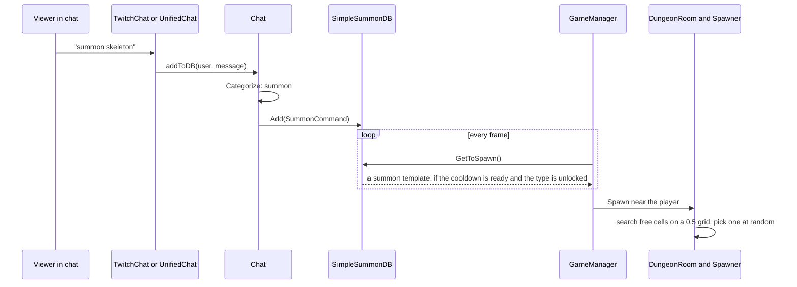
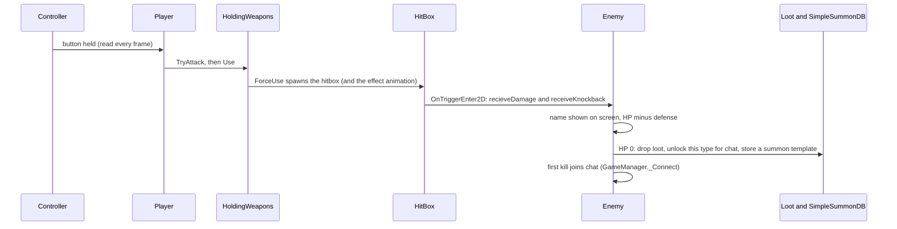
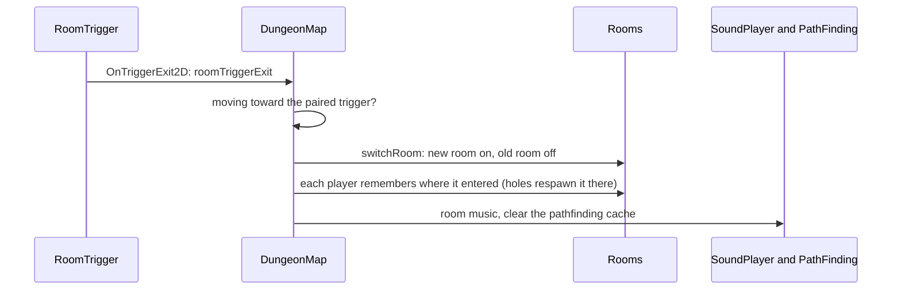

# Lord of the Dungeon
A top-down dungeon game that a streamer plays while chat fights back: chat types `summon <enemy>` to send enemies at the streamer, but only kinds the streamer has already killed. These notes are written by the AI; the graphs below them are drawn by the generator.

**The parts.** `GameManager` is the hub everything reaches through `GameManager.Instance`. It holds the player, UI, input, map and chat. `Player` and `Enemy` share `Character` (HP, team, knockback, stun). An attack is a `HitBox` spawned by one of the player's two hands (`HoldingWeapons`); weapons, enemy types and items are ScriptableObject assets in `Data Types/`. The dungeon is a `DungeonMap` of `DungeonRoom`s; only the room the player is in is active. `Experimental` holds every on/off switch for features still in testing.

**External code.** `AI/` holds code written by the AI and is drawn as outside boxes only: `PathFinding` (enemies walk around walls and holes and keep apart), `UnifiedChat` (reads Twitch and YouTube chat with no package, used when `Experimental.unifiedChat` is on), and `PlayModeOnly` (the `[PlayModeOnly]` Inspector attribute).

## A chat message becomes an enemy

## An attack lands

## The player goes through a door

