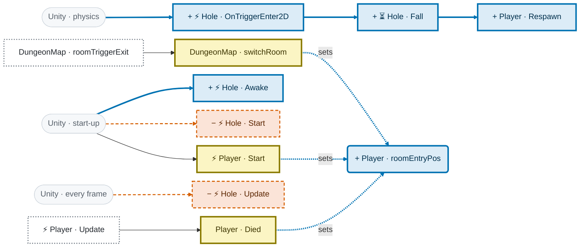
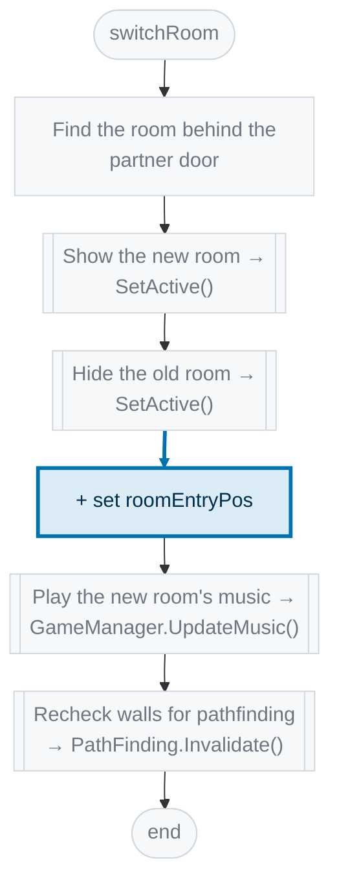
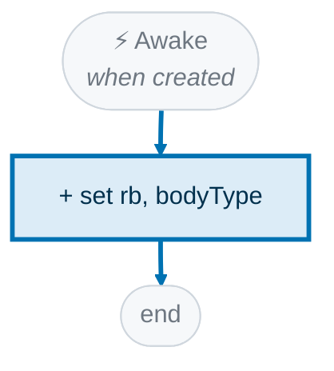
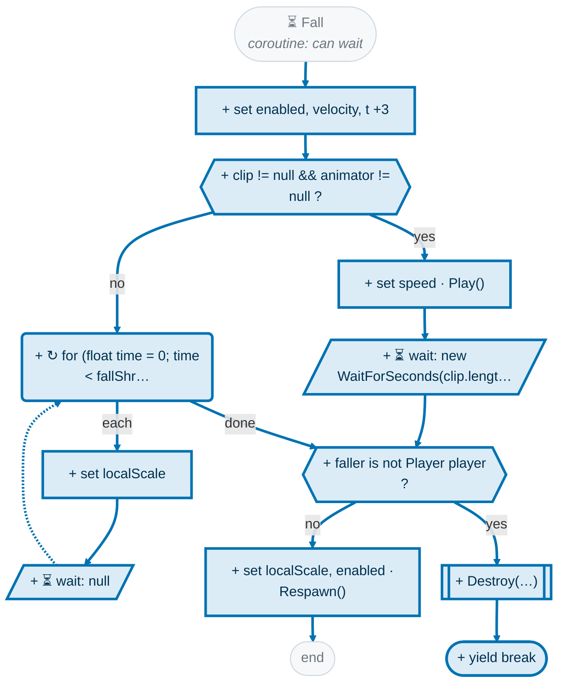
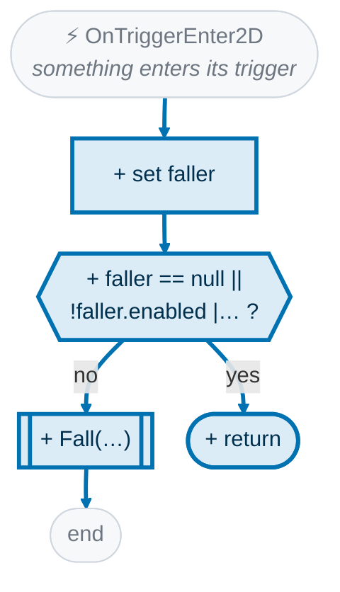
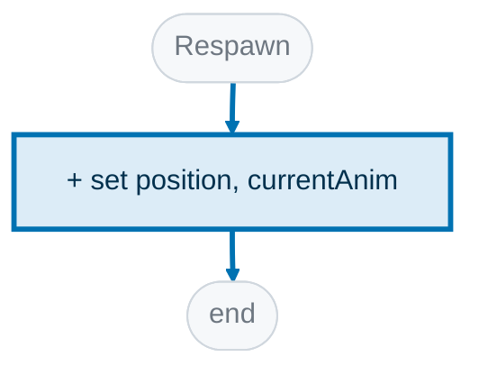
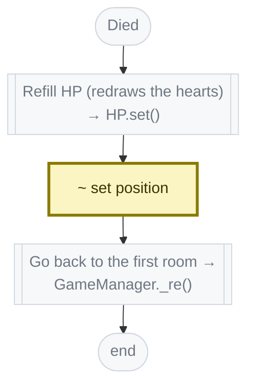
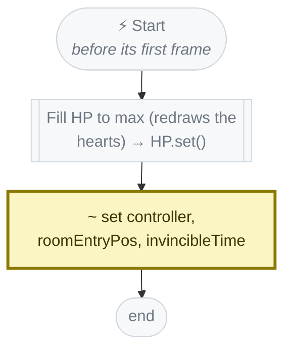

<!-- Generated by CodeGraph (CodeGraph~/tool). Don't edit: run the generator. Notes live in CodeGraph~/notes/. -->
# What changed · `b47c315~1` → `b47c315`

> Holes: player, enemies and loot fall in (assignable fall clip, else shrink); each player respawns where it entered the room

blue + added · orange − removed · yellow ~ changed · gray = same · 🟥 breaks callers · 🟧 new logic · 🟨 small edit

- 🟧 ~ **`DungeonMap.switchRoom`**  2 added
- 🟧 + **`Hole.Awake`** ⚡ new
- 🟧 + **`Hole.Fall`** ⏳ new · now calls `Player.Respawn`
- 🟧 + **`Hole.OnTriggerEnter2D`** ⚡ new · now calls `Hole.Fall`
- 🟧 + **`Player.Respawn`**  new
- 🟨 − **`Hole.Start`** ⚡ removed (was empty)
- 🟨 − **`Hole.Update`** ⚡ removed (was empty)
- 🟨 ~ **`Player.Died`**  1 changed · 🔁
- 🟨 ~ **`Player.Start`** ⚡ 1 added
- 🟨 fields: +`EnemySO.fallClip`, +`Loot.fallClip`, +`Hole.fallShrinkTime`, +`Player.fallClip`, +`Player.roomEntryPos`

**4 separate parts:** (`DungeonMap.switchRoom`, `Player.Start`, `Player.Died`, `Hole.OnTriggerEnter2D` …) · (`Hole.Awake`) · (`Hole.Start`) · (`Hole.Update`)

## Map of the change

## 🟧 ~ DungeonMap.switchRoom

🤖 Moves to the room behind a door - shows it, hides the old one.

Code that changed

| | Code |
|---|---|
| + | <code>foreach(var p in FindObjectsByType&lt;Player&gt;(FindObjectsSortMode.None))p.roomEntryPos = p.transform.position</code> |

## 🟧 + Hole.Awake

🤖 Gives the hole a kinematic body so loot can touch it too.

Code that changed

| | Code |
|---|---|
| + | <code>if(!TryGetComponent(out Rigidbody2D rb))rb = gameObject.AddComponent&lt;Rigidbody2D&gt;()</code> |
| + | <code>rb.bodyType = RigidbodyType2D.Kinematic</code> |

## 🟧 + Hole.Fall

🤖 Freezes it, plays its fall (or shrinks it), then removes or respawns it.

Code that changed

| | Code |
|---|---|
| + | <code>faller.enabled = col.enabled = false</code> |
| + | <code>if(faller.TryGetComponent(out Rigidbody2D rb))rb.velocity = Vector2.zero</code> |
| + | <code>Transform t = faller.transform</code> |
| + | <code>Vector3 scale = t.localScale</code> |
| + | <code>var clip = faller switch{Player p =&gt; p.fallClip, Enemy e =&gt; e.enemyData.fallClip, Loot l =&gt; l.fallClip, _ =&gt; null}</code> |
| + | <code>var animator = faller.GetComponentInChildren&lt;Animator&gt;()</code> |
| + | <code>clip != null && animator != null</code> |
| + | <code>animator.speed = 1</code> |
| + | <code>animator.Play(clip.name, 0, 0f)</code> |
| + | <code>yield return new WaitForSeconds(clip.length)</code> |
| + | <code>for (float time = 0; time &lt; fallShrinkTime; time += Time.deltaTime)</code> |
| + | <code>t.localScale = scale * (1 - time / fallShrinkTime)</code> |
| + | <code>yield return null</code> |
| + | <code>faller is not Player player</code> |
| + | <code>Destroy(t.gameObject)</code> |
| + | <code>yield break</code> |
| + | <code>t.localScale = scale</code> |
| + | <code>player.Respawn()</code> |
| + | <code>faller.enabled = col.enabled = true</code> |

## 🟧 + Hole.OnTriggerEnter2D

🤖 Starts a fall for a character or loot that touches it.

Code that changed

| | Code |
|---|---|
| + | <code>Behaviour faller = other.TryGetComponent(out Character c) ? c : (Behaviour)other.GetComponent&lt;Loot&gt;()</code> |
| + | <code>faller == null \|\| !faller.enabled \|\| c is Enemy e && e.enemyData.ignoreCollide</code> |
| + | <code>return</code> |
| + | <code>StartCoroutine(Fall(faller, other))</code> |

## 🟧 + Player.Respawn

🤖 Goes back to where it entered the room (after a fall).

Code that changed

| | Code |
|---|---|
| + | <code>transform.position = roomEntryPos</code> |
| + | <code>currentAnim = null</code> |

## 🟨 ~ Player.Died

🤖 Test respawn: full HP, back to (0, 0) and the first room.

Code that changed

| | Code |
|---|---|
| ~ | <code>transform.position = roomEntryPos = new Vector2(0, 0)</code> was: <code>transform.position = new Vector2(0, 0)</code> |

## 🟨 ~ Player.Start

🤖 Starts at full HP and remembers where it entered.

Code that changed

| | Code |
|---|---|
| + | <code>roomEntryPos = transform.position</code> |

