<!-- Generated by CodeGraph (CodeGraph~/tool). Don't edit: run the generator. Notes live in CodeGraph~/notes/. -->
# What this change does

`b47c315~1` → `b47c315` · Holes: player, enemies and loot fall in (assignable fall clip, else shrink); each player respawns where it entered the room

- Holes work now - anything that walks onto one falls in (fliers pass over).
- Enemies and loot that fall are gone; the player comes back where it entered the room.
- Every room change now remembers that entry spot.

| | Function | What happens now |
|---|---|---|
| 🟡&nbsp;changed | [`DungeonMap.switchRoom`](#d-dungeonmap-switchroom) | Falling in a hole puts you back at that room's door. |
| 🟢&nbsp;new | [`Hole.Awake`](#d-hole-awake) | Loot falls in too, not only characters. |
| 🟢&nbsp;new | [`Hole.Fall`](#d-hole-fall) | Enemies and loot can be lost; the player only loses its position. |
| 🟢&nbsp;new | [`Hole.OnTriggerEnter2D`](#d-hole-ontriggerenter2d) | Holes stop being decoration; fliers still pass over. |
| 🟢&nbsp;new | [`Player.Respawn`](#d-player-respawn) | A fall sends you back to the room's entrance. |
| 🟡&nbsp;changed | [`Player.Died`](#d-player-died) | After dying, a fall in the first room brings you back to (0, 0). |
| 🟡&nbsp;changed | [`Player.Start`](#d-player-start) | Falling in the first room returns you to where you started. |
| | values | 🟢 `EnemySO.fallClip`, 🟢 `Loot.fallClip`, 🟢 `Hole.fallShrinkTime`, 🟢 `Player.fallClip`, 🟢 `Player.roomEntryPos` |

## How the pieces connect now

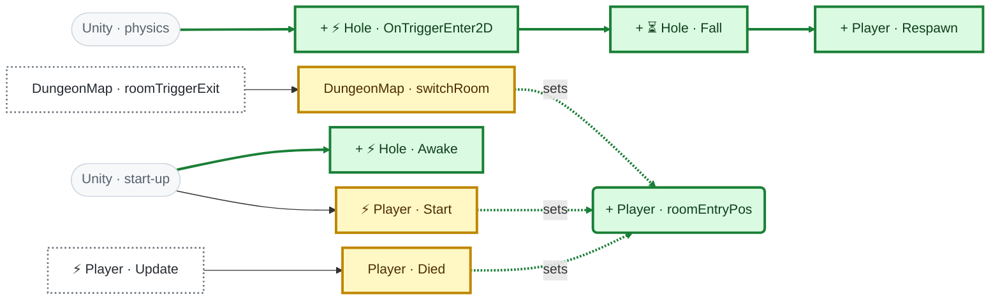

## 🟡 DungeonMap.switchRoom · changed

**Before:** Show the new room, hide the old one, change music, refresh paths.  
**Now:** Same, and every player remembers where it entered.  
**So:** Falling in a hole puts you back at that room's door.  

**Before**

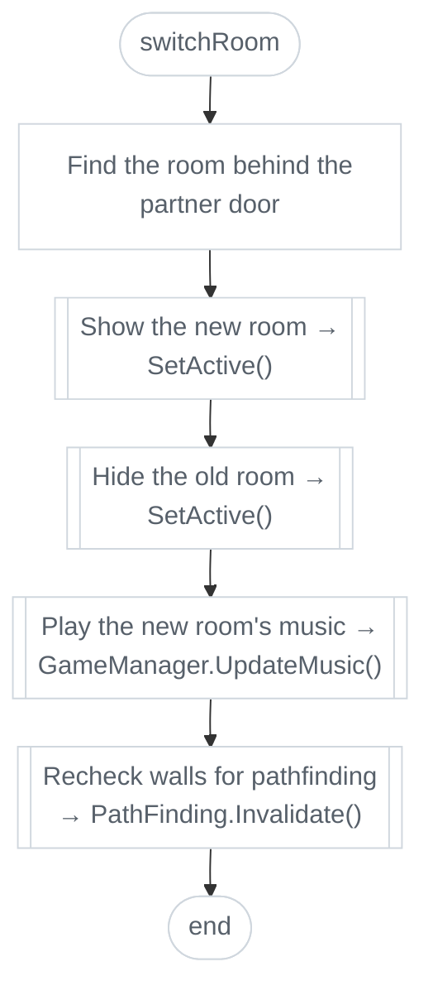

**Now**

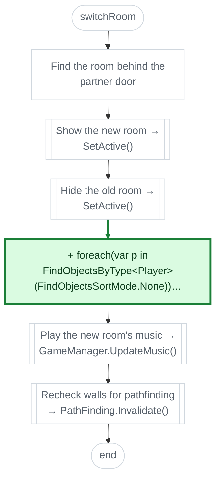

## 🟢 Hole.Awake · new

**Now:** Gives the hole a kinematic body, because loot has none.  
**So:** Loot falls in too, not only characters.  

**Now**

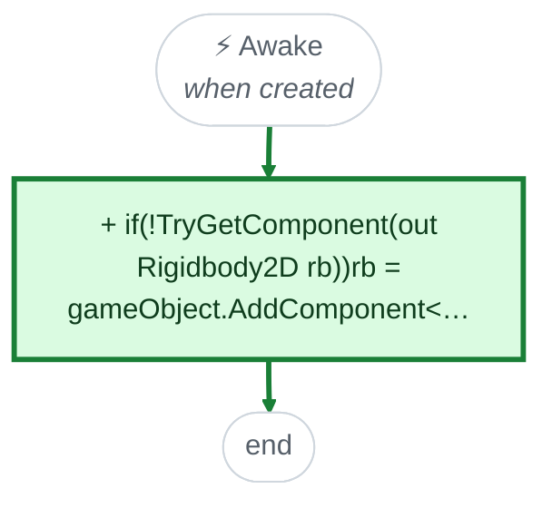

## 🟢 Hole.Fall · new

**Now:** Freeze it, play its fall clip or shrink it away, then remove it - or respawn the player.  
**So:** Enemies and loot can be lost; the player only loses its position.  

**Now**

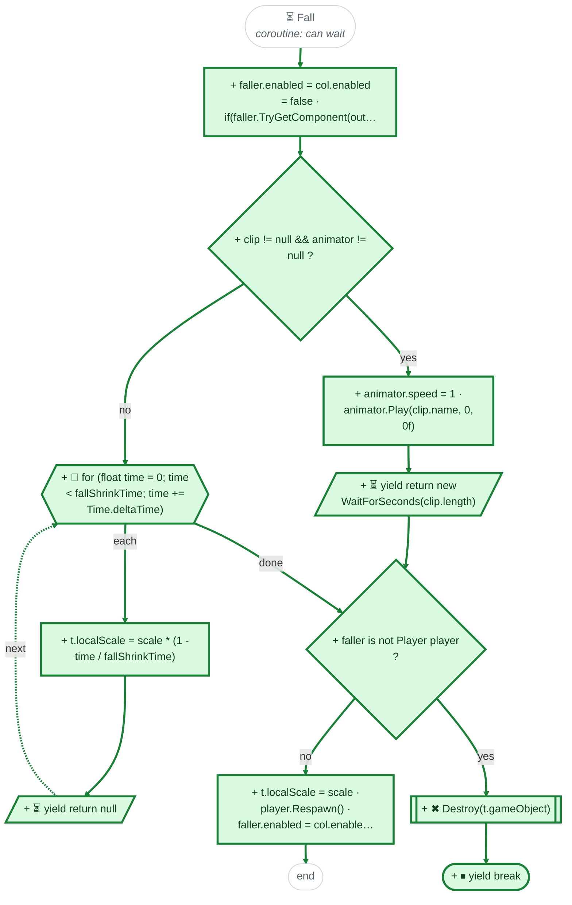

## 🟢 Hole.OnTriggerEnter2D · new

**Now:** When a character or loot touches the hole, it starts to fall.  
**So:** Holes stop being decoration; fliers still pass over.  

**Now**

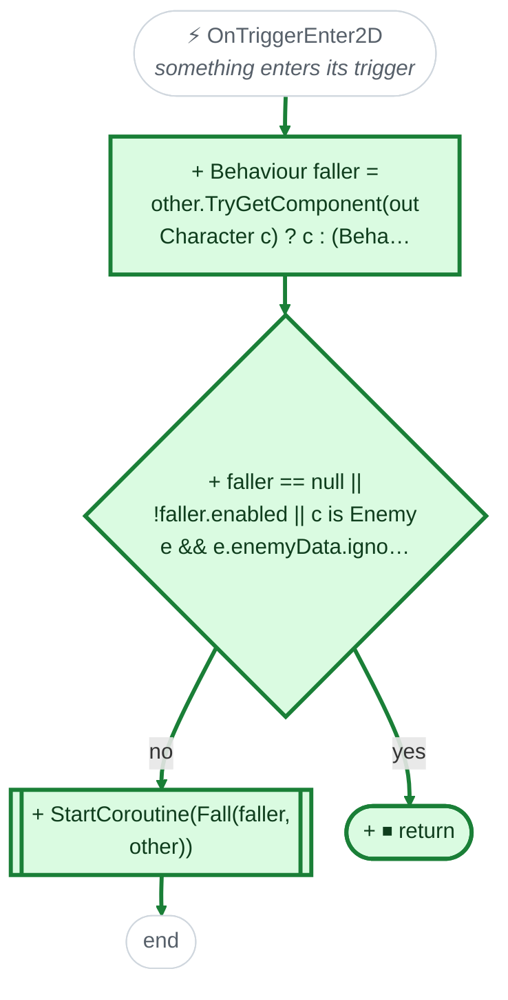

## 🟢 Player.Respawn · new

**Now:** Moves the player back to where it entered the room.  
**So:** A fall sends you back to the room's entrance.  

**Now**

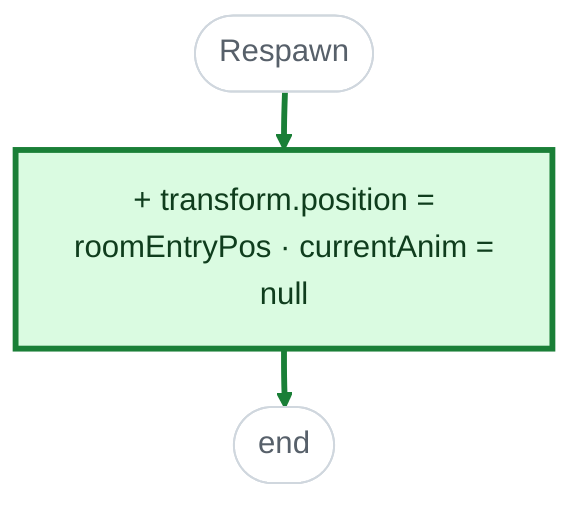

## 🟡 Player.Died · changed

**Before:** Refill HP, go to (0, 0), back to the first room.  
**Now:** Same, and (0, 0) also becomes the room entry spot.  
**So:** After dying, a fall in the first room brings you back to (0, 0).  

**Before**

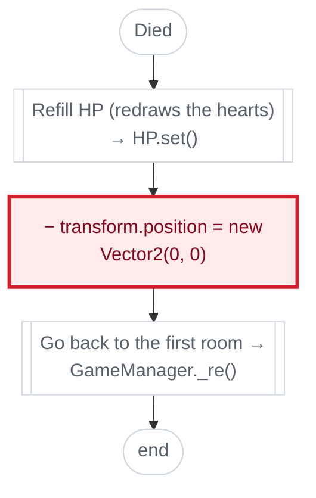

**Now**

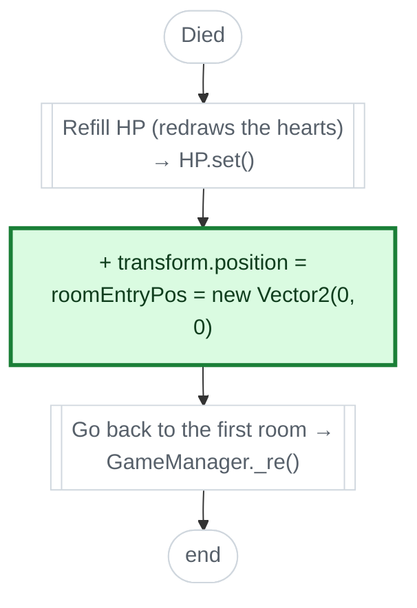

## 🟡 Player.Start · changed

**Before:** Full HP, get the controller, start the invincible timer.  
**Now:** Same, and remember the starting spot as the room entry.  
**So:** Falling in the first room returns you to where you started.  

**Before**

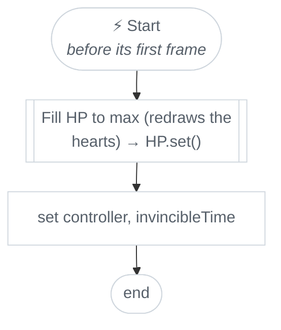

**Now**

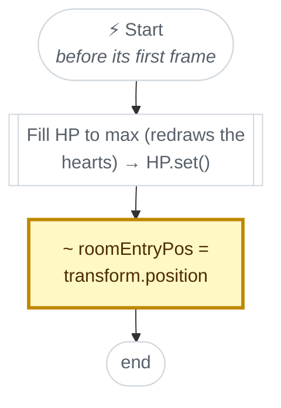

Also: 🔴 `Hole.Start` removed (empty), 🔴 `Hole.Update` removed (empty)

