<!-- Generated by CodeGraph (CodeGraph~/tool). Don't edit: run the generator. Notes live in CodeGraph~/notes/. -->
# What this change does

`b47c315~1` → `b47c315` · *Holes: player, enemies and loot fall in (assignable fall clip, else shrink); each player respawns where it entered the room*

**In the game:**

- Before: holes did nothing. Now: anything that walks onto one falls in (fliers pass over). [intended]
- Enemies and loot that fall are gone; the player is sent back to where it entered the room. [intended]
- An enemy that falls is removed without dying: no loot, no chat unlock. [side effect?]

🟡 3 changed · 🟢 4 new · 5 values · 2 empty functions came or went

- **Remember where each player entered the room:** [`Player.Start`](#d-player-start) → [`DungeonMap.switchRoom`](#d-dungeonmap-switchroom) → [`Player.Died`](#d-player-died)
- **Fall into holes:** [`Hole.Awake`](#d-hole-awake) → [`Hole.OnTriggerEnter2D`](#d-hole-ontriggerenter2d) → [`Hole.Fall`](#d-hole-fall) → [`Player.Respawn`](#d-player-respawn)

**Check these:**

- Falling costs the player no HP; it only moves it back.
- Enemies destroyed by a hole skip Died(), so they drop no loot and don't unlock chat summons.

## 🟡 Player.Start · changed

> **When:** The player appears in the scene. **Before:** Full HP, get the controller, start the invincible timer. **Now:** Same, and remember the starting spot as the room entry. **So:** Falling in the first room returns you to where you started. *[intended]*

| Before | Now |
|---|---|
| — | <code>roomEntryPos = transform.position</code> |

3 unchanged steps not listed

**Before**

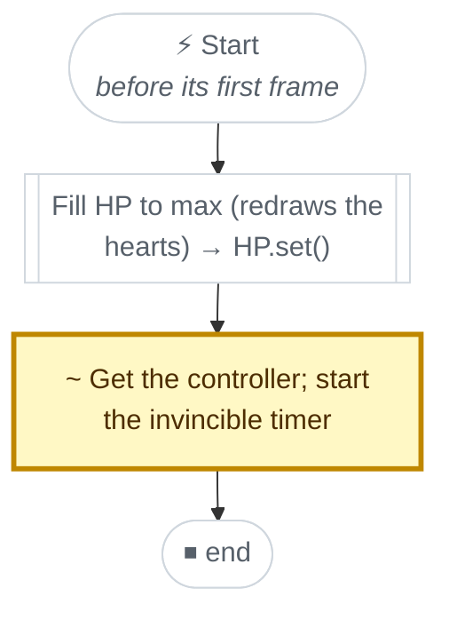

**Now**

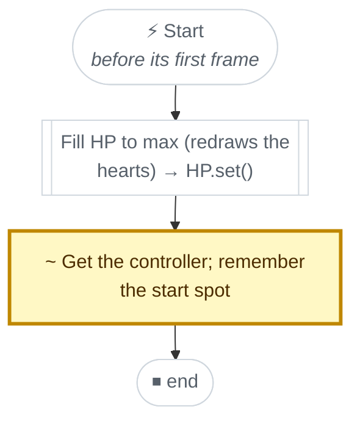

## 🟡 DungeonMap.switchRoom · changed

> **When:** You walk through a door into another room. **Before:** Show the new room, hide the old one, change music, refresh paths. **Now:** Same, and every player remembers where it entered. **So:** Falling in a hole puts you back at that room's door. *[intended]*

| Before | Now |
|---|---|
| — | <code>foreach(var p in FindObjectsByType&lt;Player&gt;(FindObjectsSortMode.None))p.roomEntryPos = p.t…</code> |

5 unchanged steps not listed

**Before**

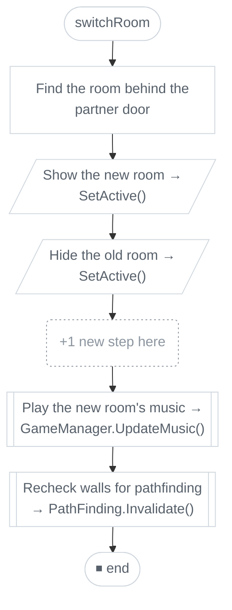

**Now**

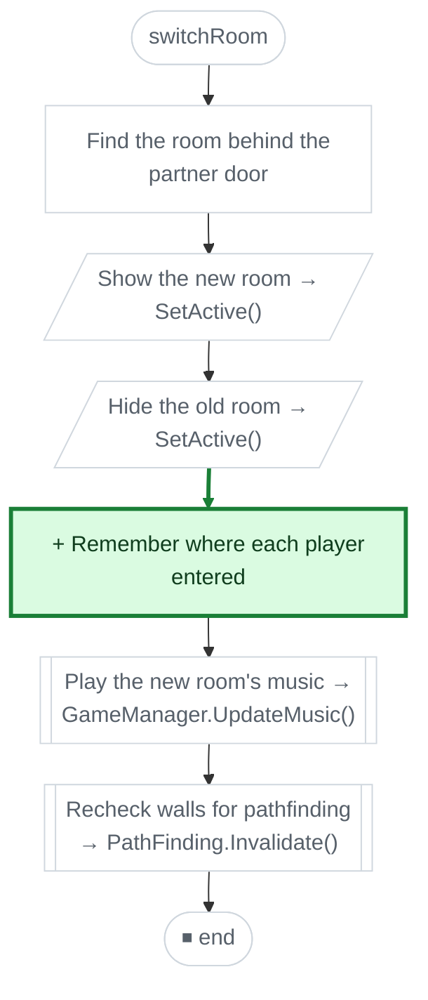

## 🟡 Player.Died · changed

> **When:** HP hits 0. **Before:** Refill HP, go to (0, 0), back to the first room. **Now:** Same, and (0, 0) also becomes the room entry spot. **So:** After dying, a fall in the first room brings you back to (0, 0). *[intended]*

| Before | Now |
|---|---|
| <code>transform.position = new Vector2(0, 0)</code> | <code>transform.position = roomEntryPos = new Vector2(0, 0)</code> |

2 unchanged steps not listed

**Before**

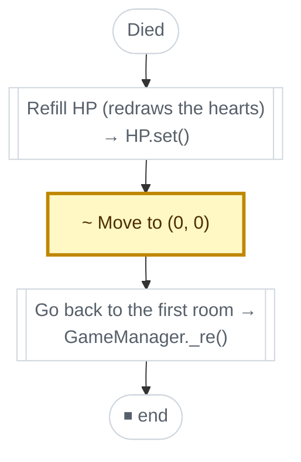

**Now**

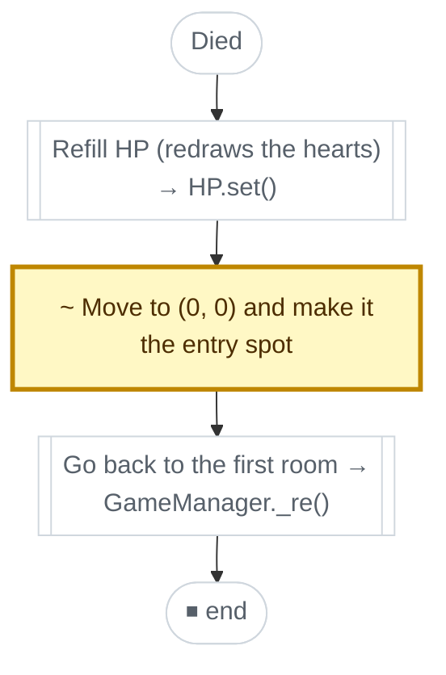

## 🟢 Hole.Awake · new

> **When:** The hole is created. **Before:** Nothing (the hole had no code). **Now:** Give the hole a kinematic body, because loot has none. **So:** Loot falls in too, not only characters. *[intended]*

**Now**

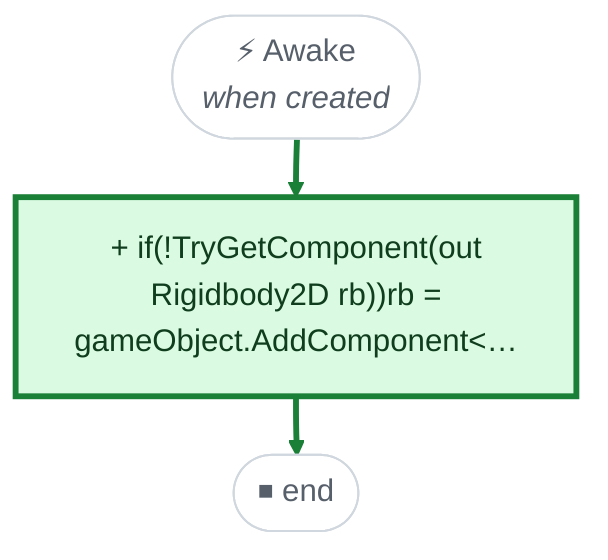

## 🟢 Hole.OnTriggerEnter2D · new

> **When:** Something touches the hole. **Before:** Nothing happened. **Now:** A character or loot starts to fall; fliers pass over. **So:** Holes stop being decoration. *[intended]*

**Now**

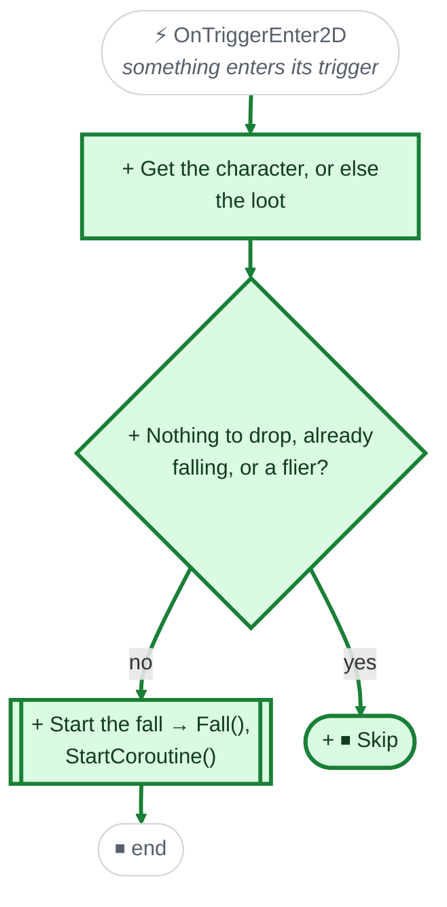

## 🟢 Hole.Fall · new

> **When:** Right after something touched the hole. **Before:** Nothing. **Now:** Freeze it, play its fall clip or shrink it away, then remove it - or respawn the player. **So:** Enemies and loot can be lost; the player only loses its position. *[intended]*

**Now**

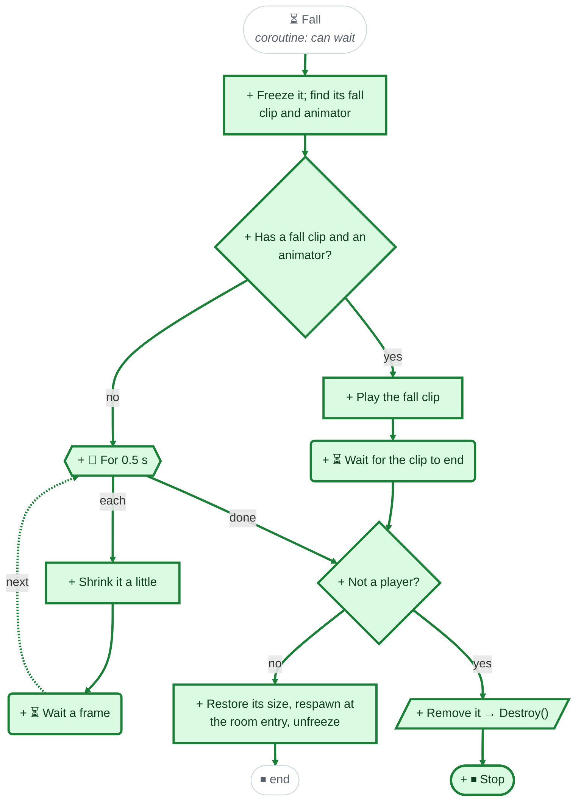

## 🟢 Player.Respawn · new

> **When:** At the end of a player's fall. **Before:** Nothing (new function). **Now:** Moves the player back to where it entered the room. **So:** A fall sends you back to the room's entrance. *[intended]*

**Now**

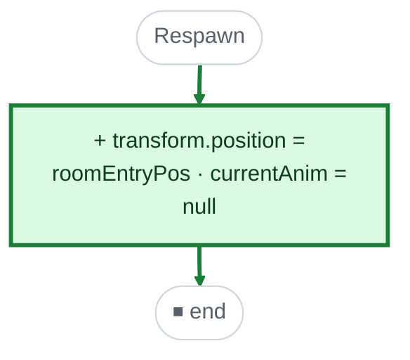

How the changed pieces connect · other changes

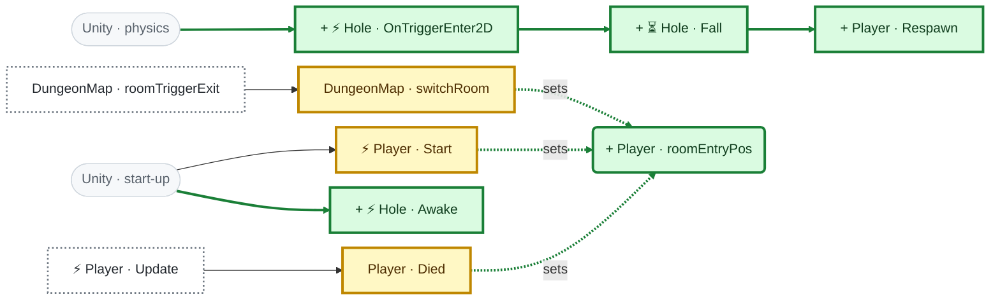

Values: 🟢 `EnemySO.fallClip`, 🟢 `Loot.fallClip`, 🟢 `Hole.fallShrinkTime`, 🟢 `Player.fallClip`, 🟢 `Player.roomEntryPos`

Empty functions: 🔴 `Hole.Start` removed, 🔴 `Hole.Update` removed

