<!-- Generated by CodeGraph (CodeGraph~/tool). Don't edit: run the generator. Notes live in CodeGraph~/notes/. -->
# AI/PathFinding.cs

⚡ Unity calls it · 🔁 runs every frame · ⏳ can wait · blue box = calls another function · gray box = simple math · [code](../../../AI/PathFinding.cs) · [all files](../index.md)

*External folder: shown only through what other files use.*

## Map

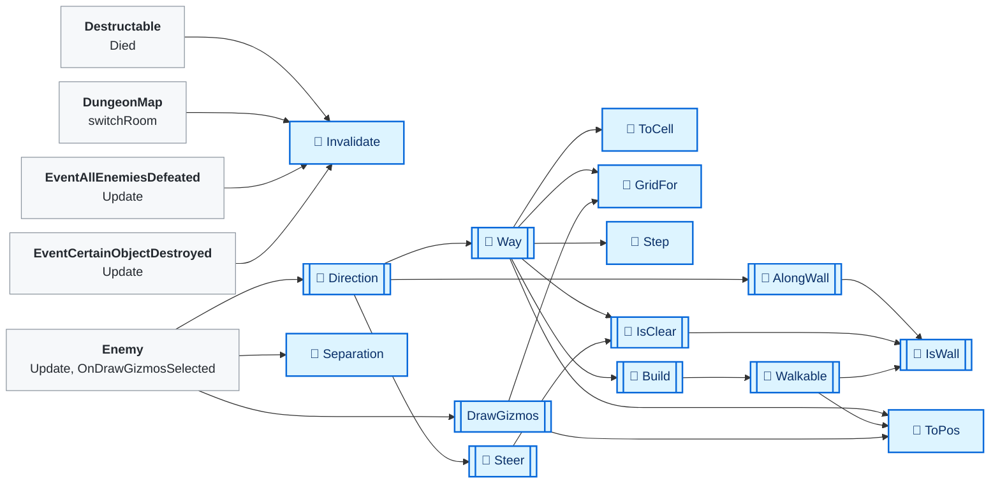

## 🔁 GridFor

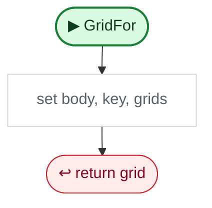

Code (L39–44)

| Step | Code |
|---|---|
| set body, key, grids | <code>body = Vector2.Max(body - Vector2.one * skin, Vector2.one*minBody)</code> L40 <code>var key = new Vector2Int(Mathf.RoundToInt(body.x * 10), Mathf.RoundToInt(body.y * 10))</code> L41 <code>if(!grids.TryGetValue(key, out var grid))grids[key] = grid = new Grid{body = (Vector2)key / 10f}</code> L42 |
| return grid | <code>return grid</code> L43 |

Source: [L39–44](../../../AI/PathFinding.cs#L39-L44)

## 🔁 Direction

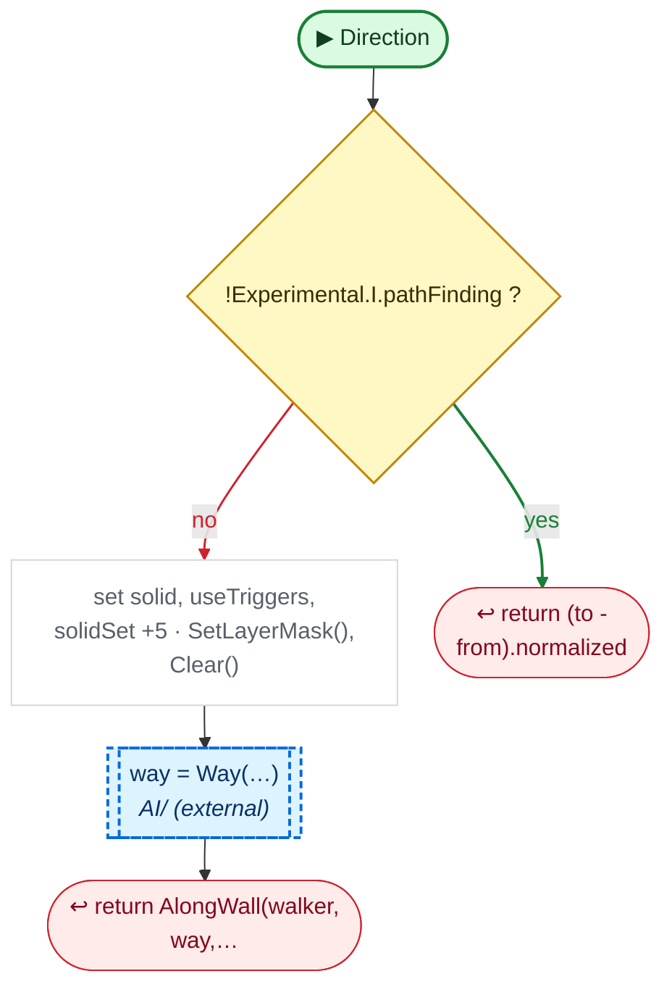

Code (L48–59)

| Step | Code |
|---|---|
| !Experimental.I.pathFinding ? | <code>!Experimental.I.pathFinding</code> L49 |
| return (to - from).normalized | <code>return (to - from).normalized</code> L49 |
| set solid, useTriggers, solidSet +5 · SetLayerMask(), Clear() | <code>if(!solidSet){solid = new ContactFilter2D(); solid.SetLayerMask(~LayerMask.GetMask("Enemy")); solid.useTriggers = true; solidSet = true;}</code> L50 <code>if(Time.time &gt; wallsAt + wallRefresh \|\| (dirtyFrame &gt;= 0 && Time.frameCount &gt;= dirtyFrame)){foreach(var x in grids.Values){x.walls.Clear(); x.fields.Clear();} wallsAt = Time.time; dirtyFrame = -1;}</code> L51 <code>if(Time.time &gt; builtAt + refresh){foreach(var x in grids.Values)x.fields.Clear(); builtAt = Time.time;}</code> L52 <code>Vector2 body = walker.bounds.size</code> L53 <code>int seed = walker.GetInstanceID()</code> L54 |
| way = Way(…) → `Way`, `Steer` | <code>var way = Way(from, to, bounds, body + Vector2.one * 2 * margin) ?? Way(from, to, bounds, body) ?? Steer(from, to, seed)</code> L55 |
| return AlongWall(walker, way,… → `AlongWall` | <code>return AlongWall(walker, way, seed)</code> L58 |

Source: [L48–59](../../../AI/PathFinding.cs#L48-L59)

## 🔁 AlongWall

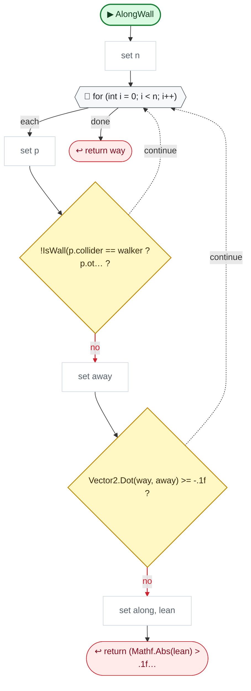

Code (L61–73)

| Step | Code |
|---|---|
| set n | <code>int n = walker.GetContacts(touching)</code> L62 |
| for (int i = 0; i &lt; n; i++) | <code>for (int i = 0; i &lt; n; i++)</code> L63 |
| set p | <code>var p = touching[i]</code> L64 |
| !IsWall(p.collider == walker ? p.ot… ? → `IsWall` | <code>!IsWall(p.collider == walker ? p.otherCollider : p.collider)</code> L65 |
| set away | <code>Vector2 away = Vector2.Dot(p.normal, (Vector2)walker.bounds.center - p.point) &lt; 0 ? -p.normal : p.normal</code> L66 |
| Vector2.Dot(way, away) &gt;= -.1f ? | <code>Vector2.Dot(way, away) &gt;= -.1f</code> L67 |
| set along, lean | <code>Vector2 along = Vector2.Perpendicular(away)</code> L68 <code>float lean = Vector2.Dot(way, along)</code> L69 |
| return (Mathf.Abs(lean) &gt; .1f… | <code>return (Mathf.Abs(lean) &gt; .1f ? Mathf.Sign(lean) : (seed & 1) == 0 ? 1 : -1) * along</code> L70 |
| return way | <code>return way</code> L72 |

Source: [L61–73](../../../AI/PathFinding.cs#L61-L73)

## 🔁 Way

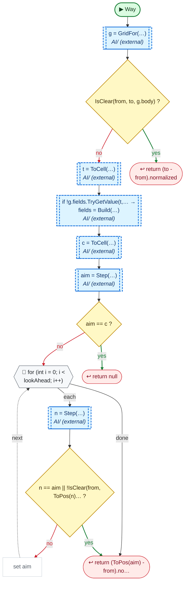

Code (L74–88)

| Step | Code |
|---|---|
| g = GridFor(…) → `GridFor` | <code>g = GridFor(body)</code> L75 |
| IsClear(from, to, g.body) ? → `IsClear` | <code>IsClear(from, to, g.body)</code> L76 |
| return (to - from).normalized | <code>return (to - from).normalized</code> L76 |
| t = ToCell(…) → `ToCell` | <code>var t = ToCell(to)</code> L77 |
| if !g.fields.TryGetValue(t,… → fields = Build(…) → `Build` | <code>if !g.fields.TryGetValue(t, out var dist)</code> L78 <code>g.fields[t] = dist = Build(t, bounds)</code> L78 |
| c = ToCell(…) → `ToCell` | <code>var c = ToCell(from)</code> L79 |
| aim = Step(…) → `Step` | <code>var aim = Step(dist, c)</code> L80 |
| aim == c ? | <code>aim == c</code> L81 |
| return null | <code>return null</code> L81 |
| for (int i = 0; i &lt; lookAhead; i++) | <code>for (int i = 0; i &lt; lookAhead; i++)</code> L82 |
| n = Step(…) → `Step` | <code>var n = Step(dist, aim)</code> L83 |
| n == aim \|\| !IsClear(from, ToPos(n)… ? → `ToPos`, `IsClear` | <code>n == aim \|\| !IsClear(from, ToPos(n), g.body)</code> L84 |
| set aim | <code>aim = n</code> L85 |
| return (ToPos(aim) - from).no… → `ToPos` | <code>return (ToPos(aim) - from).normalized</code> L87 |

Source: [L74–88](../../../AI/PathFinding.cs#L74-L88)

## 🔁 Steer

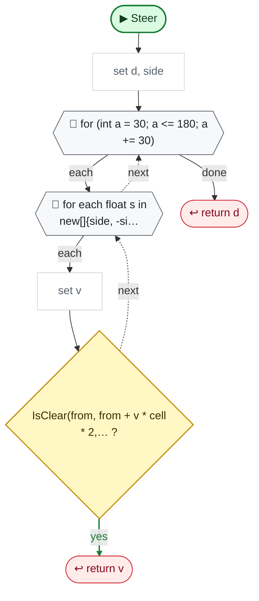

Code (L89–97)

| Step | Code |
|---|---|
| set d, side | <code>Vector2 d = (to - from).normalized</code> L90 <code>float side = ((seed + (int)(Time.time / 2)) & 1) == 0 ? 1 : -1</code> L91 |
| for (int a = 30; a &lt;= 180; a += 30) | <code>for (int a = 30; a &lt;= 180; a += 30)</code> L92 |
| for each float s in new[]{side, -si… | <code>for each float s in new[]{side, -side}</code> L92 |
| set v | <code>Vector2 v = Quaternion.Euler(0, 0, a*s) * d</code> L93 |
| IsClear(from, from + v * cell * 2,… ? → `IsClear` | <code>IsClear(from, from + v * cell * 2, g.body)</code> L94 |
| return v | <code>return v</code> L94 |
| return d | <code>return d</code> L96 |

Source: [L89–97](../../../AI/PathFinding.cs#L89-L97)

## 🔁 Step

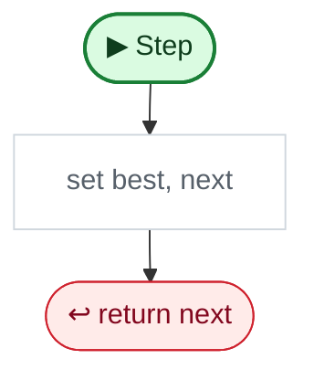

Code (L98–103)

| Step | Code |
|---|---|
| set best, next | <code>int best = dist.TryGetValue(c, out int d0) ? d0 : int.MaxValue</code> L99 <code>var next = c</code> L100 <code>foreach(var d in dirs)if(dist.TryGetValue(c + d, out int v) && v &lt; best){best = v;next = c + d;}</code> L101 |
| return next | <code>return next</code> L102 |

Source: [L98–103](../../../AI/PathFinding.cs#L98-L103)

## 🔁 IsClear

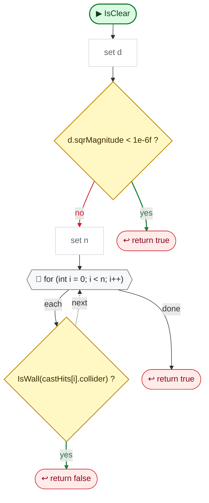

Code (L104–110)

| Step | Code |
|---|---|
| set d | <code>Vector2 d = b - a</code> L105 |
| d.sqrMagnitude &lt; 1e-6f ? | <code>d.sqrMagnitude &lt; 1e-6f</code> L106 |
| return true | <code>return true</code> L106 |
| set n | <code>int n = Physics2D.BoxCast(a, body, 0, d.normalized, solid, castHits, d.magnitude)</code> L107 |
| for (int i = 0; i &lt; n; i++) | <code>for (int i = 0; i &lt; n; i++)</code> L108 |
| IsWall(castHits[i].collider) ? → `IsWall` | <code>IsWall(castHits[i].collider)</code> L108 |
| return false | <code>return false</code> L108 |
| return true | <code>return true</code> L109 |

Source: [L104–110](../../../AI/PathFinding.cs#L104-L110)

## 🔁 Build

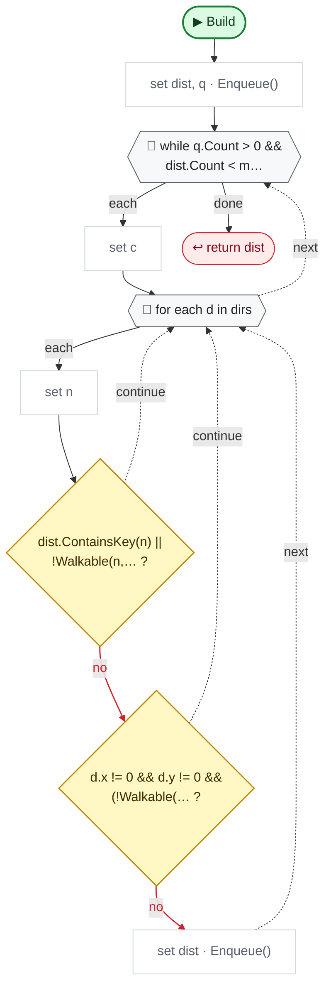

Code (L112–126)

| Step | Code |
|---|---|
| set dist, q · Enqueue() | <code>var dist = new Dictionary&lt;Vector2Int, int&gt;{{target, 0}}</code> L113 <code>var q = new Queue&lt;Vector2Int&gt;()</code> L114 <code>q.Enqueue(target)</code> L114 |
| while q.Count &gt; 0 && dist.Count &lt; m… | <code>while q.Count &gt; 0 && dist.Count &lt; maxCells</code> L115 |
| set c | <code>var c = q.Dequeue()</code> L116 |
| for each d in dirs | <code>for each d in dirs</code> L117 |
| set n | <code>var n = c + d</code> L118 |
| dist.ContainsKey(n) \|\| !Walkable(n,… ? → `Walkable` | <code>dist.ContainsKey(n) \|\| !Walkable(n, bounds)</code> L119 |
| d.x != 0 && d.y != 0 && (!Walkable(… ? → `Walkable` | <code>d.x != 0 && d.y != 0 && (!Walkable(new(n.x, c.y), bounds) \|\| !Walkable(new(c.x, n.y), bounds))</code> L120 |
| set dist · Enqueue() | <code>dist[n] = dist[c] + 1</code> L121 <code>q.Enqueue(n)</code> L122 |
| return dist | <code>return dist</code> L125 |

Source: [L112–126](../../../AI/PathFinding.cs#L112-L126)

## 🔁 Walkable

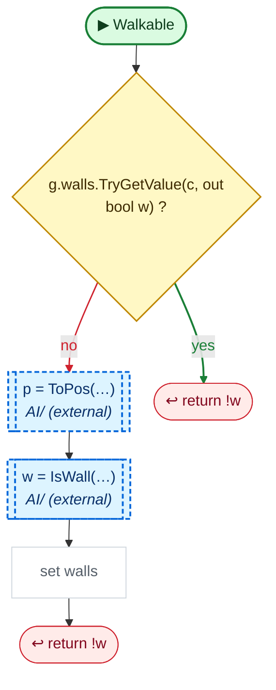

Code (L127–133)

| Step | Code |
|---|---|
| g.walls.TryGetValue(c, out bool w) ? | <code>g.walls.TryGetValue(c, out bool w)</code> L128 |
| return !w | <code>return !w</code> L128 |
| p = ToPos(…) → `ToPos` | <code>Vector2 p = ToPos(c)</code> L129 |
| w = IsWall(…) → `IsWall` | <code>w = !bounds.Contains(p) \|\| IsWall(p)</code> L130 |
| set walls | <code>g.walls[c] = w</code> L131 |
| return !w | <code>return !w</code> L132 |

Source: [L127–133](../../../AI/PathFinding.cs#L127-L133)

## 🔁 IsWall

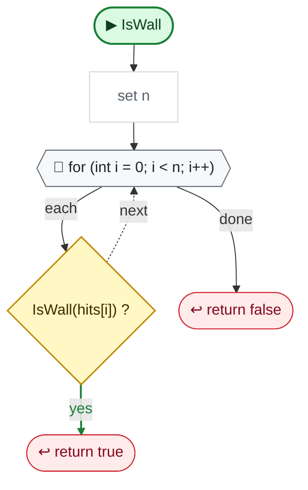

Code (L134–138)

| Step | Code |
|---|---|
| set n | <code>int n = Physics2D.OverlapBox(p, g.body, 0, solid, hits)</code> L135 |
| for (int i = 0; i &lt; n; i++) | <code>for (int i = 0; i &lt; n; i++)</code> L136 |
| IsWall(hits[i]) ? → `IsWall` | <code>IsWall(hits[i])</code> L136 |
| return true | <code>return true</code> L136 |
| return false | <code>return false</code> L137 |

Source: [L134–138](../../../AI/PathFinding.cs#L134-L138)

## IsWall

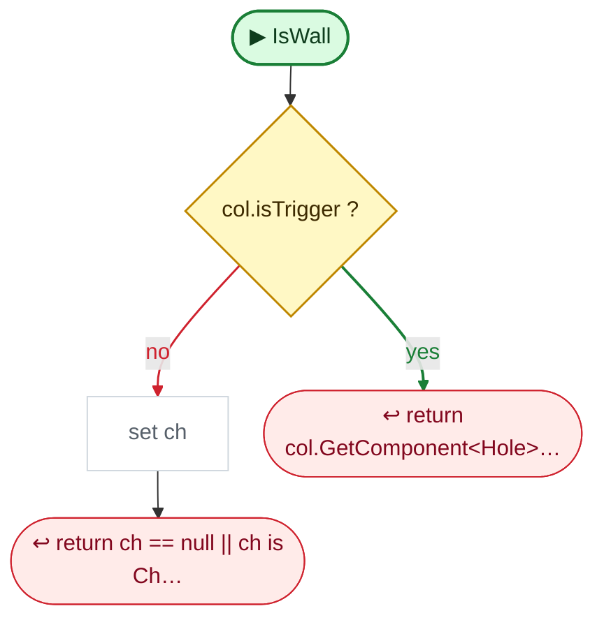

Code (L139–142)

| Step | Code |
|---|---|
| col.isTrigger ? | <code>col.isTrigger</code> L140 |
| return col.GetComponent&lt;Hole&gt;… | <code>return col.GetComponent&lt;Hole&gt;()</code> L140 |
| set ch | <code>var ch = col.GetComponentInParent&lt;Character&gt;()</code> L141 |
| return ch == null \|\| ch is Ch… | <code>return ch == null \|\| ch is Chest</code> L141 |

Source: [L139–142](../../../AI/PathFinding.cs#L139-L142)

## DrawGizmos

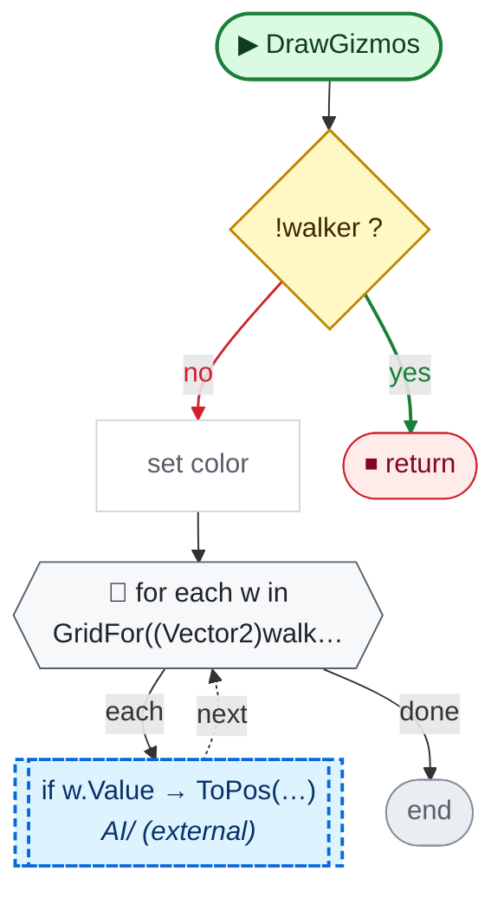

Code (L144–148)

| Step | Code |
|---|---|
| !walker ? | <code>!walker</code> L145 |
| return | <code>return</code> L145 |
| set color | <code>Gizmos.color = new Color(1, 0, 0, .35f)</code> L146 |
| for each w in GridFor((Vector2)walk… → `GridFor` | <code>for each w in GridFor((Vector2)walker.bounds.size + Vector2.one * 2 * margin).walls</code> L147 |
| if w.Value → ToPos(…) → `ToPos` | <code>if w.Value</code> L147 <code>Gizmos.DrawCube(ToPos(w.Key), Vector3.one * cell * .9f)</code> L147 |

Source: [L144–148](../../../AI/PathFinding.cs#L144-L148)

## 🔁 Separation

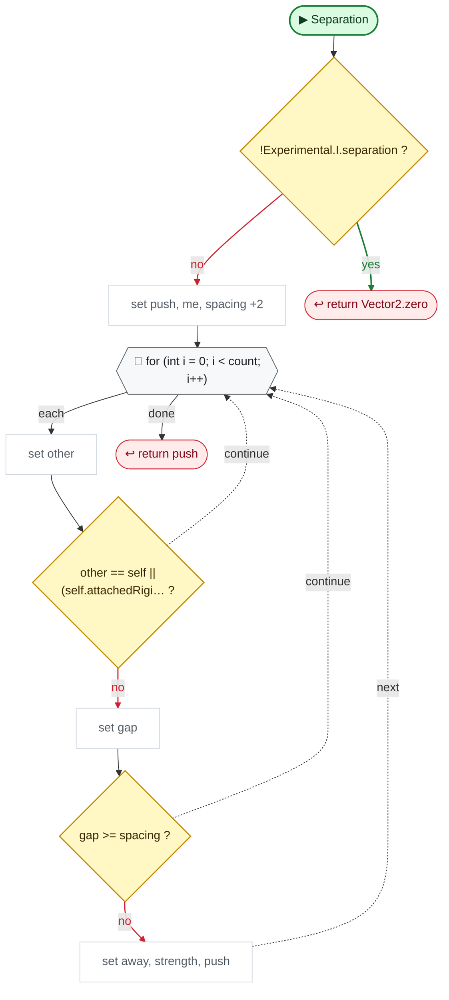

Code (L156–178)

| Step | Code |
|---|---|
| !Experimental.I.separation ? | <code>!Experimental.I.separation</code> L157 |
| return Vector2.zero | <code>return Vector2.zero</code> L157 |
| set push, me, spacing +2 | <code>Vector2 push = Vector2.zero</code> L158 <code>Bounds me = self.bounds</code> L159 <code>float spacing = me.extents.magnitude * Experimental.I.enemySpacing</code> L160 <code>float searchRadius = 2 * spacing</code> L161 <code>int count = Physics2D.OverlapCircleNonAlloc(me.center, searchRadius, near, layers)</code> L162 |
| for (int i = 0; i &lt; count; i++) | <code>for (int i = 0; i &lt; count; i++)</code> L164 |
| set other | <code>Collider2D other = near[i]</code> L165 |
| other == self \|\| (self.attachedRigi… ? | <code>other == self \|\| (self.attachedRigidbody != null && other.attachedRigidbody == self.attachedRigidbody)</code> L166 |
| set gap | <code>float gap = self.Distance(other).distance</code> L168 |
| gap &gt;= spacing ? | <code>gap &gt;= spacing</code> L169 |
| set away, strength, push | <code>Vector2 away = me.center - other.bounds.center</code> L171 <code>if(away.sqrMagnitude &lt; 0.0001f) away = Random.insideUnitCircle</code> L172 <code>float strength = Mathf.Min((spacing - gap) / spacing, 2)</code> L174 <code>push += away.normalized * strength</code> L175 |
| return push | <code>return push</code> L177 |

Source: [L156–178](../../../AI/PathFinding.cs#L156-L178)

Small helpers (4)

| | Name | Does | Code |
|---|---|---|---|
|  | margin · get |  | <code>Experimental.I.wallSpacing</code> [L14](../../../AI/PathFinding.cs#L14) |
| 🔁 | Invalidate | set dirtyFrame | <code>dirtyFrame = Time.frameCount + 1</code> [L35](../../../AI/PathFinding.cs#L35) |
| 🔁 | ToCell | simple steps | <code>new(Mathf.RoundToInt(p.x / cell), Mathf.RoundToInt(p.y / cell))</code> [L37](../../../AI/PathFinding.cs#L37) |
| 🔁 | ToPos | simple steps | <code>(Vector2)c * cell</code> [L38](../../../AI/PathFinding.cs#L38) |

Fields · PathFinding (20)

| Name | Type | Default | Note |
|---|---|---|---|
| `cell` | `float` | `0.5f` |  |
| `refresh` | `float` | `0.25f` | seconds a field is reused (the target moves) |
| `wallRefresh` | `float` | `2f` | seconds walls are cached; Invalidate() when a wall appears or goes |
| `lookAhead` | `int` | `4` | cells ahead an enemy may aim at directly, so it walks smooth lines, not grid steps |
| `margin` | `float` | `=&gt; Experimental.I.wallSpacing` | space kept from walls when the room allows it; tight spots use the exact body |
| `minBody` | `float` | `0.4f` | smallest body size checked, so tiny enemies still keep off walls a bit |
| `skin` | `float` | `0.05f` | the body is checked this much smaller, so one resting against a wall isn't "inside" it |
| `maxCells` | `int` | `4000` | BFS limit, for huge rooms |
| `dirs` | `Vector2Int[]` | `{Vector2Int.up, Vector2Int.right, Vector2Int.down, Vector2Int.left, new(1, 1), new(1, -1), new(-1, -1), new(-1, 1)}` |  |
| `grids` | `Dictionary&lt;Vector2Int, Grid&gt;` | `new()` | one per body size (0.1 steps): each enemy is checked with its own width and height |
| `g` | `Grid` |  | the grid of the walker asking now |
| `hits` | `Collider2D[]` | `new Collider2D[16]` |  |
| `castHits` | `RaycastHit2D[]` | `new RaycastHit2D[16]` |  |
| `solid` | `ContactFilter2D` |  | no Enemy layer (crowds would fill hits[] and hide the wall behind them). Triggers too: holes are triggers |
| `solidSet` | `bool` |  |  |
| `builtAt` | `float` | `-999` |  |
| `wallsAt` | `float` | `-999` |  |
| `dirtyFrame` | `int` | `-1` |  |
| `touching` | `ContactPoint2D[]` | `new ContactPoint2D[8]` |  |
| `near` | `Collider2D[]` | `new Collider2D[8]` | ---------- Separation ---------- Pushes `self` away from nearby colliders on `layers`, so characters don't stack. Add it to where it wants to walk: rb.velocity = Vector2.ClampMagnitude(way + PathFinding.Separation(col, LayerMask.GetMask("Enemy")), 1) * speed; spacing: the gap kept between collider edges, the radius of the circle around the collider: 1/√2 for a 1x1 box (bigger bodies keep more room). Each neighbour pushes 0 at `spacing` or farther, 1 when touching, up to 2 when overlapping. |

Fields · Grid (3)

| Name | Type | Default | Note |
|---|---|---|---|
| `body` *(Inspector)* | `Vector2` |  |  |
| `fields` *(Inspector)* | `Dictionary&lt;Vector2Int, Dictionary&lt;Vector2Int, int&gt;&gt;` | `new()` | target cell -&gt; steps to it from each cell |
| `walls` *(Inspector)* | `Dictionary&lt;Vector2Int, bool&gt;` | `new()` |  |

