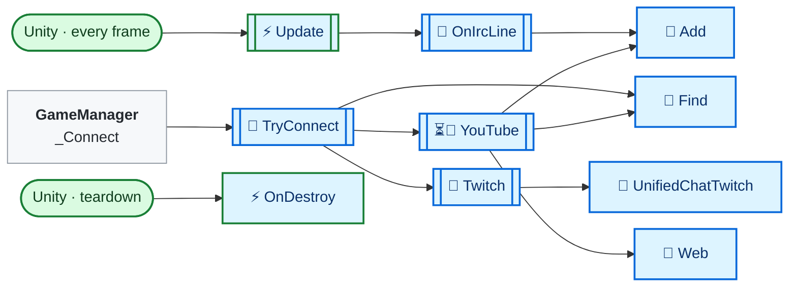
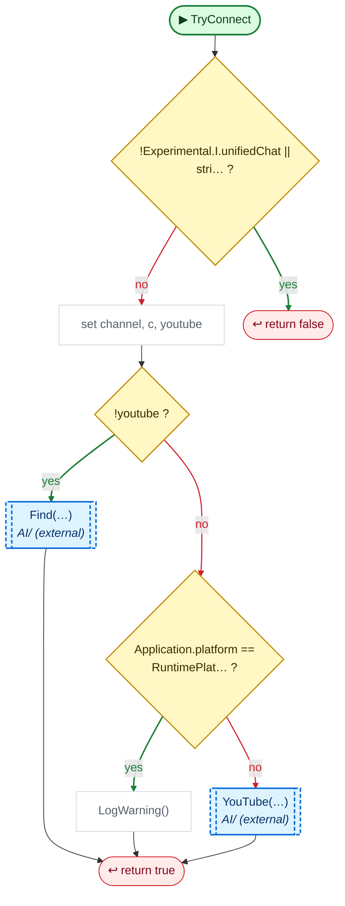
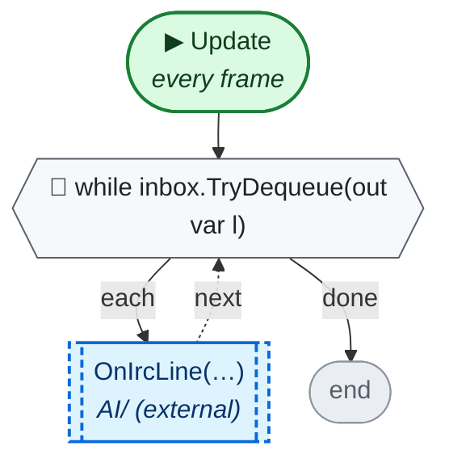
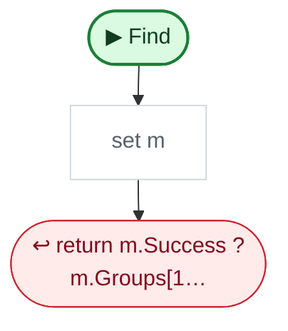
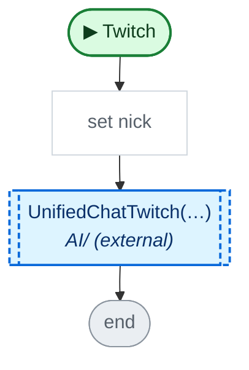
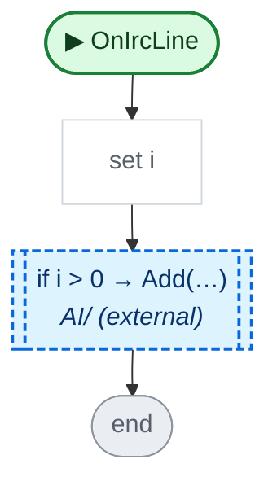
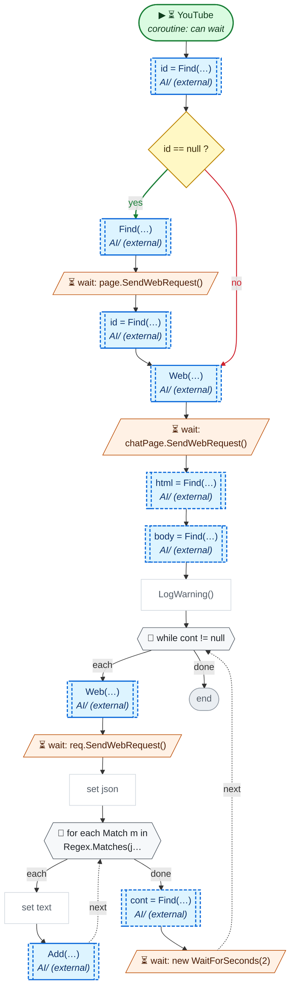
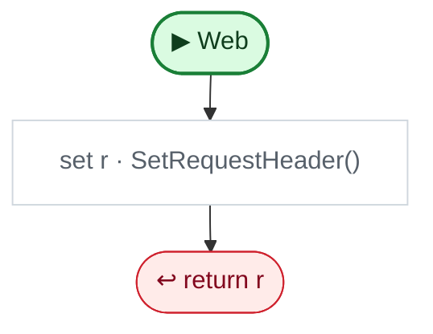

<!-- Generated by CodeGraph (CodeGraph~/tool). Don't edit: run the generator. Notes live in CodeGraph~/notes/. -->
# AI/UnifiedChat.cs

⚡ Unity calls it · 🔁 runs every frame · ⏳ can wait · blue box = calls another function · gray box = simple math · [code](../../../AI/UnifiedChat.cs) · [all files](../index.md)

*External folder: shown only through what other files use.*

## Map

## 🔁 TryConnect

Code (L19–28)

| Step | Code |
|---|---|
| !Experimental.I.unifiedChat \|\| stri… ? | <code>!Experimental.I.unifiedChat \|\| string.IsNullOrWhiteSpace(channel)</code> L20 |
| return false | <code>return false</code> L20 |
| set channel, c, youtube | <code>channel = channel.Trim()</code> L21 <code>var c = new GameObject("UnifiedChat").AddComponent&lt;UnifiedChat&gt;()</code> L22 <code>bool youtube = channel.Contains("youtube.com") \|\| channel.Contains("youtu.be") \|\| channel.StartsWith("@")</code> L23 |
| !youtube ? | <code>!youtube</code> L24 |
| Find(…) → `Find`, `Twitch` | <code>c.Twitch((Find(channel, @"twitch\.tv/(?:popout/)?(\w+)") ?? channel.TrimStart('#')).ToLowerInvariant())</code> L24 |
| Application.platform == RuntimePlat… ? | <code>Application.platform == RuntimePlatform.WebGLPlayer</code> L25 |
| LogWarning() | <code>Debug.LogWarning("YouTube chat works in desktop builds only")</code> L25 |
| YouTube(…) → `YouTube` | <code>c.StartCoroutine(c.YouTube(channel))</code> L26 |
| return true | <code>return true</code> L27 |

Source: [L19–28](../../../AI/UnifiedChat.cs#L19-L28)

## ⚡ Update · every frame

Code (L29–29)

| Step | Code |
|---|---|
| while inbox.TryDequeue(out var l) | <code>while inbox.TryDequeue(out var l)</code> L29 |
| OnIrcLine(…) → `OnIrcLine` | <code>OnIrcLine(l)</code> L29 |

Source: [L29](../../../AI/UnifiedChat.cs#L29)

## 🔁 Find

Code (L32–32)

| Step | Code |
|---|---|
| set m | <code>var m = Regex.Match(s ?? "", pattern)</code> L32 |
| return m.Success ? m.Groups[1… | <code>return m.Success ? m.Groups[1].Value : null</code> L32 |

Source: [L32](../../../AI/UnifiedChat.cs#L32)

## 🔁 Twitch

Code (L37–53)

| Step | Code |
|---|---|
| set nick | <code>string nick = "justinfan" + Random.Range(1000, 99999)</code> L38 |
| UnifiedChatTwitch(…) → `UnifiedChatTwitch` | <code>#if UNITY_WEBGL && !UNITY_EDITOR UnifiedChatTwitch(nick, ch, name); #else new Thread(() =&gt; {try{ tcp = new TcpClient("irc.chat.twitch.tv", 6667); var r = new StreamReader(tcp.GetStream()); var w = new StreamWriter(tcp.GetStream()){AutoFlush = true, NewLine = "\r\n"}; w.WriteLine("NICK " + nick); w.WriteLine("JOIN #" + ch); for(string l; (l = r.ReadLine()) != null;){ if(l.StartsWith("PING"))w.WriteLine("PONG" + l.Substring(4)); else inbox.Enqueue(l); } }catch(System.Exception e){Debug.LogWarning("Twitch chat: " + e.Message);}}){IsBackground = true}.Start(); #endif</code> L39 |

Source: [L37–53](../../../AI/UnifiedChat.cs#L37-L53)

## 🔁 OnIrcLine

Code (L54–57)

| Step | Code |
|---|---|
| set i | <code>int i = l.IndexOf(" PRIVMSG #")</code> L55 |
| if i &gt; 0 → Add(…) → `Add` | <code>if i &gt; 0</code> L56 <code>Add(l.Substring(1, l.IndexOf('!') - 1), l.Substring(l.IndexOf(" :", i) + 2))</code> L56 |

Source: [L54–57](../../../AI/UnifiedChat.cs#L54-L57)

## ⏳🔁 YouTube

Code (L59–83)

| Step | Code |
|---|---|
| id = Find(…) → `Find` | <code>string id = Find(link, @"(?:v=\|youtu\.be/\|/live/)([\w-]{11})")</code> L60 |
| id == null ? | <code>id == null</code> L61 |
| Find(…) → `Find`, `Web` | <code>using var page = Web("https://www.youtube.com/" + Find(link, @"(@[\w.-]+\|(?:channel\|c\|user)/[\w-]+)") + "/live")</code> L62 |
| wait: page.SendWebRequest() | <code>yield return page.SendWebRequest()</code> L63 |
| id = Find(…) → `Find` | <code>id = Find(page.downloadHandler.text, @"rel=""canonical"" href=""[^""]*v=([\w-]{11})")</code> L64 |
| Web(…) → `Web` | <code>using var chatPage = Web("https://www.youtube.com/live_chat?v=" + id)</code> L66 |
| wait: chatPage.SendWebRequest() | <code>yield return chatPage.SendWebRequest()</code> L67 |
| html = Find(…) → `Find` | <code>string html = chatPage.downloadHandler.text, cont = Find(html, @"""continuation"":""([^""]+)""")</code> L68 |
| body = Find(…) → `Find` | <code>string body = "{\"context\":{\"client\":{\"clientName\":\"WEB\",\"clientVersion\":\"" + (Find(html, @"""INNERTUBE_CLIENT_VERSION"":""([^""]+)""") ?? "2.20240101") + "\"}},\"continuation\":\""</code> L69 |
| LogWarning() | <code>if(cont == null)Debug.LogWarning("YouTube chat not found (is the stream live?): " + link)</code> L70 |
| while cont != null | <code>while cont != null</code> L71 |
| Web(…) → `Web` | <code>using var req = Web("https://www.youtube.com/youtubei/v1/live_chat/get_live_chat?prettyPrint=false", body + cont + "\"}")</code> L72 |
| wait: req.SendWebRequest() | <code>yield return req.SendWebRequest()</code> L73 |
| set json | <code>string json = req.downloadHandler.text</code> L74 |
| for each Match m in Regex.Matches(j… | <code>for each Match m in Regex.Matches(json, @"liveChatTextMessageRenderer"":\{""message"":\{""runs"":\[(.*?)\]\},""authorName"":\{""simpleText"":""((?:[^""\\]\|\\.)*)""")</code> L75 |
| set text | <code>string text = ""</code> L76 <code>foreach(Match t in Regex.Matches(m.Groups[1].Value, @"""text"":""((?:[^""\\]\|\\.)*)"""))text += Regex.Unescape(t.Groups[1].Value)</code> L77 |
| Add(…) → `Add` | <code>Add(Regex.Unescape(m.Groups[2].Value), text)</code> L78 |
| cont = Find(…) → `Find` | <code>cont = Find(json, @"""continuation"":""([^""]+)""") ?? cont</code> L80 |
| wait: new WaitForSeconds(2) | <code>yield return new WaitForSeconds(2)</code> L81 |

Source: [L59–83](../../../AI/UnifiedChat.cs#L59-L83)

## 🔁 Web

Code (L84–90)

| Step | Code |
|---|---|
| set r · SetRequestHeader() | <code>var r = json == null ? UnityWebRequest.Get(url) : new UnityWebRequest(url, "POST", new DownloadHandlerBuffer(), new UploadHandlerRaw(Encoding.UTF8.GetBytes(json)))</code> L85 <code>r.SetRequestHeader("User-Agent", "Mozilla/5.0 (Windows NT 10.0; Win64; x64) AppleWebKit/537.36 (KHTML, like Gecko) Chrome/124.0.0.0 Safari/537.36")</code> L86 <code>r.SetRequestHeader("Cookie", "SOCS=CAI")</code> L87 <code>if(json != null)r.SetRequestHeader("Content-Type", "application/json")</code> L88 |
| return r | <code>return r</code> L89 |

Source: [L84–90](../../../AI/UnifiedChat.cs#L84-L90)

Small helpers (3)

| | Name | Does | Code |
|---|---|---|---|
| ⚡ | OnDestroy | Close() | <code>tcp?.Close()</code> [L30](../../../AI/UnifiedChat.cs#L30) |
| 🔁 | Add | addToDB() | <code>GameManager.Instance.chat.addToDB(user, msg)</code> [L31](../../../AI/UnifiedChat.cs#L31) |
| 🔁 | UnifiedChatTwitch | nothing | *(empty)* [L35](../../../AI/UnifiedChat.cs#L35) |

Fields · UnifiedChat (2)

| Name | Type | Default | Note |
|---|---|---|---|
| `inbox` | `ConcurrentQueue&lt;string&gt;` | `new()` | desktop Twitch lines arrive on another thread |
| `tcp` | `TcpClient` |  |  |

