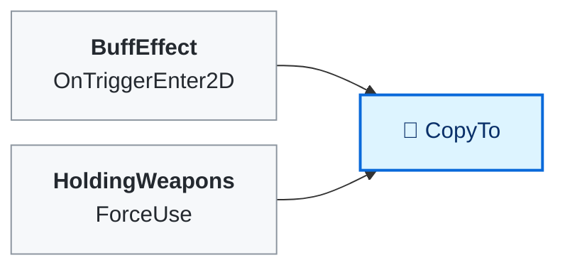
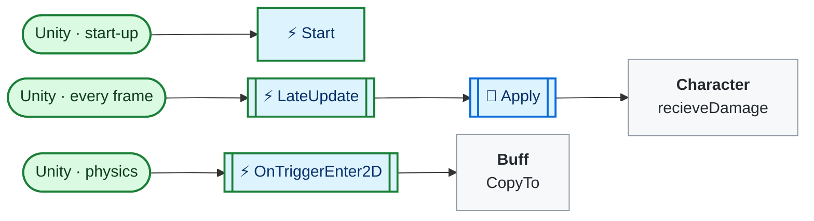
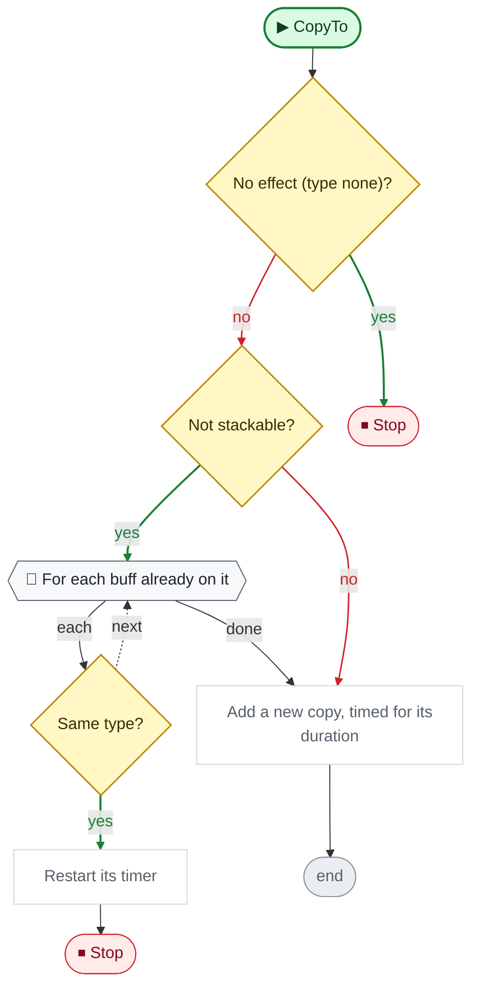
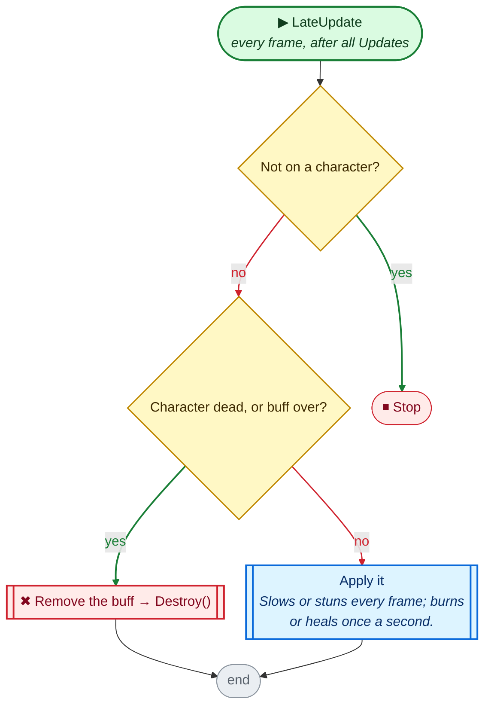
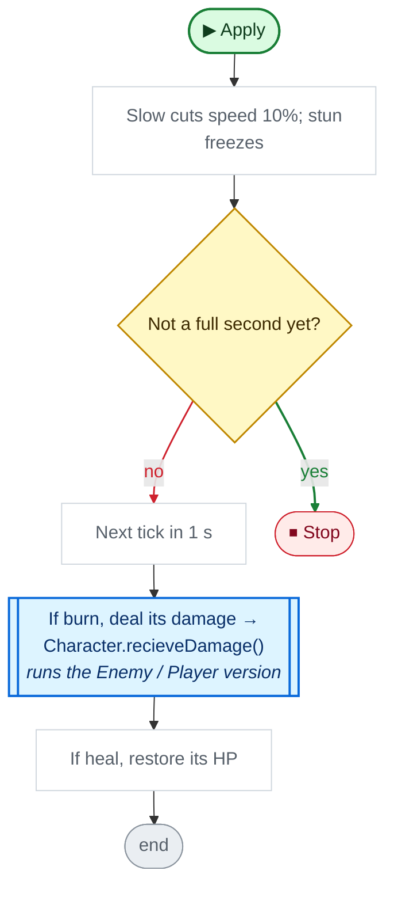

<!-- Generated by CodeGraph (CodeGraph~/tool). Don't edit: run the generator. Notes live in CodeGraph~/notes/. -->
# BuffEffect.cs

🤖 The kinds of buff - burn, heal, slow, stun, or none. *(BuffType)*

🤖 A timed burn, heal, slow or stun, passed from hitboxes to characters. *(BuffEffect)*

⚡ Unity calls it · 🔁 runs every frame · ⏳ can wait · blue box = calls another function · gray box = simple math · [code](../../BuffEffect.cs) · [all files](index.md)

## Map · BuffEffect.Buff

## Map · BuffEffect

## 🔁 CopyTo

🤖 Puts this buff on an object, or restarts it if already there.

Code (L21–26)

| Step | Code |
|---|---|
| No effect (type none)? | <code>type == BuffType.none</code> L22 |
| Stop | <code>return</code> L22 |
| Not stackable? | <code>!isStackable</code> L23 |
| For each buff already on it | <code>for each b in go.GetComponents&lt;BuffEffect&gt;()</code> L23 |
| Same type? | <code>b.buff.type == type</code> L23 |
| Restart its timer | <code>b.end = Time.time + duration</code> L23 |
| Stop | <code>return</code> L23 |
| Add a new copy, timed for its duration | <code>var c = go.AddComponent&lt;BuffEffect&gt;()</code> L24 <code>c.buff = this</code> L25 <code>c.end = Time.time + duration</code> L25 |

Source: [L21–26](../../BuffEffect.cs#L21-L26)

## ⚡ LateUpdate · every frame, after all Updates

🤖 On a character, each frame after it moved - apply until the buff ends.

Code (L45–50)

| Step | Code |
|---|---|
| Not on a character? | <code>cha == null</code> L47 |
| Stop | <code>return</code> L47 |
| Character dead, or buff over? | <code>cha.isDead \|\| Time.time &gt; end</code> L48 |
| Remove the buff → Destroy() | <code>Destroy(this)</code> L48 |
| Apply it → [`Apply`](#m-buffeffect-apply) | <code>Apply(cha)</code> L49 |

Source: [L45–50](../../BuffEffect.cs#L45-L50)

## 🔁 Apply

🤖 Slows or stuns every frame; burns or heals once a second.

Code (L52–59)

| Step | Code |
|---|---|
| Slow cuts speed 10%; stun freezes | <code>if(buff.type == BuffType.slow)cha.rb.velocity *= .9f</code> L53 <code>if(buff.type == BuffType.stun)cha.froze()</code> L54 |
| Not a full second yet? | <code>tick &gt; Time.time</code> L55 |
| Stop | <code>return</code> L55 |
| Next tick in 1 s | <code>tick = Time.time + 1</code> L56 |
| If burn, deal its damage → Character.recieveDamage() → [`Character.recieveDamage`](Character.cs.md#m-character-recievedamage) | <code>if buff.type == BuffType.burn</code> L57 <code>cha.recieveDamage(buff.power)</code> L57 |
| If heal, restore its HP | <code>if(buff.type == BuffType.heal)cha.Heal(buff.power)</code> L58 |

Source: [L52–59](../../BuffEffect.cs#L52-L59)

Small helpers (2)

| | Name | Does | Code |
|---|---|---|---|
| ⚡ | Start | Finds the character it sits on; first tick in 1 s. | <code>cha = gameObject.GetComponent&lt;Character&gt;()</code> <code>tick = Time.time + 1</code> [L32–36](../../BuffEffect.cs#L32-L36) |
| ⚡ | OnTriggerEnter2D | On a hitbox - copies the buff onto each character it can hit. | <code>if TryGetComponent(out HitBox hb) && other.TryGetComponent(out Character c) && hb.CanHit(c)</code> <code>buff.CopyTo(c.gameObject)</code> [L39–42](../../BuffEffect.cs#L39-L42) |

Values · BuffType (5)

| Name | Type | Default | Note |
|---|---|---|---|
| `burn` | `` |  |  |
| `heal` | `` |  |  |
| `slow` | `` |  |  |
| `stun` | `` |  |  |
| `none` | `` |  |  |

Fields · BuffEffect (4)

| Name | Type | Default | Note |
|---|---|---|---|
| `buff` *(Inspector)* | `Buff` |  |  |
| `cha` | `Character` |  |  |
| `end` | `float` |  | end is set only when copied, so other copies (summon templates) expire at once |
| `tick` | `float` |  | end is set only when copied, so other copies (summon templates) expire at once |

Fields · Buff (4)

| Name | Type | Default | Note |
|---|---|---|---|
| `type` *(Inspector)* | `BuffType` | `BuffType.none` | none = no effect |
| `duration` *(Inspector)* | `float` | `1f` |  |
| `power` *(Inspector)* | `int` | `1` | burn, heal: HP per second |
| `isStackable` *(Inspector)* | `bool` |  |  |

