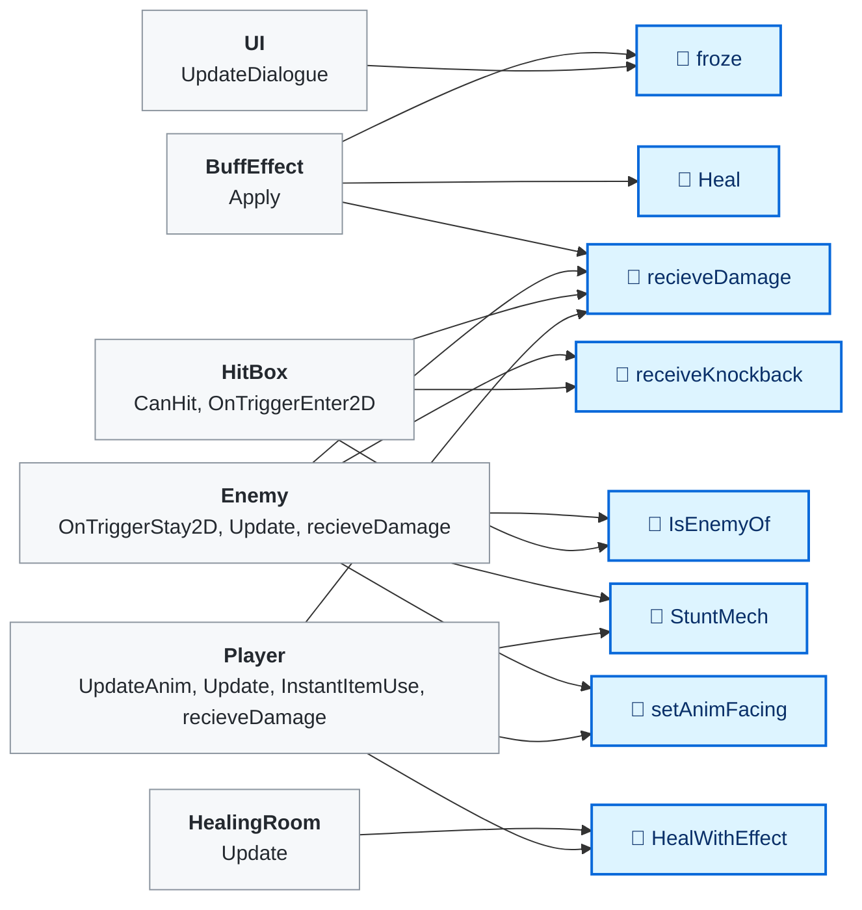
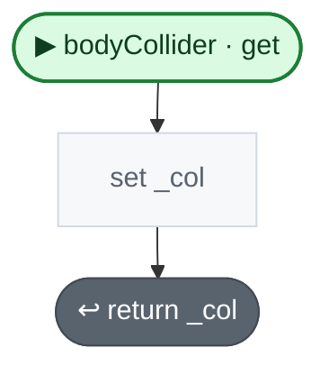
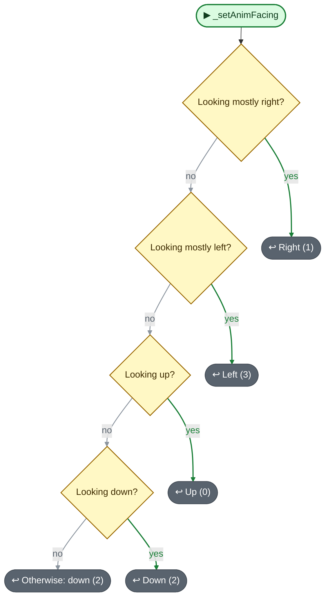
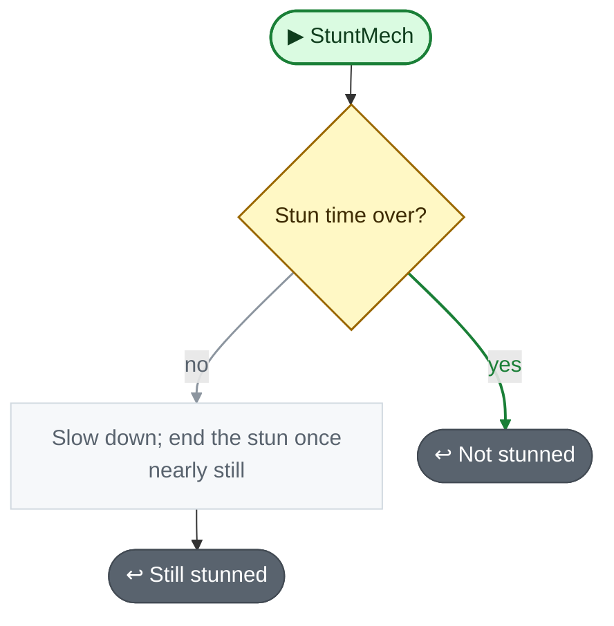
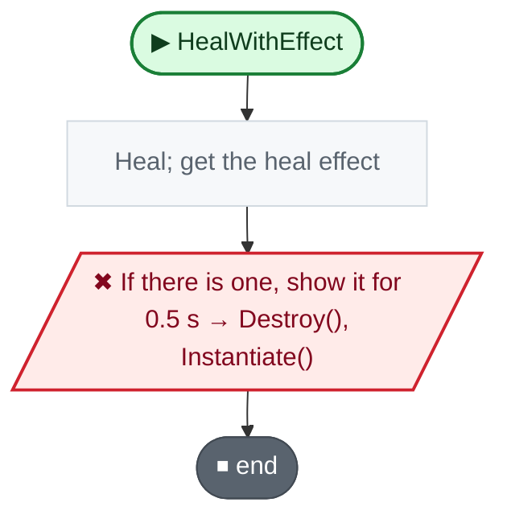

<!-- Generated by CodeGraph (CodeGraph~/tool). Don't edit: run the generator. Notes live in CodeGraph~/notes/. -->
# Character.cs

🤖 Attack and defense numbers, physical and magic. *(CombatStat)*

🤖 Which side a character is on; hits only hurt other teams. *(Team)*

🤖 Base of the player and enemies - HP, facing, stun, knockback, healing. *(Character)*

[code](../../Character.cs) · [all files](index.md)

key
▶ green: start · gray: simple math · ƒ blue: another function (short ones drawn inside) · yellow ◇: question / 🔁 loop / ⏳ wait · ✚ ✖ engine action · 📦 outside library · ⏹ end · ⚡ Unity calls it · 🔁 in a title: runs every frame

## Map

## bodyCollider · get

Code (L31–31)

| Step | Code |
|---|---|
| set _col | <code>if(!_col)_col = GetComponent&lt;Collider2D&gt;()</code> L31 |
| return _col | <code>return _col</code> L31 |

Source: [L31](../../Character.cs#L31)

## 🔁 _setAnimFacing

🤖 Turns a look direction into up, right, down or left.

Code (L37–43)

| Step | Code |
|---|---|
| Looking mostly right? | <code>looking.x &gt; 0.7071f</code> L38 |
| Right (1) | <code>return 1</code> L38 |
| Looking mostly left? | <code>looking.x &lt; -0.7071f</code> L39 |
| Left (3) | <code>return 3</code> L39 |
| Looking up? | <code>looking.y &gt; 0</code> L40 |
| Up (0) | <code>return 0</code> L40 |
| Looking down? | <code>looking.y &lt; 0</code> L41 |
| Down (2) | <code>return 2</code> L41 |
| Otherwise: down (2) | <code>return 2</code> L42 |

Source: [L37–43](../../Character.cs#L37-L43)

## 🔁 StuntMech

🤖 While stunned, slows it down and returns true.

Code (L45–50)

| Step | Code |
|---|---|
| Stun time over? | <code>stunTime &lt;= Time.time</code> L46 |
| Not stunned | <code>return false</code> L46 |
| Slow down; end the stun once nearly still | <code>rb.velocity *= Mathf.Exp(-recover * Time.deltaTime)</code> L47 <code>if(rb.velocity.magnitude &lt; 0.5f)stunTime = 0</code> L48 |
| Still stunned | <code>return true</code> L49 |

Source: [L45–50](../../Character.cs#L45-L50)

## 🔁 HealWithEffect

🤖 Heals and shows the heal animation.

Code (L60–64)

| Step | Code |
|---|---|
| Heal; get the heal effect | <code>Heal(amount)</code> L61 <code>var healEffect = GameManager.Instance.healEffect</code> L62 |
| If there is one, show it for 0.5 s → Destroy(), Instantiate() | <code>if healEffect != null</code> L63 <code>Destroy(Instantiate(healEffect, transform.position, Quaternion.identity, transform), .5f)</code> L63 |

Source: [L60–64](../../Character.cs#L60-L64)

Small helpers (16)

| | Name | Does | Code |
|---|---|---|---|
|  | looking · get |  | <code>_looking</code> [L21](../../Character.cs#L21) |
|  | looking · set |  | <code>_looking = value.normalized</code> [L21](../../Character.cs#L21) |
|  | HP · get |  | <code>_HP</code> [L24](../../Character.cs#L24) |
|  | HP · set |  | <code>_HP = value</code> [L24](../../Character.cs#L24) |
|  | isDead · get |  | <code>HP &lt;= 0</code> [L25](../../Character.cs#L25) |
|  | isMoving · get |  | <code>movement.magnitude &gt; 0</code> [L26](../../Character.cs#L26) |
|  | isLooking · get |  | <code>looking.magnitude &gt; 0</code> [L27](../../Character.cs#L27) |
|  | center · get |  | <code>bodyCollider ? (Vector2)bodyCollider.bounds.center : (Vector2)transform.position</code> [L32](../../Character.cs#L32) |
|  | team · get |  | <code>Team.Neutral</code> [L33](../../Character.cs#L33) |
| 🔁 | IsEnemyOf | True if the other character is on another team. | <code>c != null && c.team != team</code> [L34](../../Character.cs#L34) |
| 🔁 | setAnimFacing | Stores which way to face (0 up, 1 right, 2 down, 3 left). | <code>animFacing = _setAnimFacing(v)</code> [L36](../../Character.cs#L36) |
| 🔁 | froze | Stuns it for up to 1 second. | <code>stunTime = Time.time + 1</code> [L44](../../Character.cs#L44) |
| 🔁 | receiveKnockback | Knocked back and stunned, with no resistance. | <code>receiveKnockback(pos, force, 0)</code> [L51](../../Character.cs#L51) |
| 🔁 | receiveKnockback | Knocks it away from a point, less with resistance; stuns up to 1 s. | <code>Vector2 dir = Quaternion.Euler(0, 0, Random.Range(-10f, 10f)) * ((Vector2)transform.position - pos)</code> <code>rb.velocity = force * dir.normalized * (1 - resistance)</code> <code>stunTime = Time.time + 1</code> [L52–56](../../Character.cs#L52-L56) |
| 🔁 | Heal | Adds HP, up to max HP. | <code>HP += heal</code> <code>if(HP &gt; maxHP)HP = maxHP</code> [L58](../../Character.cs#L58) |
| 🔁 | recieveDamage | Does nothing here; Player and Enemy handle damage themselves. | *(empty)* [L66–67](../../Character.cs#L66-L67) |

Fields · CombatStat (4)

| Name | Type | Default | Note |
|---|---|---|---|
| `attackPhysic` *(Inspector)* | `int` | `1` |  |
| `attackMagic` *(Inspector)* | `int` | `1` |  |
| `defensePhysic` *(Inspector)* | `int` | `1` |  |
| `defenseMagic` *(Inspector)* | `int` | `1` |  |

Values · Team (3)

| Name | Type | Default | Note |
|---|---|---|---|
| `Player` | `` | `1` |  |
| `Enemy` | `` | `2` |  |
| `Neutral` | `` | `4` |  |

Fields · Character (18)

| Name | Type | Default | Note |
|---|---|---|---|
| `combatStat` | `CombatStat` |  |  |
| `maxHP` | `int` |  |  |
| `movement` | `Vector2` |  |  |
| `_looking` | `Vector2` |  |  |
| `looking` | `Vector2` |  |  |
| `animFacing` | `int` |  | up = 0, right = 1, down = 2, left = 3 |
| `_HP` | `int` |  |  |
| `HP` | `int` |  |  |
| `isDead` | `bool` | `=&gt; HP &lt;= 0` |  |
| `isMoving` | `bool` | `=&gt; movement.magnitude &gt; 0` |  |
| `isLooking` | `bool` | `=&gt; looking.magnitude &gt; 0` |  |
| `rb` *(Inspector)* | `Rigidbody2D` |  |  |
| `stunTime` | `float` |  |  |
| `_col` | `Collider2D` |  |  |
| `bodyCollider` | `Collider2D` |  |  |
| `center` | `Vector2` | `=&gt; bodyCollider ? (Vector2)bodyCollider.bounds.center : (Vector2)transform.position` | middle of the body; the transform is at the feet |
| `team` | `Team` | `=&gt; Team.Neutral` |  |
| `isHealing` | `bool` |  | standing in a healing room |

