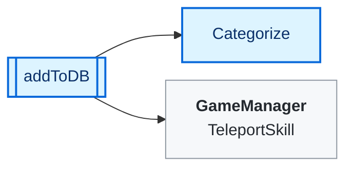
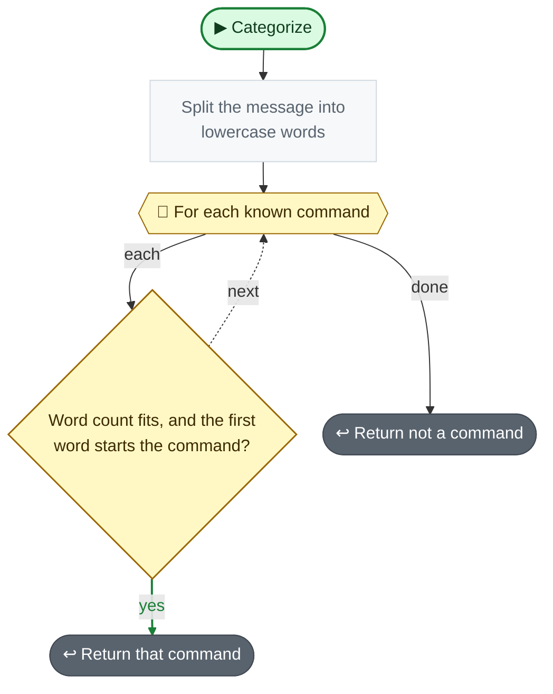
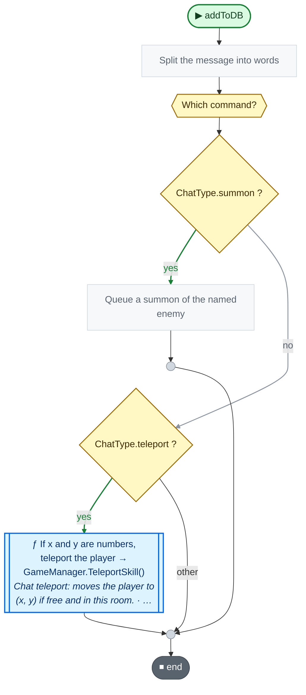

<!-- Generated by CodeGraph (CodeGraph~/tool). Don't edit: run the generator. Notes live in CodeGraph~/notes/. -->
# Connector/Chat.cs

🤖 Kinds of chat command - summon, teleport, vote, work, or not a command. *(ChatType)*

🤖 Base of the chat readers - turns chat messages into game commands. *(Chat)*

[code](../../../Connector/Chat.cs) · [all files](../index.md)

key
▶ green: start · gray: simple math · ƒ blue: another function (short ones drawn inside) · yellow ◇: question / 🔁 loop / ⏳ wait · ✚ ✖ engine action · 📦 outside library · ⏹ end · ⚡ Unity calls it · 🔁 in a title: runs every frame

## Map

## Categorize

🤖 Works out which command a chat message is, or none.

Code (L19–24)

| Step | Code |
|---|---|
| Split the message into lowercase words | <code>string[] words = message.ToLowerInvariant().Split(' ', System.StringSplitOptions.RemoveEmptyEntries)</code> L20 |
| For each known command | <code>for each c in commands</code> L21 |
| Word count fits, and the first word starts the command? | <code>words.Length &gt;= c.minWords && words.Length &lt;= c.maxWords && c.word.StartsWith(words[0], System.StringComparison.Ordinal)</code> L22 |
| Return that command | <code>return c.type</code> L22 |
| Return not a command | <code>return ChatType.invalid</code> L23 |

Source: [L19–24](../../../Connector/Chat.cs#L19-L24)

## addToDB

🤖 Handles one chat message - queues a summon or does a teleport.

Code (L25–31)

| Step | Code |
|---|---|
| Split the message into words | <code>string[] words = msg.Split(' ', System.StringSplitOptions.RemoveEmptyEntries)</code> L26 |
| Which command? | <code>switch Categorize(msg)</code> L27 |
| Queue a summon of the named enemy | <code>summondb.Add(username, new SummonCommand(words[1], username))</code> L28 |
| If x and y are numbers, teleport the player → GameManager.TeleportSkill() → [`GameManager.TeleportSkill`](../GameManager.cs.md#m-gamemanager-teleportskill) | <code>if int.TryParse(words[1], out int x) && int.TryParse(words[2], out int y)</code> L29 <code>GameManager.Instance.TeleportSkill(x, y)</code> L29 |

Source: [L25–31](../../../Connector/Chat.cs#L25-L31)

Values · ChatType (5)

| Name | Type | Default | Note |
|---|---|---|---|
| `summon` | `` | `0` |  |
| `teleport` | `` | `1` |  |
| `vote` | `` |  |  |
| `work` | `` |  |  |
| `invalid` | `` |  |  |

Fields · Chat (2)

| Name | Type | Default | Note |
|---|---|---|---|
| `summondb` *(Inspector)* | `SimpleSummonDB` |  |  |
| `commands` | `(string word, int minWords, int maxWords, ChatType type)[]` | `{ ("summon", 2, 3, ChatType.summon), ("spawn", 2, 3, ChatType.summon), ("teleport", 3, 3, ChatType.teleport), ("vote", 2, 2, ChatType.vote), ("work", 2, 2, ChatType.work), }` | the first word can be any start of the command ("s", "sum", "summon"), then the allowed word count |

