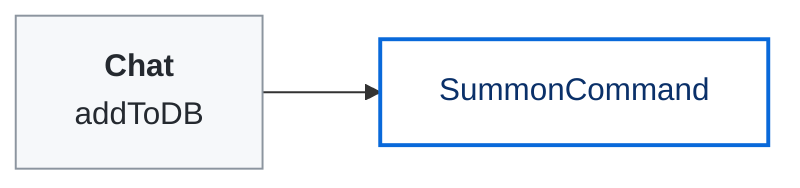
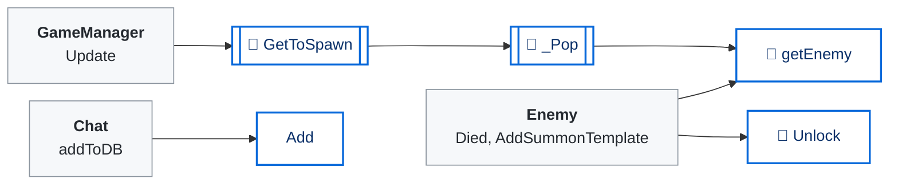
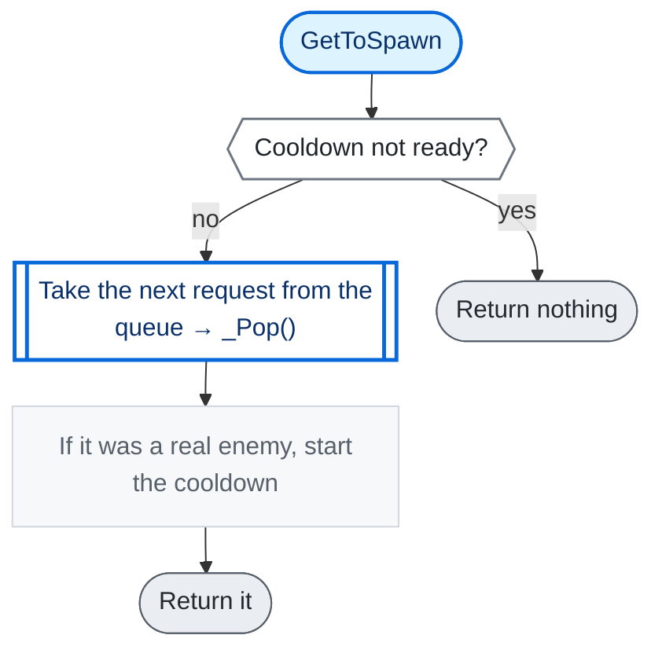
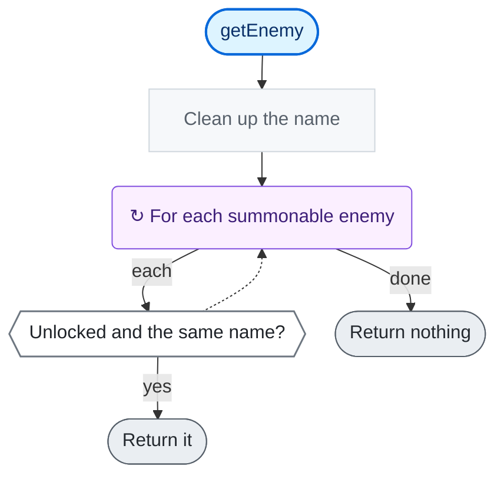

<!-- Generated by CodeGraph (CodeGraph~/tool). Don't edit: run the generator. Notes live in CodeGraph~/notes/. -->
# Connector/SummonDB.cs

🤖 One chat summon request - who asked, which enemy, and where. *(SummonCommand)*

🤖 Chat's summon queue, with one shared cooldown for all of chat. *(SimpleSummonDB)*

⚡ Unity calls it · 🔁 runs every frame · ⏳ can wait · blue box = calls another function · gray box = simple math · [code](../../../Connector/SummonDB.cs) · [all files](../index.md)

## Map · SummonCommand

## Map · SimpleSummonDB

## 🔁 GetToSpawn

🤖 Gives the next summoned enemy when the cooldown allows, else nothing.

Code (L22–27)

| Step | Code |
|---|---|
| Cooldown not ready? | <code>!spawnSkill.isReady</code> L23 |
| Return nothing | <code>return null</code> L23 |
| Take the next request from the queue → _Pop() → [`_Pop`](#m-simplesummondb--pop) | <code>var output = _Pop()</code> L24 |
| If it was a real enemy, start the cooldown | <code>if(output != null)spawnSkill.Call()</code> L25 |
| Return it | <code>return output</code> L26 |

Source: [L22–27](../../../Connector/SummonDB.cs#L22-L27)

## 🔁 getEnemy

🤖 Finds the unlocked summon template with this name.

Code (L35–39)

| Step | Code |
|---|---|
| Clean up the name | <code>string n = enemyName.ToLowerInvariant().Trim()</code> L36 |
| For each summonable enemy | <code>for each Enemy e in summonableEnemy</code> L37 |
| Unlocked and the same name? | <code>unlocked.Contains(e.enemyData) && e.enemyData.enemyName.ToLowerInvariant().Trim() == n</code> L37 |
| Return it | <code>return e</code> L37 |
| Return nothing | <code>return null</code> L38 |

Source: [L35–39](../../../Connector/SummonDB.cs#L35-L39)

Small helpers (5)

| | Name | Does | Code |
|---|---|---|---|
|  | SummonCommand | Stores the enemy name, the user and the place of a request. | <code>this.username = username</code> <code>this.spawnableName = spawnableName</code> <code>this.spawnableLocation = spawnableLocation</code> [L8–10](../../../Connector/SummonDB.cs#L8-L10) |
|  | Reset | Empties the summon queue. | <code>summonQ.Clear()</code> <code>indexQ = 0</code> [L28](../../../Connector/SummonDB.cs#L28) |
|  | Add | Queues a request (the queue is cleared once it passes 300). | <code>if(summonQ.Count &gt; 300)Reset()</code> <code>summonQ.Add(command)</code> [L29–32](../../../Connector/SummonDB.cs#L29-L32) |
| 🔁 | _Pop | Takes the next request and finds its enemy, or nothing. | <code>summonQ.Count &gt; indexQ ? getEnemy(summonQ[indexQ++].spawnableName) : null</code> [L33](../../../Connector/SummonDB.cs#L33) |
| 🔁 | Unlock | Lets chat summon this enemy type (once the streamer has killed one). | <code>if(!unlocked.Contains(e))unlocked.Add(e)</code> [L34](../../../Connector/SummonDB.cs#L34) |

Fields · SummonCommand (3)

| Name | Type | Default | Note |
|---|---|---|---|
| `username` *(Inspector)* | `string` |  |  |
| `spawnableName` *(Inspector)* | `string` |  |  |
| `spawnableLocation` *(Inspector)* | `string` |  |  |

Fields · SimpleSummonDB (6)

| Name | Type | Default | Note |
|---|---|---|---|
| `summonableEnemy` *(Inspector)* | `List&lt;Enemy&gt;` |  |  |
| `limitPerPlayer` *(Inspector)* | `int` | `10` |  |
| `spawnSkill` *(Inspector)* | `Skill` |  |  |
| `summonQ` *(Inspector)* | `List&lt;SummonCommand&gt;` | `new()` |  |
| `unlocked` *(Inspector)* | `List&lt;EnemySO&gt;` | `new()` | enemy types the streamer has killed; only these can be summoned |
| `indexQ` | `int` | `0` |  |

