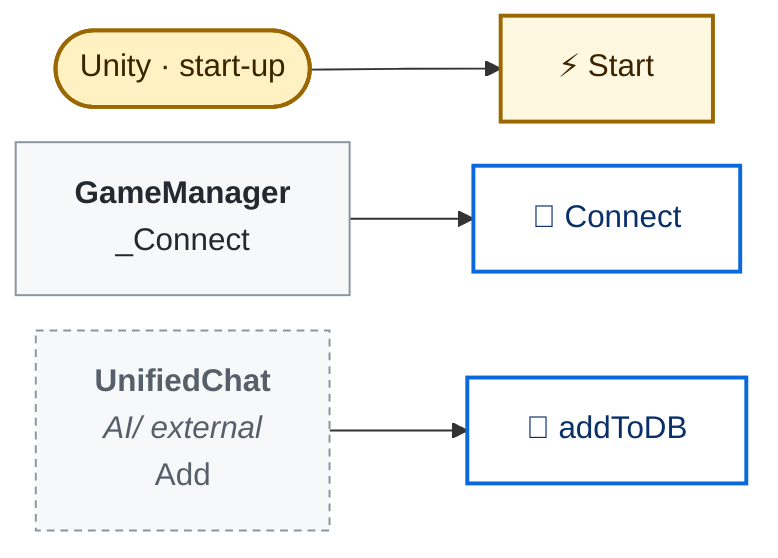

<!-- Generated by CodeGraph (CodeGraph~/tool). Don't edit: run the generator. Notes live in CodeGraph~/notes/. -->
# Connector/TwitchChat.cs

🤖 Reads Twitch chat through the Lexone package (the backup reader).

⚡ Unity calls it · 🔁 runs every frame · ⏳ can wait · blue box = calls another function · gray box = simple math · [code](../../../Connector/TwitchChat.cs) · [all files](../index.md)

## Map

Small helpers (5)

| | Name | Does | Code |
|---|---|---|---|
| ⚡ | Start | Grabs the Lexone chat connection. | <code>irc = IRC.Instance</code> [L15–19](../../../Connector/TwitchChat.cs#L15-L19) |
| 🔁 | Connect | Joins the saved channel. | <code>Connect(channel)</code> [L21](../../../Connector/TwitchChat.cs#L21) |
| 🔁 | Connect | Joins a Twitch channel and starts listening to its messages. | <code>irc.JoinChannel(channel)</code> <code>irc.OnChatMessage += OnChatMessage</code> [L22–25](../../../Connector/TwitchChat.cs#L22-L25) |
|  | OnChatMessage | Passes each chat message on to the command reader. | <code>addToDB(chatter)</code> [L27–32](../../../Connector/TwitchChat.cs#L27-L32) |
| 🔁 | addToDB | Hands the chatter's name and message to the command reader. | <code>var name = chatter.tags.displayName</code> <code>var msg = chatter.message</code> <code>addToDB(name, msg)</code> [L34–38](../../../Connector/TwitchChat.cs#L34-L38) |

Fields · TwitchChat (3)

| Name | Type | Default | Note |
|---|---|---|---|
| `sampleTwitchChatter` *(Inspector)* | `Chatter` |  | public List&lt;Chatter&gt; chatters; public List&lt;ChatMsg&gt; chatMsgs; |
| `channel` *(Inspector)* | `string` |  |  |
| `irc` *(Inspector)* | `IRC` |  |  |

