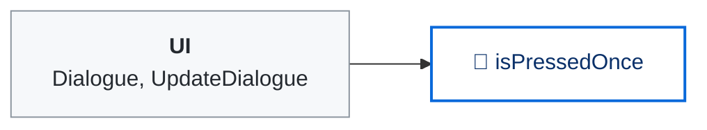
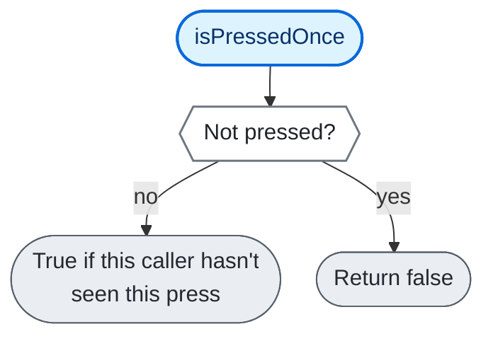
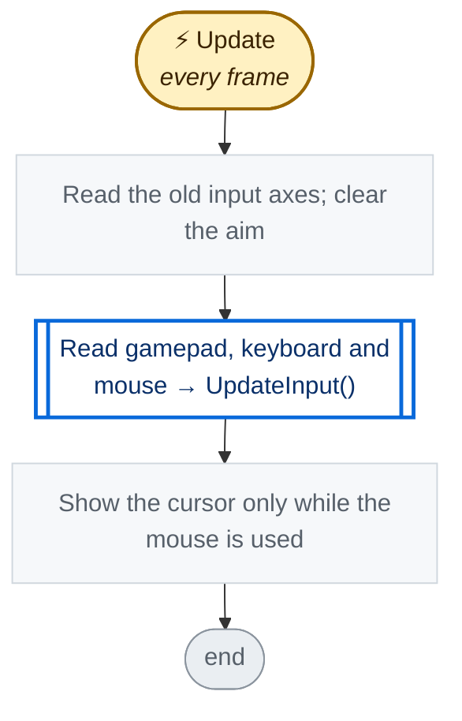
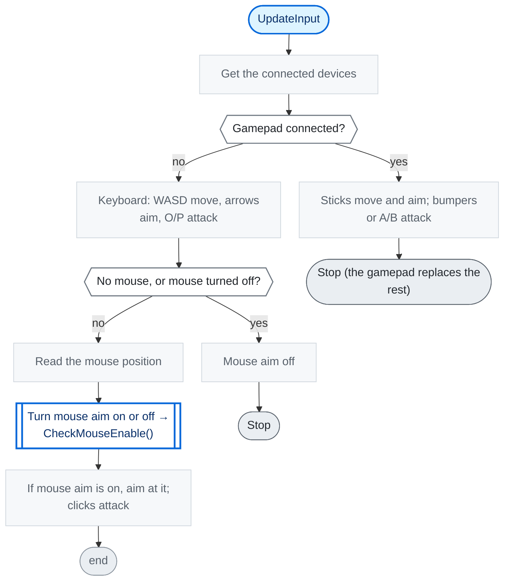

<!-- Generated by CodeGraph (CodeGraph~/tool). Don't edit: run the generator. Notes live in CodeGraph~/notes/. -->
# Controller.cs

🤖 One button's state, with a "seen once per press" check. *(ControllerButton)*

🤖 Reads gamepad, keyboard and mouse into movement, aim and attack buttons. *(Controller)*

⚡ Unity calls it · 🔁 runs every frame · ⏳ can wait · blue box = calls another function · gray box = simple math · [code](../../Controller.cs) · [all files](index.md)

## Map · ControllerButton

## Map · Controller

```mermaid
---
config:
  flowchart:
    wrappingWidth: 320
    nodeSpacing: 18
    rankSpacing: 60
---
flowchart LR
  m_Controller_Update[["⚡ Update"]]
  m_Controller_UpdateInput[["🔁 UpdateInput"]]
  m_Controller_CheckMouseEnable["🔁 CheckMouseEnable"]
  U_every_frame(["Unity · every frame"])
  U_every_frame --> m_Controller_Update
  m_Controller_Update --> m_Controller_UpdateInput
  m_Controller_UpdateInput --> m_Controller_CheckMouseEnable
  classDef engine fill:#fff1c2,stroke:#9a6700,stroke-width:2px,color:#3b2300
  classDef own fill:#ffffff,stroke:#0969da,stroke-width:2px,color:#0a3069
  classDef ownev fill:#fff8e1,stroke:#9a6700,stroke-width:2px,color:#3b2300
  classDef other fill:#f6f8fa,stroke:#8c959f,color:#24292f
  classDef ext fill:#f6f8fa,stroke:#8c959f,stroke-dasharray:4 3,color:#57606a
  classDef more fill:#ffffff,stroke:#d0d7de,stroke-dasharray:2 2,color:#57606a
  class U_every_frame engine
  class m_Controller_UpdateInput,m_Controller_CheckMouseEnable own
  class m_Controller_Update ownev
```

## 🔁 isPressedOnce

🤖 True only the first time each caller asks during one press.

Code (L11–14)

| Step | Code |
|---|---|
| Not pressed? | <code>!isPressed</code> L12 |
| Return false | <code>return false</code> L12 |
| True if this caller hasn't seen this press | <code>return _isSeen.Add(uniqueIdentifierString)</code> L13 |

Source: [L11–14](../../Controller.cs#L11-L14)

## ⚡ Update · every frame

🤖 Each frame - read all devices, show the cursor only for mouse use.

Code (L32–37)

| Step | Code |
|---|---|
| Read the old input axes; clear the aim | <code>movement = new Vector2(Input.GetAxisRaw("Horizontal"), Input.GetAxisRaw("Vertical"))</code> L33 <code>looking = Vector2.zero</code> L34 |
| Read gamepad, keyboard and mouse → UpdateInput() → [`UpdateInput`](#m-controller-updateinput) | <code>UpdateInput()</code> L35 |
| Show the cursor only while the mouse is used | <code>Cursor.visible = mouseActive</code> L36 |

Source: [L32–37](../../Controller.cs#L32-L37)

## 🔁 UpdateInput

🤖 A gamepad replaces everything; else keyboard, then mouse aim if active.

Code (L38–68)

| Step | Code |
|---|---|
| Get the connected devices | <code>var gamepad = Gamepad.current</code> L39 <code>var keyboard = Keyboard.current</code> L40 <code>var mouse = Mouse.current</code> L41 |
| Gamepad connected? | <code>gamepad != null</code> L42 |
| Sticks move and aim; bumpers or A/B attack | <code>movement = gamepad.leftStick.ReadValue()</code> L43 <code>looking = gamepad.rightStick.ReadValue()</code> L44 <code>attackLeft.isPressed = gamepad.leftShoulder.isPressed \|\| gamepad.buttonSouth.isPressed</code> L47 <code>attackRight.isPressed = gamepad.rightShoulder.isPressed \|\| gamepad.buttonEast.isPressed</code> L48 |
| Stop (the gamepad replaces the rest) | <code>return</code> L49 |
| Keyboard: WASD move, arrows aim, O/P attack | <code>if(keyboard != null){ var k = keyboard; movement = new Vector2(Axis(k.aKey.isPressed, k.dKey.isPressed), Axis(k.sKey.isPressed, k.wKey.isPressed)); looking = new Vector2(Axis(k.leftArrowKey.isPressed, k.rightArrowKey.isPressed), Axis(k.downArrowKey.isPressed, k.upArrowKey.isPressed)); attack = keyboard.kKey.isPressed; switchWeapon.isPressed = keyboard.qKey.isPressed; attackLeft.isPressed = keyboard.oKey.isPressed; attackRight.isPressed = keyboard.pKey.isPressed; }</code> L51 |
| No mouse, or mouse turned off? | <code>mouse == null \|\| disableMouse</code> L60 |
| Mouse aim off | <code>mouseActive = false</code> L60 |
| Stop | <code>return</code> L60 |
| Read the mouse position | <code>Vector2 mousePos = mouse.position.ReadValue()</code> L61 |
| Turn mouse aim on or off → CheckMouseEnable() → [`CheckMouseEnable`](#m-controller-checkmouseenable) | <code>CheckMouseEnable(mousePos)</code> L62 |
| If mouse aim is on, aim at it; clicks attack | <code>if(mouseActive){ looking = (Vector2)(Camera.main.ScreenToWorldPoint(mousePos) - GameManager.Instance.player.transform.position); attackLeft.isPressed = mouse.leftButton.isPressed; attackRight.isPressed = mouse.rightButton.isPressed; }</code> L63 |

Source: [L38–68](../../Controller.cs#L38-L68)

Small helpers (5)

| | Name | Does | Code |
|---|---|---|---|
|  | isPressed · get |  | <code>_isPressed</code> [L10](../../Controller.cs#L10) |
|  | isPressed · set |  | <code>_isPressed = value</code> <code>if(!value)_isSeen.Clear()</code> [L10](../../Controller.cs#L10) |
|  | disableMouse · get |  | <code>Experimental.I.disableMouse</code> [L23](../../Controller.cs#L23) |
| 🔁 | Axis | Turns two keys into -1, 0 or 1. | <code>(positive ? 1 : 0) - (negative ? 1 : 0)</code> [L69](../../Controller.cs#L69) |
| 🔁 | CheckMouseEnable | Mouse aim turns on when it moves far, off after a still pause. | <code>if((mousePos - mouseLastPos).magnitude &gt; mouseDistanceActivation)mouseActive = true</code> <code>if(mouseActive){ if((mouseLastPos - mousePos).magnitude &gt; 0){mouseLastTime = Time.time;mouseLastPos = mousePos;} if(Time.time - mouseLastTime &gt; mouseTimeDeactivation)mouseActive = false; }else if(Time.time - mouseLastTime &gt; mouseTimeDeactivation){mouseLastTime = Time.time;mouseLastPos = mousePos;}</code> [L71–77](../../Controller.cs#L71-L77) |

Fields · ControllerButton (3)

| Name | Type | Default | Note |
|---|---|---|---|
| `_isPressed` *(Inspector)* | `bool` |  |  |
| `_isSeen` *(Inspector)* | `HashSet&lt;string&gt;` | `new()` |  |
| `isPressed` | `bool` |  |  |

Fields · Controller (12)

| Name | Type | Default | Note |
|---|---|---|---|
| `movement` | `Vector2` |  |  |
| `looking` | `Vector2` |  |  |
| `attack` | `bool` |  |  |
| `switchWeapon` | `ControllerButton` |  |  |
| `disableMouse` | `bool` | `=&gt; Experimental.I.disableMouse` |  |
| `mouseActive` | `bool` | `true` | set by the script: on when the mouse moves, off after mouseTimeDeactivation still |
| `mouseDistanceActivation` *(Inspector)* | `float` | `10f` |  |
| `mouseLastPos` | `Vector2` |  |  |
| `mouseLastTime` | `float` |  |  |
| `mouseTimeDeactivation` *(Inspector)* | `float` | `1f` |  |
| `attackLeft` | `ControllerButton` |  |  |
| `attackRight` | `ControllerButton` |  |  |

