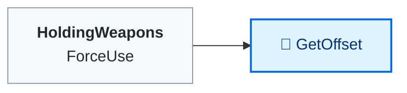

<!-- Generated by CodeGraph (CodeGraph~/tool). Don't edit: run the generator. Notes live in CodeGraph~/notes/. -->
# Data Types/Weapon.cs

🤖 Weapon data asset - damage, cooldown, hitbox, sounds, icon, buff.

⚡ Unity calls it · 🔁 runs every frame · ⏳ can wait · blue box = calls another function · gray box = simple math · [code](../../../Data%20Types/Weapon.cs) · [all files](../index.md)

## Map

Small helpers (1)

| | Name | Does | Code |
|---|---|---|---|
| 🔁 | GetOffset | The extra hitbox offset for a facing (up, right, down, left). | <code>new[]{upOffset, rightOffset, downOffset, leftOffset}[facing]</code> [L23](../../../Data%20Types/Weapon.cs#L23) |

Fields · Weapon (19)

| Name | Type | Default | Note |
|---|---|---|---|
| `type` *(Inspector)* | `WeaponType` |  |  |
| `useSound` *(Inspector)* | `AudioClip` |  |  |
| `hitSound` *(Inspector)* | `AudioClip` |  |  |
| `isMagical` *(Inspector)* | `bool` |  |  |
| `damage` *(Inspector)* | `int` |  |  |
| `cooldown` *(Inspector)* | `float` |  |  |
| `knocback` *(Inspector)* | `float` |  |  |
| `hitBoxDistance` *(Inspector)* | `float` |  | How far in front of the player the hitbox spawns |
| `hitBox` *(Inspector)* | `HitBox` |  |  |
| `upOffset` *(Inspector)* | `Vector2` |  | Extra hitbox offset per facing direction (x = right, y = up) |
| `rightOffset` *(Inspector)* | `Vector2` |  | Extra hitbox offset per facing direction (x = right, y = up) |
| `downOffset` *(Inspector)* | `Vector2` |  | Extra hitbox offset per facing direction (x = right, y = up) |
| `leftOffset` *(Inspector)* | `Vector2` |  | Extra hitbox offset per facing direction (x = right, y = up) |
| `velocity` *(Inspector)* | `float` |  | Hitbox flying speed. 0 = stays where it spawns |
| `destroyTimer` *(Inspector)* | `float` |  | Seconds before the hitbox disappears. 0 = disappears on first touch (if it doesn't fly: right away, touching or not) |
| `maxHits` *(Inspector)* | `int` |  | Enemies it can hit before disappearing. 0 = unlimited |
| `anim` *(Inspector)* | `BaseWeapon` |  |  |
| `uiWep` *(Inspector)* | `Sprite` |  |  |
| `buff` *(Inspector)* | `BuffEffect.Buff` |  | Buff section: type none = no effect; copied to each hitbox (BuffEffect.cs) |

