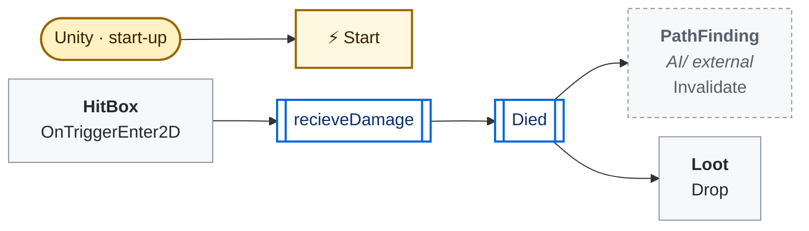
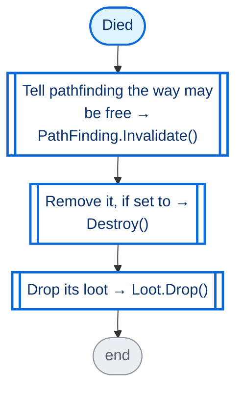
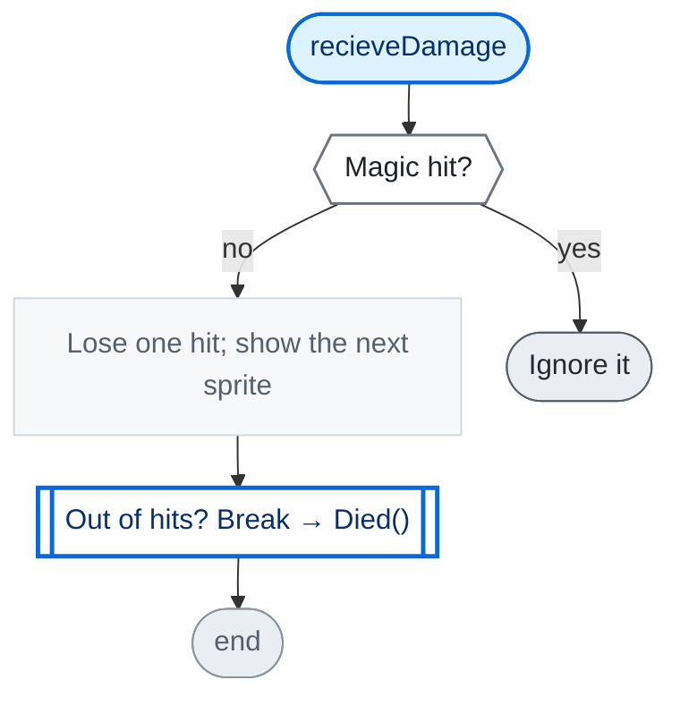

<!-- Generated by CodeGraph (CodeGraph~/tool). Don't edit: run the generator. Notes live in CodeGraph~/notes/. -->
# DestructableObj.cs

🤖 A breakable object (like a crate) - breaks after some hits, drops loot.

⚡ Unity calls it · 🔁 runs every frame · ⏳ can wait · blue box = calls another function · gray box = simple math · [code](../../DestructableObj.cs) · [all files](index.md)

## Map

## Died

🤖 Breaks - frees its spot for pathfinding, maybe vanishes, drops loot.

Code (L18–22)

| Step | Code |
|---|---|
| Tell pathfinding the way may be free → PathFinding.Invalidate() → `PathFinding.Invalidate` | <code>PathFinding.Invalidate()</code> L19 |
| Remove it, if set to → Destroy() | <code>if destroyAfterDead</code> L20 <code>Destroy(gameObject)</code> L20 |
| Drop its loot → Loot.Drop() → [`Loot.Drop`](Loot.cs.md#m-loot-drop) | <code>Loot.Drop(loot, weaponLoot, transform)</code> L21 |

Source: [L18–22](../../DestructableObj.cs#L18-L22)

## recieveDamage

🤖 Each non-magic hit counts once and shows the next damage sprite.

Code (L23–28)

| Step | Code |
|---|---|
| Magic hit? | <code>isMagical</code> L24 |
| Ignore it | <code>return</code> L24 |
| Lose one hit; show the next sprite | <code>HP -= 1</code> L25 <code>if(++index &lt; sprites.Length)myRender.sprite = sprites[index]</code> L26 |
| Out of hits? Break → Died() → [`Died`](#m-destructable-died) | <code>if HP == 0</code> L27 <code>Died()</code> L27 |

Source: [L23–28](../../DestructableObj.cs#L23-L28)

Small helpers (1)

| | Name | Does | Code |
|---|---|---|---|
| ⚡ | Start | Sets how many hits it takes to break. | <code>HP = hitUntillBreak</code> [L17](../../DestructableObj.cs#L17) |

Fields · Destructable (8)

| Name | Type | Default | Note |
|---|---|---|---|
| `sprites` *(Inspector)* | `Sprite[]` |  | one per hit |
| `index` | `int` |  |  |
| `HP` | `int` |  |  |
| `myRender` *(Inspector)* | `SpriteRenderer` |  |  |
| `hitUntillBreak` *(Inspector)* | `int` | `1` |  |
| `destroyAfterDead` *(Inspector)* | `bool` |  |  |
| `loot` *(Inspector)* | `Loot` |  |  |
| `weaponLoot` *(Inspector)* | `Weapon` |  | Optional. Weapon to drop, no Loot prefab needed |

