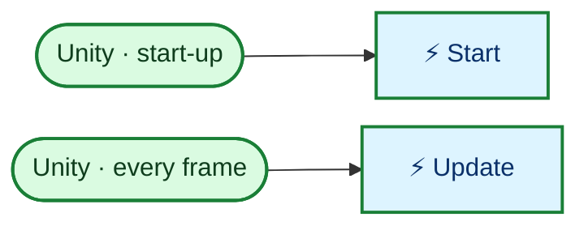

<!-- Generated by CodeGraph (CodeGraph~/tool). Don't edit: run the generator. Notes live in CodeGraph~/notes/. -->
# Dialogue.cs

🤖 Names of the story dialogues. *(DialogueSequence)*

🤖 All story dialogue lines, in one place. *(Dialogues)*

🤖 When a dialogue starts - at scene start, or when called. *(TriggerType)*

🤖 Shows a dialogue, at scene start or when something calls it. *(Dialogue)*

⚡ Unity calls it · 🔁 runs every frame · ⏳ can wait · blue box = calls another function · gray box = simple math · [code](../../Dialogue.cs) · [all files](index.md)

## Map

Small helpers (3)

| | Name | Does | Code |
|---|---|---|---|
| ⚡ | Start | Shows its dialogue right away if set to start on its own. | <code>ui = GameManager.Instance.ui</code> <code>if(tt == TriggerType.OnStart)Call()</code> [L31–35](../../Dialogue.cs#L31-L35) |
|  | Call | Shows its own lines, or the chosen story sequence. | <code>ui.Dialogue(sequence == DialogueSequence.None ? dialogueText : Dialogues.text[sequence])</code> [L37–39](../../Dialogue.cs#L37-L39) |
| ⚡ | Update | Does nothing (empty). | *(empty)* [L42–45](../../Dialogue.cs#L42-L45) |

Values · DialogueSequence (4)

| Name | Type | Default | Note |
|---|---|---|---|
| `None` | `` |  |  |
| `EnterDungeon` | `` |  |  |
| `FinishFirstRoom` | `` |  |  |
| `EnterOuterHotSpring` | `` |  |  |

Fields · Dialogues (1)

| Name | Type | Default | Note |
|---|---|---|---|
| `text` | `Dictionary&lt;DialogueSequence, string[]&gt;` | `new(){ [DialogueSequence.EnterDungeon] = new[]{ "Went out of the dungeon to eat currywurst with a girl and fell in love...", "Then came back to find all my warriors turned into skeletons by a lizard my sworn brother adopted!", "Havelagandr!", }, [DialogueSequence.FinishFirstRoom] = new[]{ "Now those roaming soul of my subordinate are around our dungeon. They should help me in reclaiming my throne! ", "I've been nice to them ever since. I even shorten their shift to 23hrs a day! There's no way they will turn against me!", }, [DialogueSequence.EnterOuterHotSpring] = new[]{ "good thing I built a personal spa room here. those souls should thank me I turn their village to something more useful.", }, }` |  |

Values · TriggerType (2)

| Name | Type | Default | Note |
|---|---|---|---|
| `OnStart` | `` |  |  |
| `OnCall` | `` |  |  |

Fields · Dialogue (4)

| Name | Type | Default | Note |
|---|---|---|---|
| `sequence` *(Inspector)* | `DialogueSequence` | `DialogueSequence.None` |  |
| `tt` *(Inspector)* | `TriggerType` | `TriggerType.OnStart` |  |
| `dialogueText` *(Inspector)* | `string[]` |  | Used only when Sequence is None |
| `ui` | `UI` |  |  |

