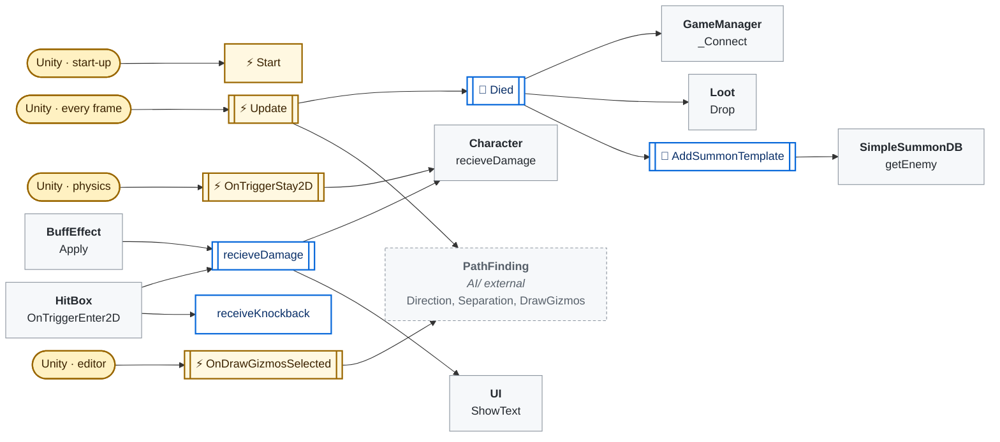
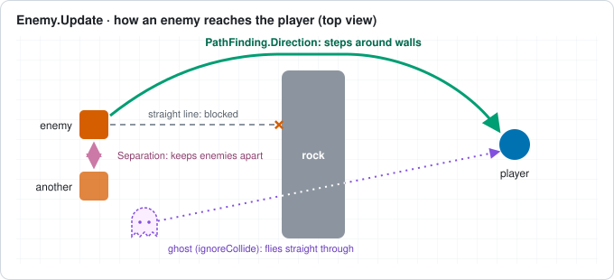
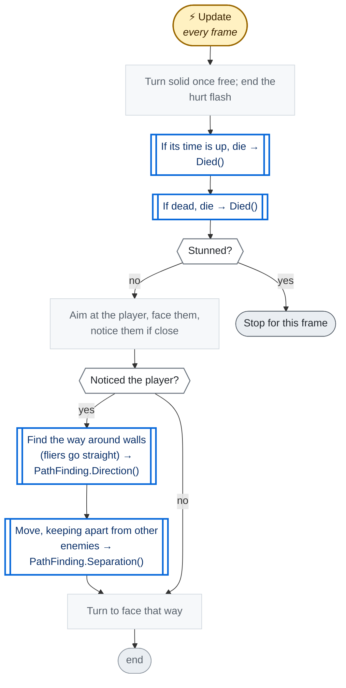
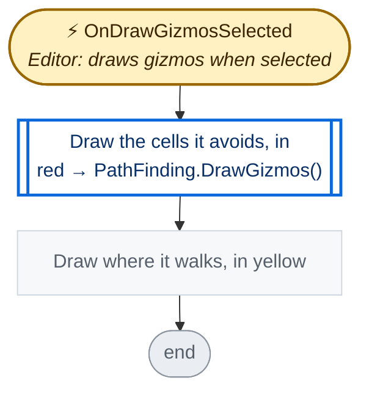
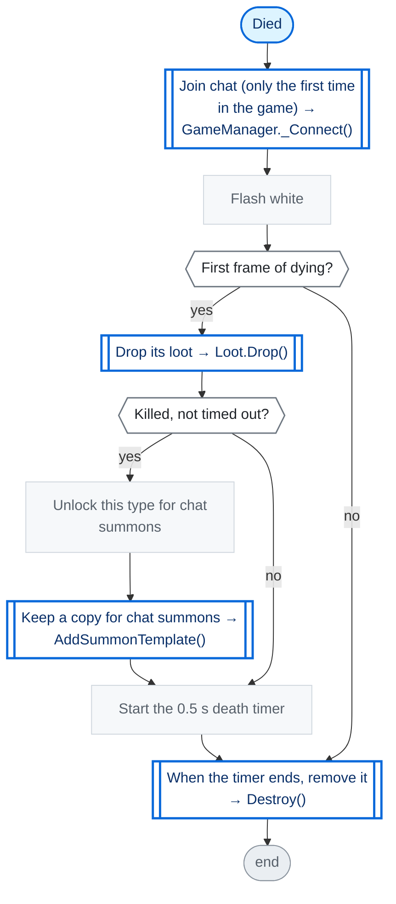
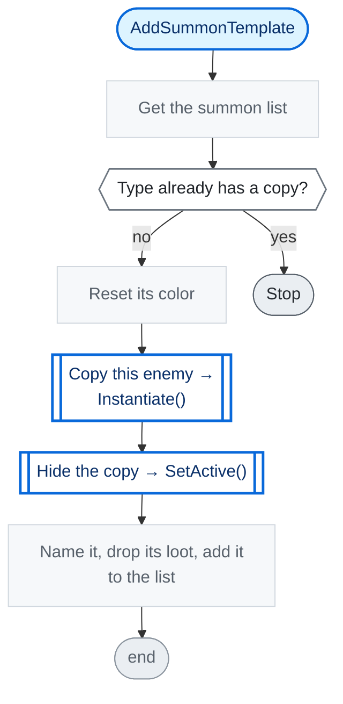
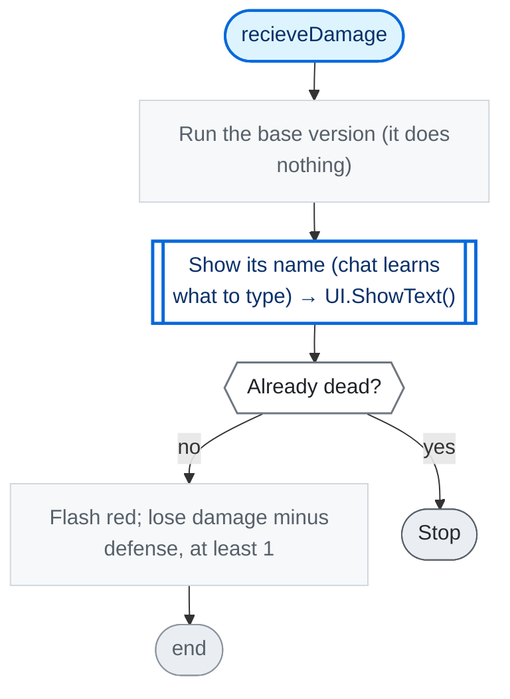
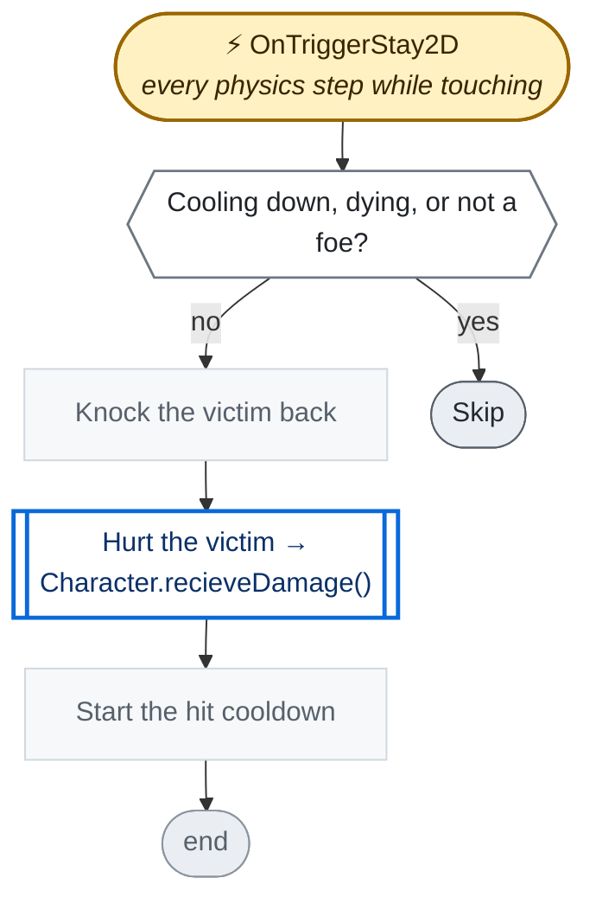

<!-- Generated by CodeGraph (CodeGraph~/tool). Don't edit: run the generator. Notes live in CodeGraph~/notes/. -->
# Enemy.cs

🤖 A monster that chases the player and hurts it on touch.

⚡ Unity calls it · 🔁 runs every frame · ⏳ can wait · blue box = calls another function · gray box = simple math · [code](../../Enemy.cs) · [all files](index.md)

## Map

## ⚡ Update · every frame

🤖 Each frame, walk to the player around walls.

Code (L47–62)

| Step | Code |
|---|---|
| Turn solid once free; end the hurt flash | <code>if(justSpawn && !col.IsTouchingLayers()){col.isTrigger = enemyData.ignoreCollide;justSpawn = false;notice = false;}</code> L48 <code>if(hurtTime &lt; Time.time)sr.color = originalSRcolor</code> L49 |
| If its time is up, die → Died() → [`Died`](#m-enemy-died) | <code>if Time.time &gt; lifeSpan + born</code> L50 <code>Died()</code> L50 |
| If dead, die → Died() → [`Died`](#m-enemy-died) | <code>if isDead</code> L51 <code>Died()</code> L51 |
| Stunned? | <code>StuntMech(enemyData.knocbackRecovery)</code> L52 |
| Stop for this frame | <code>return</code> L52 |
| Aim at the player, face them, notice them if close | <code>Vector2 target = GameManager.Instance.player.center</code> L53 <code>movement = target - center</code> L54 <code>if(facesPlayer && Mathf.Abs(movement.x) &gt; 0.01f)sr.flipX = (movement.x &lt; 0) != spriteFacesLeft</code> L55 <code>if(movement.magnitude &lt; enemyData.noticeRange)notice = true</code> L56 |
| Noticed the player? | <code>notice</code> L57 |
| Find the way around walls (fliers go straight) → PathFinding.Direction() → `PathFinding.Direction` | <code>way = enemyData.ignoreCollide ? movement.normalized : PathFinding.Direction(center, target, GameManager.Instance.currentRoom.bounds, col)</code> L58 |
| Move, keeping apart from other enemies → PathFinding.Separation() → `PathFinding.Separation` | <code>rb.velocity = Vector2.ClampMagnitude(way + PathFinding.Separation(col, LayerMask.GetMask("Enemy")), 1) * enemyData.initSpeed</code> L59 |
| Turn to face that way | <code>setAnimFacing(movement.normalized)</code> L61 |

Source: [L47–62](../../Enemy.cs#L47-L62)

## ⚡ OnDrawGizmosSelected · Editor: draws gizmos when selected

🤖 Editor only, when selected - shows the cells it avoids and where it walks.

Code (L64–68)

| Step | Code |
|---|---|
| Draw the cells it avoids, in red → PathFinding.DrawGizmos() → `PathFinding.DrawGizmos` | <code>PathFinding.DrawGizmos(col)</code> L65 |
| Draw where it walks, in yellow | <code>Gizmos.color = Color.yellow</code> L66 <code>Gizmos.DrawLine(center, center + way)</code> L67 |

Source: [L64–68](../../Enemy.cs#L64-L68)

## 🔁 Died

🤖 Runs every frame while dying - drops loot once, then vanishes after 0.5 s.

Code (L70–82)

| Step | Code |
|---|---|
| Join chat (only the first time in the game) → GameManager._Connect() → [`GameManager._Connect`](GameManager.cs.md#m-gamemanager--connect) | <code>GameManager.Instance._Connect()</code> L71 |
| Flash white | <code>sr.color = Color.white</code> L72 |
| First frame of dying? | <code>deathBreathTime == 0</code> L73 |
| Drop its loot → Loot.Drop() → [`Loot.Drop`](Loot.cs.md#m-loot-drop) | <code>Loot.Drop(loot, weaponLoot, transform)</code> L74 |
| Killed, not timed out? | <code>isDead</code> L75 |
| Unlock this type for chat summons | <code>GameManager.Instance.summondb.Unlock(enemyData)</code> L76 |
| Keep a copy for chat summons → AddSummonTemplate() → [`AddSummonTemplate`](#m-enemy-addsummontemplate) | <code>AddSummonTemplate()</code> L77 |
| Start the 0.5 s death timer | <code>deathBreathTime = Time.time + .5f</code> L79 |
| When the timer ends, remove it → Destroy() | <code>if Time.time &gt;= deathBreathTime</code> L81 <code>Destroy(gameObject)</code> L81 |

Source: [L70–82](../../Enemy.cs#L70-L82)

## 🔁 AddSummonTemplate

🤖 Keeps a hidden copy of this enemy as what chat summons, if its type has none yet.

Code (L83–90)

| Step | Code |
|---|---|
| Get the summon list | <code>var db = GameManager.Instance.summondb</code> L84 |
| Type already has a copy? → [`SimpleSummonDB.getEnemy`](Connector/SummonDB.cs.md#m-simplesummondb-getenemy) | <code>db.getEnemy(enemyData.enemyName) != null</code> L85 |
| Stop | <code>return</code> L85 |
| Reset its color | <code>sr.color = originalSRcolor</code> L86 |
| Copy this enemy → Instantiate() | <code>var t = Instantiate(this)</code> L87 |
| Hide the copy → SetActive() | <code>t.gameObject.SetActive(false)</code> L87 |
| Name it, drop its loot, add it to the list | <code>t.name = enemyData.enemyName + " (summon template)"</code> L87 <code>t.loot = null</code> L88 <code>t.weaponLoot = null</code> L88 <code>db.summonableEnemy.Add(t)</code> L89 |

Source: [L83–90](../../Enemy.cs#L83-L90)

## recieveDamage

🤖 Shows its name, then takes damage minus defense (at least 1).

Code (L91–98)

| Step | Code |
|---|---|
| Run the base version (it does nothing) | <code>base.recieveDamage(dmg, isMagical)</code> L92 |
| Show its name (chat learns what to type) → UI.ShowText() → [`UI.ShowText`](UI.cs.md#m-ui-showtext) | <code>GameManager.Instance.ui.ShowText(enemyData.enemyName.ToLowerInvariant())</code> L93 |
| Already dead? | <code>isDead</code> L94 |
| Stop | <code>return</code> L94 |
| Flash red; lose damage minus defense, at least 1 | <code>HurtColor()</code> L95 <code>dmg -= isMagical ? enemyData.combatStat.defenseMagic : enemyData.combatStat.defensePhysic</code> L96 <code>HP -= Mathf.Max(dmg, 1)</code> L97 |

Source: [L91–98](../../Enemy.cs#L91-L98)

## ⚡ OnTriggerStay2D · every physics step while touching

🤖 Touch damage - hurts characters of other teams, once per cooldown.

Code (L103–108)

| Step | Code |
|---|---|
| Cooling down, dying, or not a foe? | <code>cooldownTimer &gt; Time.time \|\| deathBreathTime != 0 \|\| !other.TryGetComponent(out Character victim) \|\| !IsEnemyOf(victim)</code> L104 |
| Skip | <code>return</code> L104 |
| Knock the victim back | <code>victim.receiveKnockback(transform.position, enemyData.attackKnockback)</code> L105 |
| Hurt the victim → Character.recieveDamage() → [`Character.recieveDamage`](Character.cs.md#m-character-recievedamage) | <code>victim.recieveDamage(enemyData.combatStat.attackPhysic)</code> L106 |
| Start the hit cooldown | <code>cooldownTimer = Time.time + enemyData.cooldown</code> L107 |

Source: [L103–108](../../Enemy.cs#L103-L108)

Small helpers (8)

| | Name | Does | Code |
|---|---|---|---|
|  | initSpeed · get |  | <code>enemyData.initSpeed</code> [L8](../../Enemy.cs#L8) |
|  | team · get |  | <code>Team.Enemy</code> [L9](../../Enemy.cs#L9) |
|  | combatStat · get |  | <code>enemyData.combatStat</code> [L10](../../Enemy.cs#L10) |
|  | maxHP · get |  | <code>enemyData.maxHP</code> [L11](../../Enemy.cs#L11) |
|  | facesPlayer · get |  | <code>true</code> [L29](../../Enemy.cs#L29) |
| ⚡ | Start | Sets up stats and parts; starts as a trigger so it never spawns stuck. | <code>HP = enemyData.maxHP</code> <code>born = Time.time</code> <code>sr = GetComponentInChildren&lt;SpriteRenderer&gt;()</code> <code>foreach(Transform child in sr.transform){ var s = child.GetComponent&lt;SpriteRenderer&gt;(); if(s != null)sr = s; }</code> <code>originalSRcolor = sr.color</code> <code>GetComponent&lt;Rigidbody2D&gt;().freezeRotation = true</code> <code>gameObject.layer = LayerMask.NameToLayer("Enemy")</code> <code>col = GetComponent&lt;Collider2D&gt;()</code> <code>col.isTrigger = true</code> <code>justSpawn = true</code> [L32–46](../../Enemy.cs#L32-L46) |
|  | HurtColor | Flashes red for 0.1 s. | <code>hurtTime = Time.time + 0.1f</code> <code>sr.color = Color.red</code> [L99](../../Enemy.cs#L99) |
|  | receiveKnockback | Gets pushed back, less if it resists knockback. | <code>receiveKnockback(pos, force, enemyData.knockbackResistance)</code> [L101](../../Enemy.cs#L101) |

Fields · Enemy (24)

| Name | Type | Default | Note |
|---|---|---|---|
| `enemyData` *(Inspector)* | `EnemySO` |  |  |
| `initSpeed` | `float` | `=&gt; enemyData.initSpeed` |  |
| `team` | `Team` | `=&gt; Team.Enemy` |  |
| `combatStat` | `CombatStat` |  |  |
| `maxHP` | `int` |  |  |
| `anim` *(Inspector)* | `Animator` |  |  |
| `enemyIdle` *(Inspector)* | `AnimationClip[]` |  |  |
| `enemyWalk` *(Inspector)* | `AnimationClip[]` |  |  |
| `enemyAttack` *(Inspector)* | `AnimationClip[]` |  |  |
| `loot` *(Inspector)* | `Loot` |  |  |
| `weaponLoot` *(Inspector)* | `Weapon` |  | Optional. Weapon to drop, no Loot prefab needed |
| `sr` | `SpriteRenderer` |  |  |
| `col` | `Collider2D` |  |  |
| `originalSRcolor` | `Color` |  |  |
| `deathBreathTime` | `float` |  |  |
| `hurtTime` | `float` |  |  |
| `lifeSpan` | `float` | `360` | seconds, then it dies by itself |
| `born` | `float` |  |  |
| `cooldownTimer` | `float` |  |  |
| `justSpawn` | `bool` |  |  |
| `notice` | `bool` |  |  |
| `spriteFacesLeft` *(Inspector)* | `bool` |  | Tick if the sprite art faces left. It is flipped to face the player |
| `facesPlayer` | `bool` | `=&gt; true` | false: never flipped (Chest) |
| `way` | `Vector2` |  | where it walks, for the gizmo |

