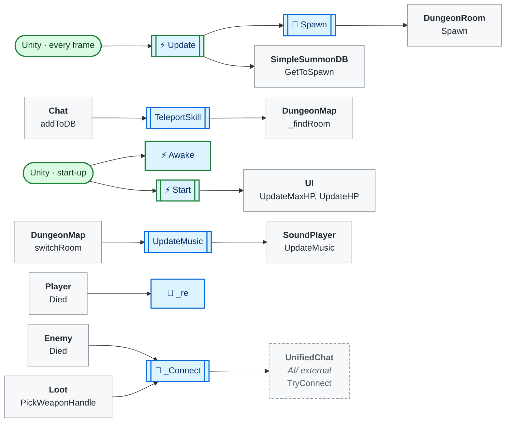
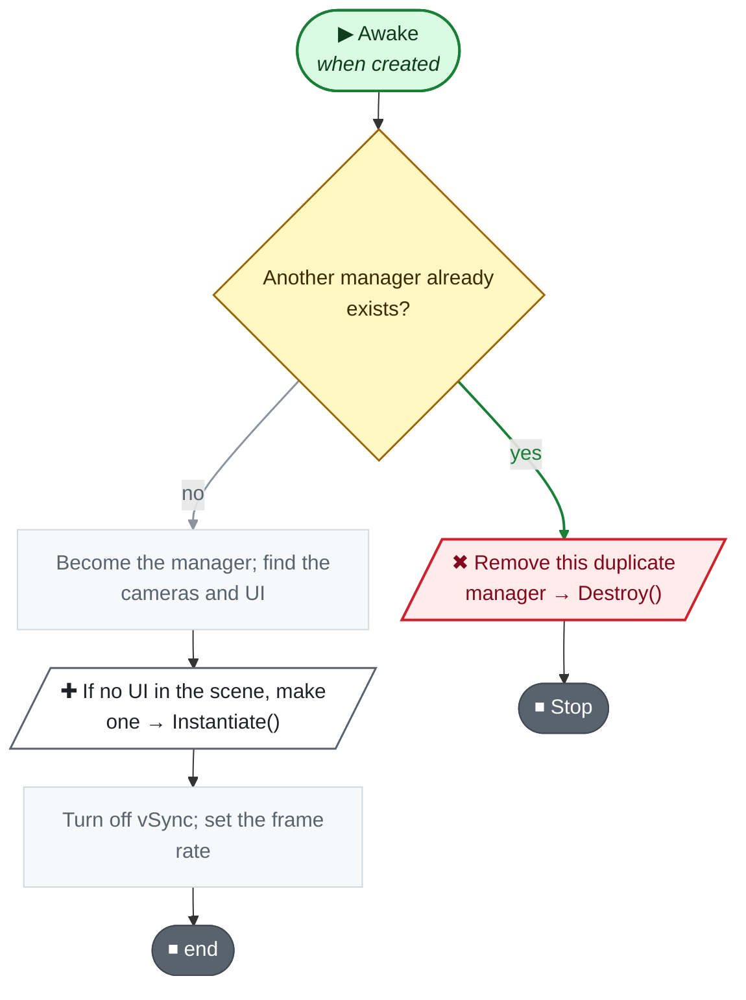
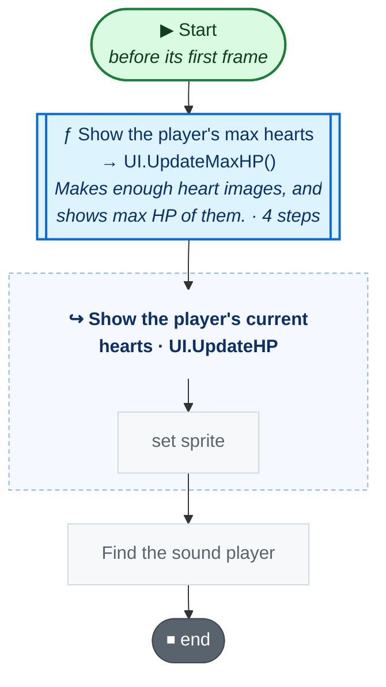
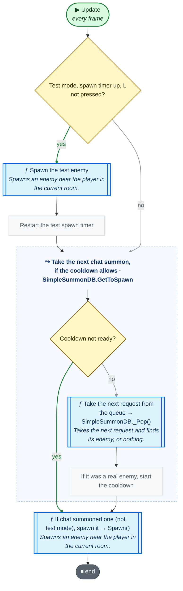
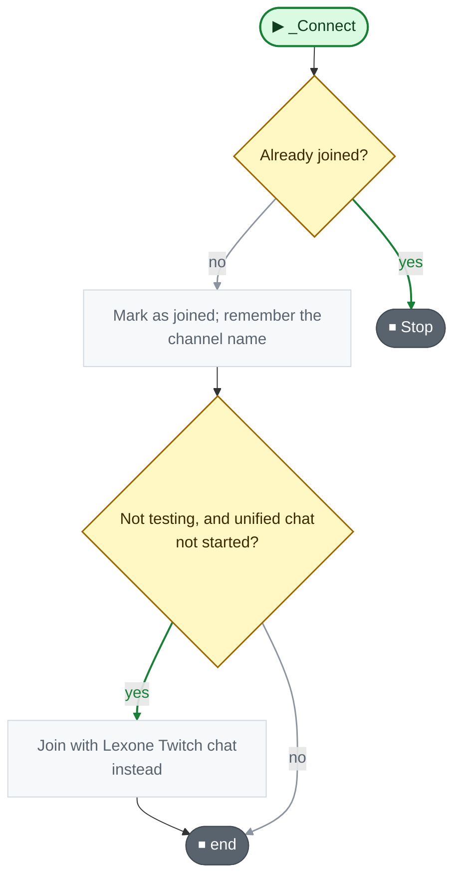
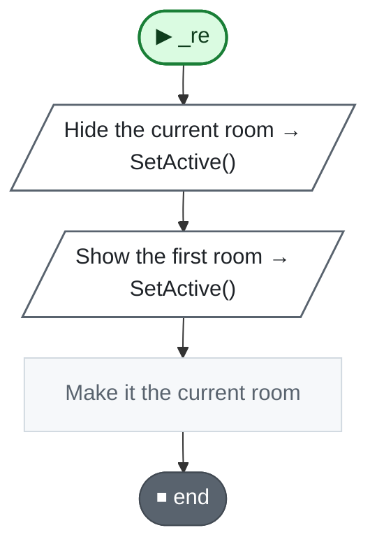
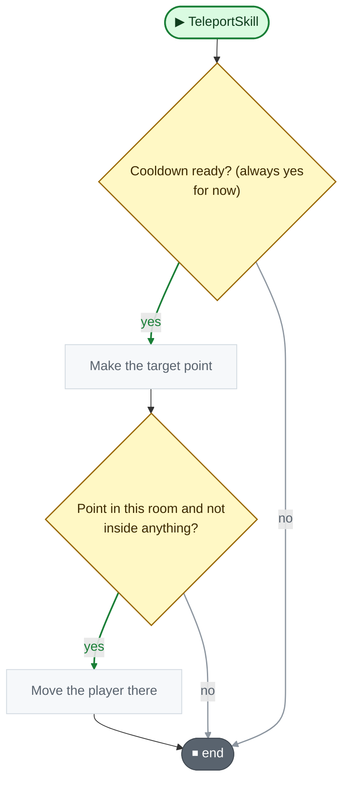

<!-- Generated by CodeGraph (CodeGraph~/tool). Don't edit: run the generator. Notes live in CodeGraph~/notes/. -->
# GameManager.cs

🤖 The game's hub - holds player, UI, map and chat, and spawns summons.

[code](../../GameManager.cs) · [all files](index.md)

key
▶ green: start · gray: simple math · ƒ blue: another function (short ones drawn inside) · yellow ◇: question / 🔁 loop / ⏳ wait · ✚ ✖ engine action · 📦 outside library · ⏹ end · ⚡ Unity calls it · 🔁 in a title: runs every frame

## Map

## ⚡ Awake · when created

🤖 Becomes the only game manager, finds or makes the UI, sets the frame rate.

Code (L34–44)

| Step | Code |
|---|---|
| Another manager already exists? | <code>Instance != null && Instance != this</code> L35 |
| Remove this duplicate manager → Destroy() | <code>Destroy(this)</code> L35 |
| Stop | <code>return</code> L35 |
| Become the manager; find the cameras and UI | <code>Instance = this</code> L36 <code>DontDestroyOnLoad(this)</code> L37 <code>mainCam = Camera.main</code> L38 <code>uiCam = mainCam.transform.Find("UI Cam").GetComponent&lt;Camera&gt;()</code> L39 <code>ui = FindFirstObjectByType&lt;UI&gt;()</code> L40 |
| If no UI in the scene, make one → Instantiate() | <code>if ui == null</code> L41 <code>ui = Instantiate(uiPrefab, new Vector2(0, 0), Quaternion.identity)</code> L41 |
| Turn off vSync; set the frame rate | <code>QualitySettings.vSyncCount = 0</code> L42 <code>Application.targetFrameRate = FPS</code> L43 |

Source: [L34–44](../../GameManager.cs#L34-L44)

## ⚡ Start · before its first frame

🤖 Shows the player's hearts and finds the sound player.

Code (L45–49)

| Step | Code |
|---|---|
| Show the player's max hearts → UI.UpdateMaxHP() → [`UI.UpdateMaxHP`](UI.cs.md#m-ui-updatemaxhp) | <code>ui.UpdateMaxHP(player.maxHP)</code> L46 |
| Show the player's current hearts → UI.UpdateHP() → [`UI.UpdateHP`](UI.cs.md#m-ui-updatehp) | <code>ui.UpdateHP(player.HP)</code> L47 |
| Find the sound player | <code>soundPlayer = FindFirstObjectByType&lt;SoundPlayer&gt;()</code> L48 |

Source: [L45–49](../../GameManager.cs#L45-L49)

## ⚡ Update · every frame

🤖 Each frame, spawns a test enemy or whatever chat summoned.

Code (L50–54)

| Step | Code |
|---|---|
| Test mode, spawn timer up, L not pressed? | <code>testWithoutChat && !Input.GetKeyDown(KeyCode.L) && tmp &lt; Time.time</code> L51 |
| Spawn the test enemy → [`Spawn`](#m-gamemanager-spawn) | <code>Spawn(mockEnemy)</code> L51 |
| Restart the test spawn timer | <code>tmp = Time.time + testWithoutChatSpawnCooldown</code> L51 |
| Take the next chat summon, if the cooldown allows → SimpleSummonDB.GetToSpawn() → [`SimpleSummonDB.GetToSpawn`](Connector/SummonDB.cs.md#m-simplesummondb-gettospawn) | <code>var summon = summondb.GetToSpawn()</code> L52 |
| If chat summoned one (not test mode), spawn it → Spawn() → [`Spawn`](#m-gamemanager-spawn) | <code>if !testWithoutChat && summon != null</code> L53 <code>Spawn(summon)</code> L53 |

Source: [L50–54](../../GameManager.cs#L50-L54)

## 🔁 _Connect

🤖 Joins chat once - unified chat first, Lexone Twitch chat as backup.

Code (L57–62)

| Step | Code |
|---|---|
| Already joined? | <code>_connectOnce</code> L58 |
| Stop | <code>return</code> L58 |
| Mark as joined; remember the channel name | <code>_connectOnce = true</code> L59 <code>chat.channel = Data.cn</code> L60 |
| Not testing, and unified chat not started? → `UnifiedChat.TryConnect` | <code>!testWithoutChat && !UnifiedChat.TryConnect(Data.cn)</code> L61 |
| Join with Lexone Twitch chat instead | <code>chat.Connect()</code> L61 |

Source: [L57–62](../../GameManager.cs#L57-L62)

## 🔁 _re

🤖 Sends the map back to the first room.

Code (L63–67)

| Step | Code |
|---|---|
| Hide the current room → SetActive() | <code>map.currentRoom.gameObject.SetActive(false)</code> L64 |
| Show the first room → SetActive() | <code>initRoom.gameObject.SetActive(true)</code> L65 |
| Make it the current room | <code>map.currentRoom = initRoom</code> L66 |

Source: [L63–67](../../GameManager.cs#L63-L67)

## TeleportSkill

🤖 Chat teleport: moves the player to (x, y) if free and in this room.

Code (L68–73)

| Step | Code |
|---|---|
| Cooldown ready? (always yes for now) | <code>true</code> L69 |
| Make the target point | <code>Vector2 pos = new Vector2(x, y)</code> L70 |
| Point in this room and not inside anything? → [`DungeonMap._findRoom`](Map/DungeonMap.cs.md#m-dungeonmap--findroom) | <code>map._findRoom(pos) == map.currentRoom && Physics2D.OverlapPoint(pos) == null</code> L71 |
| Move the player there | <code>player.transform.position = pos</code> L71 |

Source: [L68–73](../../GameManager.cs#L68-L73)

Small helpers (9)

| | Name | Does | Code |
|---|---|---|---|
|  | testWithoutChat · get |  | <code>Experimental.I.testWithoutChat</code> [L6](../../GameManager.cs#L6) |
|  | testWithoutChatSpawnCooldown · get |  | <code>Experimental.I.testWithoutChatSpawnCooldown</code> [L7](../../GameManager.cs#L7) |
|  | playerPos · get |  | <code>player.transform.position</code> [L15](../../GameManager.cs#L15) |
|  | summondb · get |  | <code>chat.summondb</code> [L22](../../GameManager.cs#L22) |
|  | summonableEnemy · get |  | <code>summondb.summonableEnemy</code> [L23](../../GameManager.cs#L23) |
|  | dungeonMap · get |  | <code>map</code> [L25](../../GameManager.cs#L25) |
|  | currentRoom · get |  | <code>map.currentRoom</code> [L26](../../GameManager.cs#L26) |
|  | UpdateMusic | Lets the sound player pick music for the current room. | <code>soundPlayer.UpdateMusic()</code> [L29](../../GameManager.cs#L29) |
| 🔁 | Spawn | Spawns an enemy near the player in the current room. | <code>currentRoom.Spawn(enemy, playerPos, spawnRangeFromPlayer)</code> [L55](../../GameManager.cs#L55) |

Fields · GameManager (25)

| Name | Type | Default | Note |
|---|---|---|---|
| `testWithoutChat` | `bool` | `=&gt; Experimental.I.testWithoutChat` |  |
| `testWithoutChatSpawnCooldown` | `float` | `=&gt; Experimental.I.testWithoutChatSpawnCooldown` |  |
| `spawnRangeFromPlayer` *(Inspector)* | `float` | `3` |  |
| `FPS` *(Inspector)* | `int` | `60` |  |
| `Instance` | `GameManager` |  |  |
| `player` *(Inspector)* | `Player` |  |  |
| `ui` | `UI` |  |  |
| `mockEnemy` *(Inspector)* | `Enemy` |  |  |
| `controller` *(Inspector)* | `Controller` |  |  |
| `playerPos` | `Vector2` | `=&gt; player.transform.position` |  |
| `uiCam` | `Camera` |  |  |
| `mainCam` | `Camera` |  |  |
| `uiPrefab` *(Inspector)* | `UI` |  |  |
| `healEffect` *(Inspector)* | `GameObject` |  | Heal animation shown for half a second on any Character that heals (healing room, Health Bone) |
| `chat` *(Inspector)* | `TwitchChat` |  |  |
| `summondb` | `SimpleSummonDB` | `=&gt; chat.summondb` |  |
| `summonableEnemy` | `List&lt;Enemy&gt;` | `=&gt; summondb.summonableEnemy` |  |
| `map` *(Inspector)* | `DungeonMap` |  |  |
| `dungeonMap` | `DungeonMap` | `=&gt; map` |  |
| `currentRoom` | `DungeonRoom` | `=&gt; map.currentRoom` |  |
| `availableSkill` *(Inspector)* | `List&lt;ChatType&gt;` |  |  |
| `soundPlayer` | `SoundPlayer` |  |  |
| `initRoom` *(Inspector)* | `DungeonRoom` |  |  |
| `tmp` | `float` |  |  |
| `_connectOnce` | `bool` | `false` |  |

