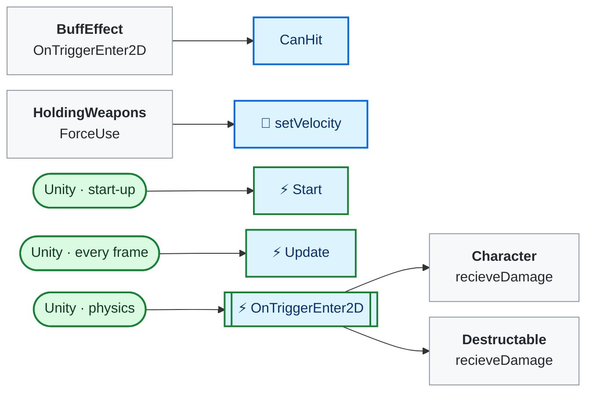
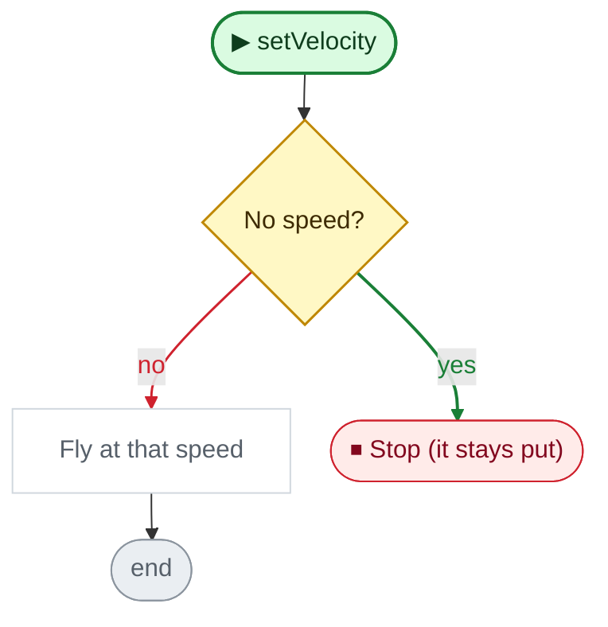
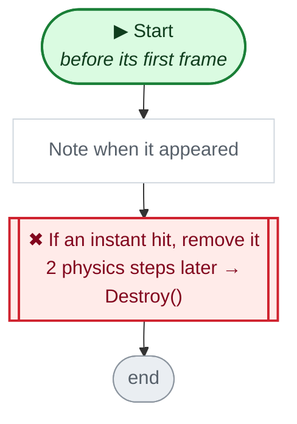

<!-- Generated by CodeGraph (CodeGraph~/tool). Don't edit: run the generator. Notes live in CodeGraph~/notes/. -->
# HitBox.cs

🤖 An attack's damage area - hurts what it touches, then disappears.

⚡ Unity calls it · 🔁 runs every frame · ⏳ can wait · blue box = calls another function · gray box = simple math · [code](../../HitBox.cs) · [all files](index.md)

## Map

## 🔁 setVelocity

🤖 Makes it fly at a speed (0 means it stays put).

Code (L18–22)

| Step | Code |
|---|---|
| No speed? | <code>v.magnitude == 0</code> L19 |
| Stop (it stays put) | <code>return</code> L19 |
| Fly at that speed | <code>if(!rb)rb = GetComponent&lt;Rigidbody2D&gt;()</code> L20 <code>rb.velocity = v</code> L21 |

Source: [L18–22](../../HitBox.cs#L18-L22)

## ⚡ Start · before its first frame

🤖 Notes when it appeared; instant hits remove themselves quickly.

Code (L23–26)

| Step | Code |
|---|---|
| Note when it appeared | <code>startTime = Time.time</code> L24 |
| If an instant hit, remove it 2 physics steps later → Destroy() | <code>if weapon.destroyTimer == 0 && weapon.velocity == 0</code> L25 <code>Destroy(gameObject, Time.fixedDeltaTime * 2)</code> L25 |

Source: [L23–26](../../HitBox.cs#L23-L26)

## ⚡ OnTriggerEnter2D · something enters its trigger

🤖 On touch, hurts and pushes each foe once, or breaks a prop.

```mermaid
---
config:
  flowchart:
    wrappingWidth: 260
    nodeSpacing: 26
    rankSpacing: 30
---
flowchart TD
  nS(["▶ OnTriggerEnter2D<br><i>something enters its trigger</i>"])
  n0d68c1{"Touched a character it may<br>hit?"}
  ne2ac55{"Already hit this one?"}
  n87f62c["Play the hit sound"]
  nb94866[["Hurt it →<br>Character.recieveDamage()<br><i>runs the Enemy / Player version</i>"]]
  na8b982["Push it away from the attacker"]
  n4b577e[["✖ If out of hits, remove the<br>hitbox → Destroy()"]]
  n7d1471{"Non-magic hit on a breakable<br>prop?"}
  nefeac6_h["↪ Damage the prop ·<br>Destructable.recieveDamage"]
  nefeac6_n129e7b{"Magic hit?"}
  nefeac6_n9ada94["Lose one hit; show the next<br>sprite"]
  nefeac6_n300dd8[["Out of hits? Break →<br>Destructable.Died()<br><i>Breaks - frees its spot for</i><br><i>pathfinding, maybe vanishes, drops …</i>"]]
  nbee12d[["✖ Remove the hitbox →<br>Destroy()"]]
  nc17712[["✖ No timer? Remove it on first<br>touch → Destroy()"]]
  nE(["end"])
  nb2e4fc(["⏹ Skip"])
  subgraph nefeac6_g[" "]
    nefeac6_h
    nefeac6_n129e7b
    nefeac6_n9ada94
    nefeac6_n300dd8
  end
  style nefeac6_g fill:#f5f9ff,stroke:#8cb4e8,stroke-dasharray:4 3,color:#0a3069
  nS --> n0d68c1
  n0d68c1 -->|yes| ne2ac55
  ne2ac55 -->|no| n87f62c
  ne2ac55 -->|yes| nb2e4fc
  n87f62c --> nb94866
  nb94866 --> na8b982
  na8b982 --> n4b577e
  n4b577e ~~~ n7d1471
  n0d68c1 -->|no| n7d1471
  n7d1471 -->|yes| nefeac6_h
  n4b577e --> nc17712
  nbee12d --> nc17712
  n7d1471 -->|no| nc17712
  nc17712 --> nE
  nefeac6_h --> nefeac6_n129e7b
  nefeac6_n129e7b -->|no| nefeac6_n9ada94
  nefeac6_n129e7b -->|yes| nbee12d
  nefeac6_n9ada94 --> nefeac6_n300dd8
  nefeac6_n300dd8 --> nbee12d
  linkStyle 1 stroke:#1a7f37,stroke-width:2px,color:#1a7f37
  linkStyle 2 stroke:#cf222e,stroke-width:1.5px,color:#cf222e
  linkStyle 3 stroke:#1a7f37,stroke-width:2px,color:#1a7f37
  linkStyle 8 stroke:#cf222e,stroke-width:1.5px,color:#cf222e
  linkStyle 9 stroke:#1a7f37,stroke-width:2px,color:#1a7f37
  linkStyle 12 stroke:#cf222e,stroke-width:1.5px,color:#cf222e
  linkStyle 15 stroke:#cf222e,stroke-width:1.5px,color:#cf222e
  linkStyle 16 stroke:#1a7f37,stroke-width:2px,color:#1a7f37
  classDef unity fill:#dafbe1,stroke:#1a7f37,stroke-width:2px,color:#0f3d1d
  classDef start fill:#dafbe1,stroke:#1a7f37,stroke-width:2px,color:#0f3d1d
  classDef calc fill:#ffffff,stroke:#d0d7de,color:#57606a
  classDef calls fill:#ddf4ff,stroke:#0969da,stroke-width:2px,color:#0a3069
  classDef ext fill:#ddf4ff,stroke:#0969da,stroke-width:2px,stroke-dasharray:5 3,color:#0a3069
  classDef cond fill:#fff8c5,stroke:#bf8700,stroke-width:1.5px,color:#3d2a00
  classDef loop fill:#f6f8fa,stroke:#57606a,color:#1f2328
  classDef exit fill:#ffebe9,stroke:#cf222e,color:#82071e
  classDef kill fill:#ffebe9,stroke:#cf222e,stroke-width:2px,color:#82071e
  classDef spawn fill:#dafbe1,stroke:#1a7f37,stroke-width:2px,color:#0f3d1d
  classDef wait fill:#fff1e5,stroke:#bc4c00,color:#4d1d00
  classDef fin fill:#eaeef2,stroke:#8c959f,color:#57606a
  classDef join fill:#d0d7de,stroke:#8c959f,color:#57606a
  classDef ghdr fill:#f5f9ff,stroke:#f5f9ff,color:#0a3069,font-weight:bold
  class n87f62c,na8b982,nefeac6_n9ada94 calc
  class nb94866,nefeac6_n300dd8 calls
  class n0d68c1,ne2ac55,n7d1471,nefeac6_n129e7b cond
  class nb2e4fc exit
  class nE fin
  class nefeac6_h ghdr
  class n4b577e,nbee12d,nc17712 kill
  class nS unity
```

Code (L29–41)

| Step | Code |
|---|---|
| Touched a character it may hit? | <code>other.TryGetComponent(out Character enemy) && CanHit(enemy)</code> L30 |
| Already hit this one? | <code>!hitEnemy.Add(enemy)</code> L31 |
| Skip | <code>return</code> L31 |
| Play the hit sound | <code>SoundPlayer.PlaySound(weapon.hitSound)</code> L32 |
| Hurt it → Character.recieveDamage() → [`Character.recieveDamage`](Character.cs.md#m-character-recievedamage) | <code>enemy.recieveDamage(damage, weapon.isMagical)</code> L33 |
| Push it away from the attacker | <code>enemy.receiveKnockback(playerPos, weapon.knocback)</code> L34 |
| If out of hits, remove the hitbox → Destroy() | <code>if weapon.maxHits &gt; 0 && weapon.maxHits &lt;= ++hitCount</code> L35 <code>Destroy(gameObject)</code> L35 |
| Non-magic hit on a breakable prop? | <code>!weapon.isMagical && other.TryGetComponent(out Destructable des)</code> L36 |
| Damage the prop → Destructable.recieveDamage() → [`Destructable.recieveDamage`](DestructableObj.cs.md#m-destructable-recievedamage) | <code>des.recieveDamage(damage, weapon.isMagical)</code> L37 |
| Remove the hitbox → Destroy() | <code>Destroy(gameObject)</code> L38 |
| No timer? Remove it on first touch → Destroy() | <code>if weapon.destroyTimer == 0</code> L40 <code>Destroy(gameObject)</code> L40 |

Source: [L29–41](../../HitBox.cs#L29-L41)

Small helpers (2)

| | Name | Does | Code |
|---|---|---|---|
|  | CanHit | True if it may hurt that character (the owner's foes, or anyone if no owner). | <code>owner == null ? c != null : owner.IsEnemyOf(c)</code> [L17](../../HitBox.cs#L17) |
| ⚡ | Update | Removes itself when its timer runs out. | <code>if weapon.destroyTimer != 0 && Time.time - startTime &gt; weapon.destroyTimer</code> <code>Destroy(gameObject)</code> [L27](../../HitBox.cs#L27) |

Fields · HitBox (8)

| Name | Type | Default | Note |
|---|---|---|---|
| `weapon` | `Weapon` |  |  |
| `damage` | `int` |  |  |
| `owner` | `Character` |  | who used it: hurts only other teams. null = hurts everyone |
| `playerPos` | `Vector2` |  | the user's position: knockback pushes away from it |
| `startTime` | `float` |  |  |
| `hitEnemy` *(Inspector)* | `HashSet&lt;Character&gt;` | `new()` |  |
| `rb` | `Rigidbody2D` |  |  |
| `hitCount` | `int` |  |  |

