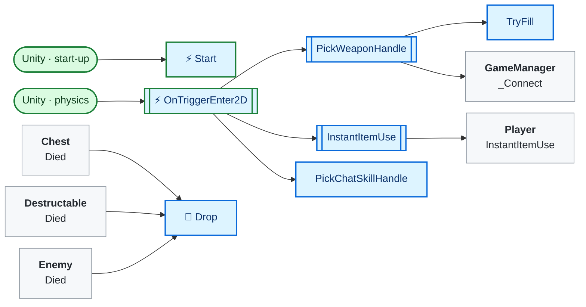
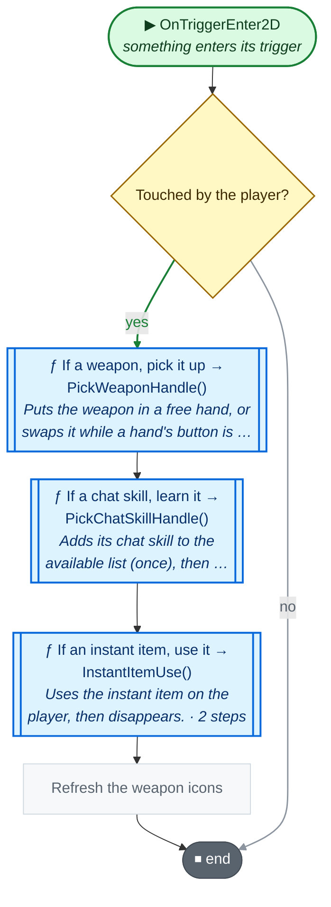
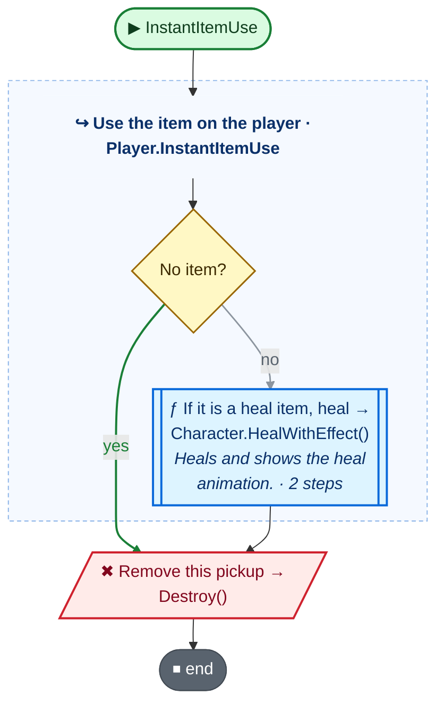
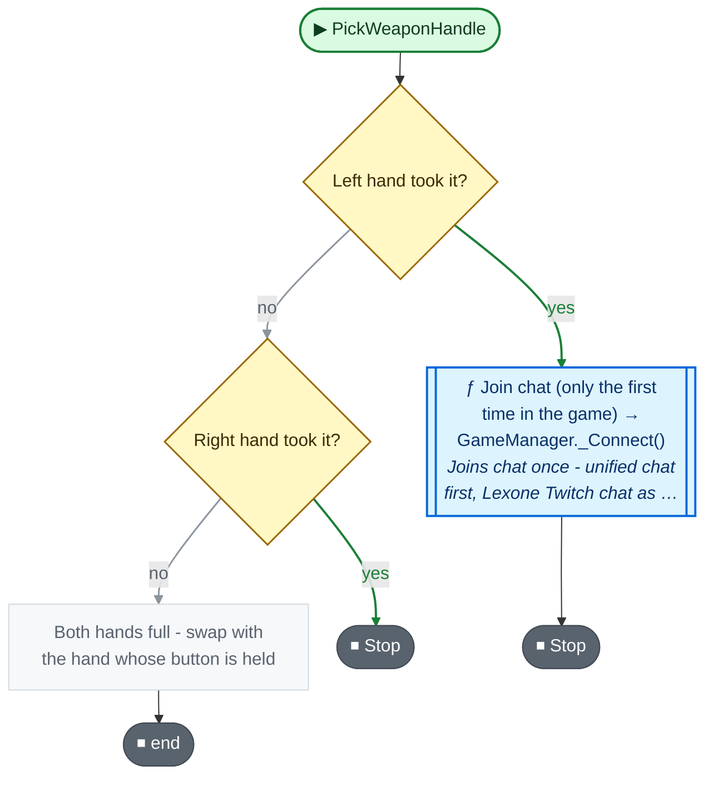
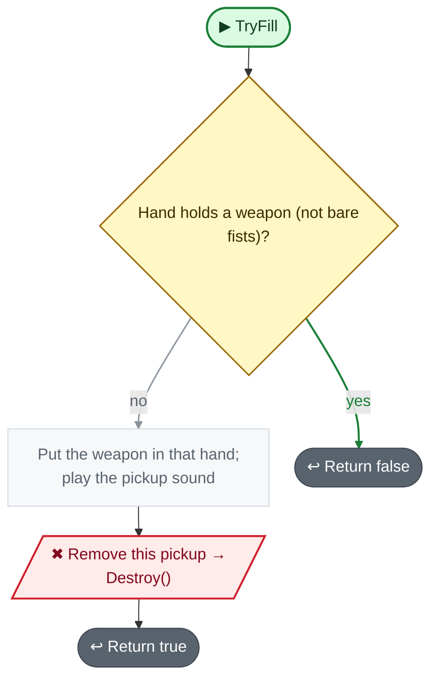
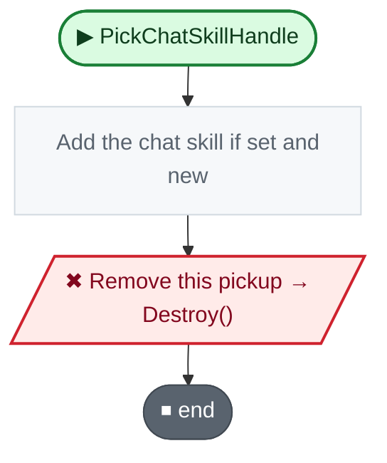
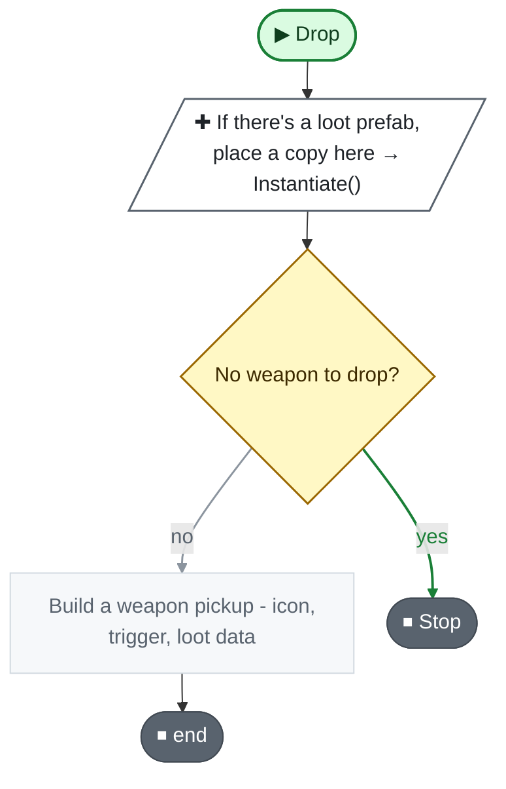

<!-- Generated by CodeGraph (CodeGraph~/tool). Don't edit: run the generator. Notes live in CodeGraph~/notes/. -->
# Loot.cs

🤖 Kind of pickup - weapon, chat skill, instant item, or none. *(LootType)*

🤖 A pickup on the floor that gives the player a weapon, skill or item. *(Loot)*

[code](../../Loot.cs) · [all files](index.md)

key
▶ green: start · gray: simple math · ƒ blue: another function (short ones drawn inside) · yellow ◇: question / 🔁 loop / ⏳ wait · ✚ ✖ engine action · 📦 outside library · ⏹ end · ⚡ Unity calls it · 🔁 in a title: runs every frame

## Map

## ⚡ OnTriggerEnter2D · something enters its trigger

🤖 When the player steps on it, gives what it holds.

Code (L29–37)

| Step | Code |
|---|---|
| Touched by the player? | <code>other.TryGetComponent(out Player player)</code> L31 |
| If a weapon, pick it up → PickWeaponHandle() → [`PickWeaponHandle`](#m-loot-pickweaponhandle) | <code>if lootType == LootType.weapon</code> L32 <code>PickWeaponHandle(player)</code> L32 |
| If a chat skill, learn it → PickChatSkillHandle() → [`PickChatSkillHandle`](#m-loot-pickchatskillhandle) | <code>if lootType == LootType.chatSkill</code> L33 <code>PickChatSkillHandle(player)</code> L33 |
| If an instant item, use it → InstantItemUse() → [`InstantItemUse`](#m-loot-instantitemuse) | <code>if lootType == LootType.instantItem</code> L34 <code>InstantItemUse(player)</code> L34 |
| Refresh the weapon icons | <code>GameManager.Instance.ui.UpdateWeap()</code> L35 |

Source: [L29–37](../../Loot.cs#L29-L37)

## InstantItemUse

🤖 Uses the instant item on the player, then disappears.

Code (L38–42)

| Step | Code |
|---|---|
| Use the item on the player → Player.InstantItemUse() → [`Player.InstantItemUse`](Player.cs.md#m-player-instantitemuse) | <code>player.InstantItemUse(instantItem)</code> L40 |
| Remove this pickup → Destroy() | <code>Destroy(gameObject)</code> L41 |

Source: [L38–42](../../Loot.cs#L38-L42)

## PickWeaponHandle

🤖 Puts the weapon in a free hand, or swaps it while a hand's button is held.

Code (L43–49)

| Step | Code |
|---|---|
| Left hand took it? → [`TryFill`](#m-loot-tryfill) | <code>TryFill(player.lWeapon)</code> L44 |
| Join chat (only the first time in the game) → GameManager._Connect() → [`GameManager._Connect`](GameManager.cs.md#m-gamemanager--connect) | <code>GameManager.Instance._Connect()</code> L44 |
| Stop | <code>return</code> L44 |
| Right hand took it? → [`TryFill`](#m-loot-tryfill) | <code>TryFill(player.rWeapon)</code> L45 |
| Stop | <code>return</code> L45 |
| Both hands full - swap with the hand whose button is held | <code>var c = GameManager.Instance.controller</code> L46 <code>if(c.attackLeft.isPressed)Swap(player.lWeapon); else if(c.attackRight.isPressed)Swap(player.rWeapon)</code> L47 |

Source: [L43–49](../../Loot.cs#L43-L49)

## TryFill

🤖 Puts the weapon in an empty or bare-fists hand and removes the pickup.

Code (L50–56)

| Step | Code |
|---|---|
| Hand holds a weapon (not bare fists)? | <code>hand.weapon != null && hand.weapon.type != WeaponType.CQC</code> L51 |
| Return false | <code>return false</code> L51 |
| Put the weapon in that hand; play the pickup sound | <code>hand.weapon = weaponLoot</code> L52 <code>SoundPlayer.PlaySound(SoundPlayer.instance.sd_pickup_wep)</code> L53 |
| Remove this pickup → Destroy() | <code>Destroy(gameObject)</code> L54 |
| Return true | <code>return true</code> L55 |

Source: [L50–56](../../Loot.cs#L50-L56)

## PickChatSkillHandle

🤖 Adds its chat skill to the available list (once), then disappears.

Code (L58–61)

| Step | Code |
|---|---|
| Add the chat skill if set and new | <code>if(skill != ChatType.invalid && !GameManager.Instance.availableSkill.Contains(skill))GameManager.Instance.availableSkill.Add(skill)</code> L59 |
| Remove this pickup → Destroy() | <code>Destroy(gameObject)</code> L60 |

Source: [L58–61](../../Loot.cs#L58-L61)

## 🔁 Drop

🤖 Drops a loot prefab and/or a weapon pickup where an object was.

Code (L64–78)

| Step | Code |
|---|---|
| If there's a loot prefab, place a copy here → Instantiate() | <code>if prefab != null</code> L65 <code>Instantiate(prefab, from.position, Quaternion.identity).transform.parent = from.parent</code> L65 |
| No weapon to drop? | <code>weapon == null</code> L66 |
| Stop | <code>return</code> L66 |
| Build a weapon pickup - icon, trigger, loot data | <code>var go = new GameObject(weapon.name + " loot")</code> L67 <code>go.transform.position = from.position</code> L68 <code>go.transform.parent = from.parent</code> L69 <code>var sr = go.AddComponent&lt;SpriteRenderer&gt;()</code> L70 <code>sr.sprite = weapon.uiWep</code> L71 <code>var fromSr = from.GetComponentInChildren&lt;SpriteRenderer&gt;()</code> L72 <code>if(fromSr != null){sr.sortingLayerID = fromSr.sortingLayerID; sr.sortingOrder = fromSr.sortingOrder + 1;}</code> L73 <code>go.AddComponent&lt;BoxCollider2D&gt;().isTrigger = true</code> L74 <code>var loot = go.AddComponent&lt;Loot&gt;()</code> L75 <code>loot.lootType = LootType.weapon</code> L76 <code>loot.weaponLoot = weapon</code> L77 |

Source: [L64–78](../../Loot.cs#L64-L78)

Small helpers (4)

| | Name | Does | Code |
|---|---|---|---|
| ⚡ | Start | Makes sure it has a sprite and a trigger, then shows its icon. | <code>Yoink()</code> <code>sr = GetComponentInChildren&lt;SpriteRenderer&gt;()</code> <code>if(sr == null)sr = gameObject.AddComponent&lt;SpriteRenderer&gt;()</code> <code>UpdateImage()</code> <code>if(GetComponent&lt;Collider2D&gt;() == null)gameObject.AddComponent&lt;BoxCollider2D&gt;().isTrigger = true</code> [L19–25](../../Loot.cs#L19-L25) |
|  | Yoink | Does nothing yet (meant to pop the loot away from where it dropped). | *(empty)* [L26](../../Loot.cs#L26) |
|  | UpdateImage | Shows the weapon's icon, if this loot is a weapon. | <code>if(lootType == LootType.weapon)sr.sprite = weaponLoot.uiWep</code> [L27](../../Loot.cs#L27) |
|  | Swap | Trades this weapon with the one in that hand, and updates its icon. | <code>(hand.weapon, weaponLoot) = (weaponLoot, hand.weapon)</code> <code>UpdateImage()</code> <code>Yoink()</code> [L57](../../Loot.cs#L57) |

Values · LootType (4)

| Name | Type | Default | Note |
|---|---|---|---|
| `weapon` | `` |  |  |
| `chatSkill` | `` |  |  |
| `instantItem` | `` |  |  |
| `None` | `` |  |  |

Fields · Loot (7)

| Name | Type | Default | Note |
|---|---|---|---|
| `lootType` *(Inspector)* | `LootType` | `LootType.None` |  |
| `skill` *(Inspector)* | `ChatType` | `ChatType.invalid` |  |
| `weaponLoot` *(Inspector)* | `Weapon` |  |  |
| `instantItem` *(Inspector)* | `InstantItem` |  |  |
| `anim` *(Inspector)* | `Animator` |  |  |
| `fallClip` *(Inspector)* | `AnimationClip` |  | Fall down animation when it falls in a hole (a state with this clip's name in its Animator). Empty: it shrinks away |
| `sr` | `SpriteRenderer` |  |  |

