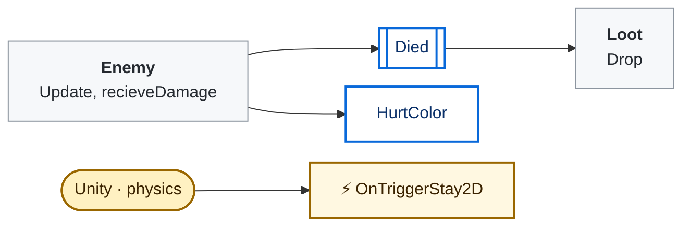
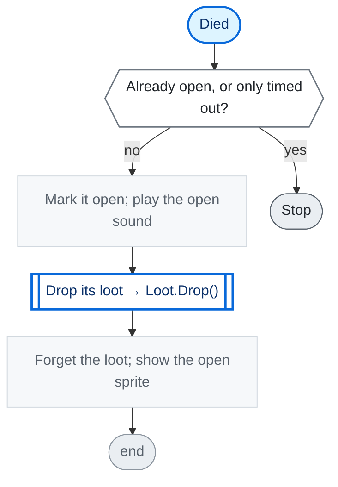

<!-- Generated by CodeGraph (CodeGraph~/tool). Don't edit: run the generator. Notes live in CodeGraph~/notes/. -->
# Map/Chest.cs

🤖 An enemy that is a chest; any hit opens it and drops its loot.

⚡ Unity calls it · 🔁 runs every frame · ⏳ can wait · blue box = calls another function · gray box = simple math · [code](../../../Map/Chest.cs) · [all files](../index.md)

## Map

## Died

🤖 Opens it on the first hit; a chest is never removed.

Code (L12–19)

| Step | Code |
|---|---|
| Already open, or only timed out? | <code>opened \|\| !isDead</code> L13 |
| Stop | <code>return</code> L13 |
| Mark it open; play the open sound | <code>opened = true</code> L14 <code>if(sd_open_chest != null)SoundPlayer.PlaySound(sd_open_chest)</code> L15 |
| Drop its loot → Loot.Drop() → [`Loot.Drop`](../Loot.cs.md#m-loot-drop) | <code>Loot.Drop(loot, weaponLoot, transform)</code> L16 |
| Forget the loot; show the open sprite | <code>loot = null</code> L17 <code>weaponLoot = null</code> L17 <code>myRender.sprite = openSprite</code> L18 |

Source: [L12–19](../../../Map/Chest.cs#L12-L19)

Small helpers (4)

| | Name | Does | Code |
|---|---|---|---|
|  | recieveDamage | Any hit empties its HP, so it opens. | <code>HP = 0</code> [L20](../../../Map/Chest.cs#L20) |
|  | HurtColor | No red flash for a chest. | *(empty)* [L21](../../../Map/Chest.cs#L21) |
|  | facesPlayer · get |  | <code>false</code> [L22](../../../Map/Chest.cs#L22) |
| ⚡ | OnTriggerStay2D | No touch damage. | *(empty)* [L23](../../../Map/Chest.cs#L23) |

Fields · Chest (6)

| Name | Type | Default | Note |
|---|---|---|---|
| `openSprite` *(Inspector)* | `Sprite` |  |  |
| `closedSprite` *(Inspector)* | `Sprite` |  |  |
| `myRender` *(Inspector)* | `SpriteRenderer` |  |  |
| `sd_open_chest` *(Inspector)* | `AudioClip` |  |  |
| `opened` | `bool` |  |  |
| `facesPlayer` | `bool` | `=&gt; false` |  |

