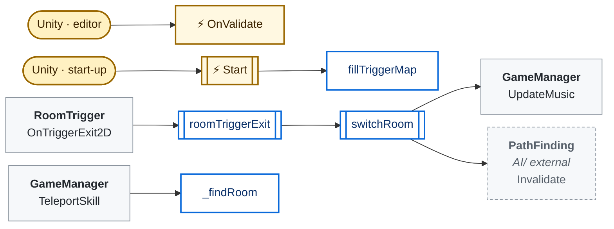
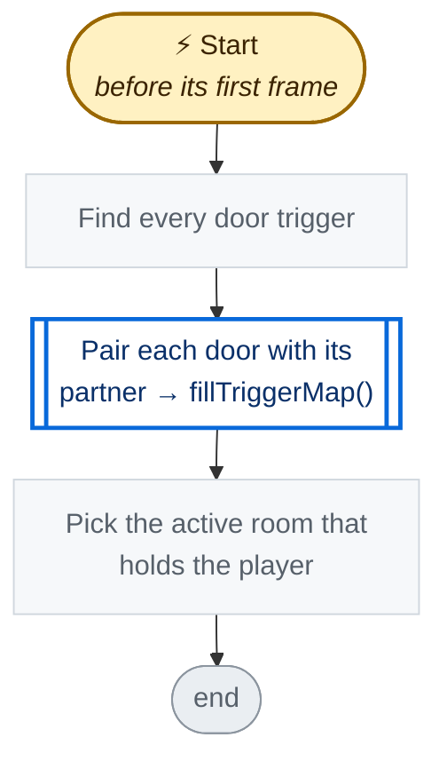
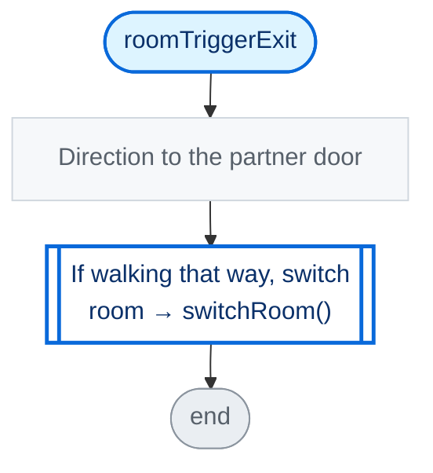
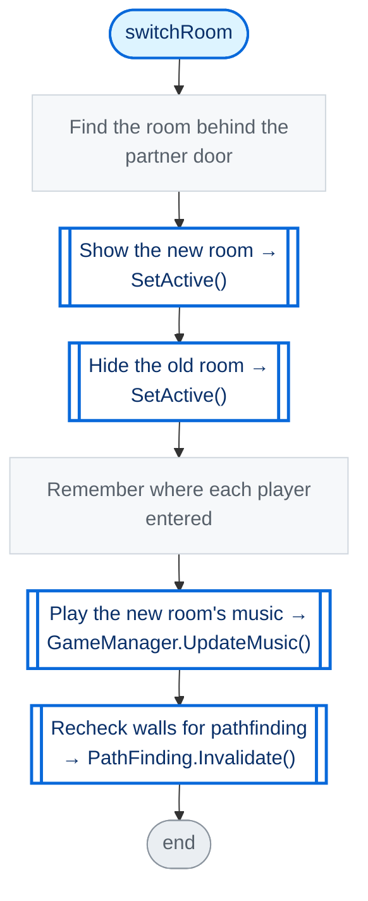
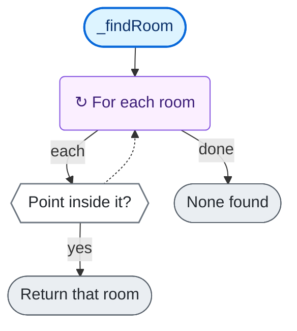

<!-- Generated by CodeGraph (CodeGraph~/tool). Don't edit: run the generator. Notes live in CodeGraph~/notes/. -->
# Map/DungeonMap.cs

🤖 All rooms and doors of the dungeon; only the current room is active.

⚡ Unity calls it · 🔁 runs every frame · ⏳ can wait · blue box = calls another function · gray box = simple math · [code](../../../Map/DungeonMap.cs) · [all files](../index.md)

## Map

## ⚡ Start · before its first frame

🤖 Pairs up the doors and finds the room the player starts in.

Code (L15–19)

| Step | Code |
|---|---|
| Find every door trigger | <code>roomTrigger = FindObjectsByType&lt;RoomTrigger&gt;(FindObjectsInactive.Include, FindObjectsSortMode.None)</code> L16 |
| Pair each door with its partner → fillTriggerMap() → [`fillTriggerMap`](#m-dungeonmap-filltriggermap) | <code>fillTriggerMap()</code> L17 |
| Pick the active room that holds the player | <code>foreach(var r in allRooms)if(r.bounds.Contains(GameManager.Instance.playerPos) && r.gameObject.activeInHierarchy)currentRoom = r</code> L18 |

Source: [L15–19](../../../Map/DungeonMap.cs#L15-L19)

## roomTriggerExit

🤖 Switches room when the player leaves a door toward its partner.

Code (L31–34)

| Step | Code |
|---|---|
| Direction to the partner door | <code>Vector2 toPartner = triggerMap[trigger].transform.position - trigger.transform.position</code> L32 |
| If walking that way, switch room → switchRoom() → [`switchRoom`](#m-dungeonmap-switchroom) | <code>if Vector2.Dot(toPartner, GameManager.Instance.player.rb.velocity) &gt; 0</code> L33 <code>switchRoom(trigger)</code> L33 |

Source: [L31–34](../../../Map/DungeonMap.cs#L31-L34)

## switchRoom

🤖 Moves to the room behind a door - shows it, hides the old one.

Code (L35–42)

| Step | Code |
|---|---|
| Find the room behind the partner door | <code>currentRoom = triggerMap[trigger].transform.parent.GetComponent&lt;DungeonRoom&gt;()</code> L36 |
| Show the new room → SetActive() | <code>currentRoom.gameObject.SetActive(true)</code> L37 |
| Hide the old room → SetActive() | <code>trigger.transform.parent.gameObject.SetActive(false)</code> L38 |
| Remember where each player entered | <code>foreach(var p in FindObjectsByType&lt;Player&gt;(FindObjectsSortMode.None))p.roomEntryPos = p.transform.position</code> L39 |
| Play the new room's music → GameManager.UpdateMusic() → [`GameManager.UpdateMusic`](../GameManager.cs.md#m-gamemanager-updatemusic) | <code>GameManager.Instance.UpdateMusic()</code> L40 |
| Recheck walls for pathfinding → PathFinding.Invalidate() → `PathFinding.Invalidate` | <code>PathFinding.Invalidate()</code> L41 |

Source: [L35–42](../../../Map/DungeonMap.cs#L35-L42)

## _findRoom

🤖 Finds the room that contains a point (the code says it is buggy).

Code (L43–46)

| Step | Code |
|---|---|
| For each room | <code>for each r in allRooms</code> L44 |
| Point inside it? | <code>r.bounds.Contains(pos)</code> L44 |
| Return that room | <code>return r</code> L44 |
| None found | <code>return null</code> L45 |

Source: [L43–46](../../../Map/DungeonMap.cs#L43-L46)

Small helpers (2)

| | Name | Does | Code |
|---|---|---|---|
| ⚡ | OnValidate | Editor only - collects every room in the scene. | <code>allRooms = FindObjectsByType&lt;DungeonRoom&gt;(FindObjectsInactive.Include, FindObjectsSortMode.None)</code> [L13](../../../Map/DungeonMap.cs#L13) |
|  | fillTriggerMap | Pairs each door trigger with the nearest one in another room. | <code>foreach(var a in roomTrigger){ float m = float.MaxValue; RoomTrigger mr = null; foreach(var b in roomTrigger){ float d = (a.transform.position - b.transform.position).magnitude; if(a.transform.parent != b.transform.parent && d &lt; m){m = d; mr = b;} } triggerMap[a] = mr; }</code> [L20–30](../../../Map/DungeonMap.cs#L20-L30) |

Fields · DungeonMap (6)

| Name | Type | Default | Note |
|---|---|---|---|
| `currentRoom` *(Inspector)* | `DungeonRoom` |  |  |
| `allRooms` | `DungeonRoom[]` |  |  |
| `width` *(Inspector)* | `int` |  | pixel of each cell |
| `height` *(Inspector)* | `int` |  | pixel of each cell |
| `roomTrigger` | `RoomTrigger[]` |  |  |
| `triggerMap` *(Inspector)* | `Dictionary&lt;RoomTrigger, RoomTrigger&gt;` | `new()` |  |

