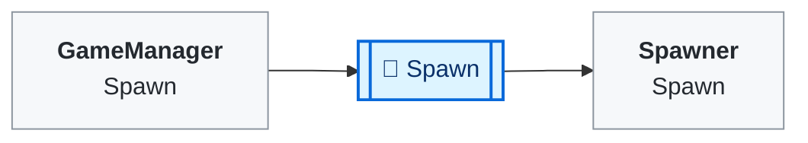
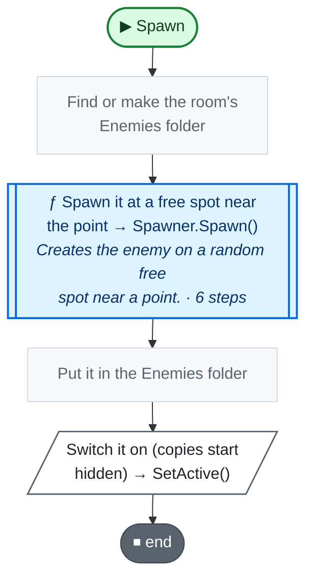

<!-- Generated by CodeGraph (CodeGraph~/tool). Don't edit: run the generator. Notes live in CodeGraph~/notes/. -->
# Map/DungeonRoom.cs

🤖 Kinds of room; each kind picks its music. *(RoomType)*

🤖 One room of the dungeon; summoned enemies spawn inside it. *(DungeonRoom)*

[code](../../../Map/DungeonRoom.cs) · [all files](../index.md)

key
▶ green: start · gray: simple math · ƒ blue: another function (short ones drawn inside) · yellow ◇: question / 🔁 loop / ⏳ wait · ✚ ✖ engine action · 📦 outside library · ⏹ end · ⚡ Unity calls it · 🔁 in a title: runs every frame

## Map

## 🔁 Spawn

🤖 Spawns an enemy near a point and keeps it under this room.

Code (L11–17)

| Step | Code |
|---|---|
| Find or make the room's Enemies folder | <code>var enemies = transform.Find("Enemies")</code> L12 <code>if(!enemies){enemies = new GameObject("Enemies").transform; enemies.SetParent(transform);}</code> L13 |
| Spawn it at a free spot near the point → Spawner.Spawn() → [`Spawner.Spawn`](../Spawner.cs.md#m-spawner-spawn-enemy-vector2-float) | <code>var e = spawner.Spawn(enemy, oriPos, range)</code> L14 |
| Put it in the Enemies folder | <code>e.transform.parent = enemies</code> L15 |
| Switch it on (copies start hidden) → SetActive() | <code>e.gameObject.SetActive(true)</code> L16 |

Source: [L11–17](../../../Map/DungeonRoom.cs#L11-L17)

Small helpers (1)

| | Name | Does | Code |
|---|---|---|---|
|  | bounds · get |  | <code>spawner.bounds</code> [L9](../../../Map/DungeonRoom.cs#L9) |

Values · RoomType (4)

| Name | Type | Default | Note |
|---|---|---|---|
| `rest` | `` |  |  |
| `enemies` | `` |  |  |
| `traps` | `` |  |  |
| `boss` | `` |  |  |

Fields · DungeonRoom (3)

| Name | Type | Default | Note |
|---|---|---|---|
| `spawner` *(Inspector)* | `Spawner` |  |  |
| `roomType` *(Inspector)* | `RoomType` | `RoomType.enemies` | picks the music |
| `bounds` | `Bounds` | `=&gt; spawner.bounds` |  |

