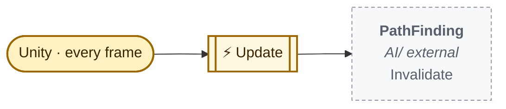
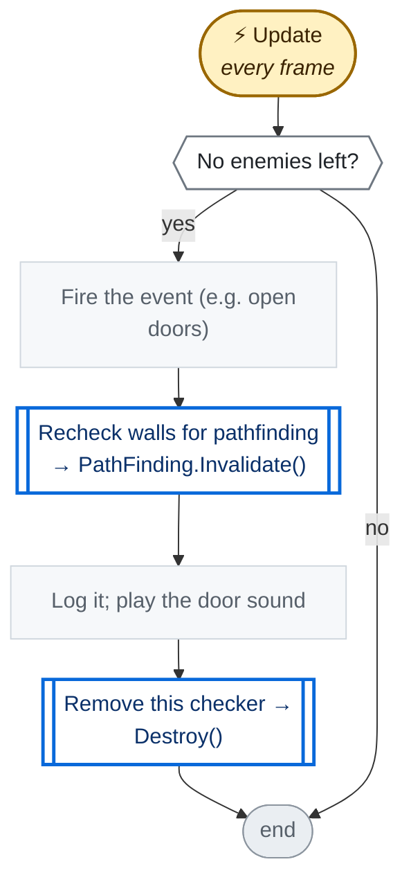
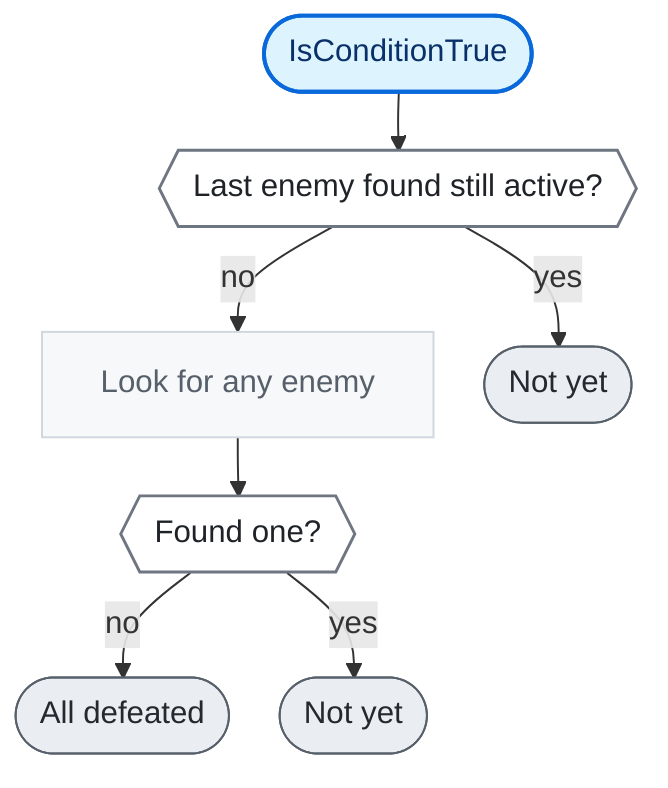

<!-- Generated by CodeGraph (CodeGraph~/tool). Don't edit: run the generator. Notes live in CodeGraph~/notes/. -->
# Map/EventAllEnemiesDefeated.cs

🤖 Fires an event once no enemy is left (e.g. to open doors).

⚡ Unity calls it · 🔁 runs every frame · ⏳ can wait · blue box = calls another function · gray box = simple math · [code](../../../Map/EventAllEnemiesDefeated.cs) · [all files](../index.md)

## Map

## ⚡ Update · every frame

🤖 Each frame: when no enemy is left, fire once and remove itself.

Code (L10–20)

| Step | Code |
|---|---|
| No enemies left? | <code>IsConditionTrue()</code> L12 |
| Fire the event (e.g. open doors) | <code>onAllEnemiesDefeated?.Invoke()</code> L14 |
| Recheck walls for pathfinding → PathFinding.Invalidate() → `PathFinding.Invalidate` | <code>PathFinding.Invalidate()</code> L15 |
| Log it; play the door sound | <code>print("ALL ENEMIES DEFEATED!")</code> L16 <code>SoundPlayer.PlaySound(SoundPlayer.instance.sd_door_open)</code> L17 |
| Remove this checker → Destroy() | <code>Destroy(gameObject)</code> L18 |

Source: [L10–20](../../../Map/EventAllEnemiesDefeated.cs#L10-L20)

## 🔁 IsConditionTrue

🤖 True when no active enemy exists; it rescans only once the last one is gone.

Code (L22–28)

| Step | Code |
|---|---|
| Last enemy found still active? | <code>alive != null && alive.isActiveAndEnabled</code> L24 |
| Not yet | <code>return false</code> L24 |
| Look for any enemy | <code>alive = FindAnyObjectByType&lt;Enemy&gt;()</code> L25 |
| Found one? | <code>alive != null</code> L26 |
| Not yet | <code>return false</code> L26 |
| All defeated | <code>return true</code> L27 |

Source: [L22–28](../../../Map/EventAllEnemiesDefeated.cs#L22-L28)

Fields · EventAllEnemiesDefeated (2)

| Name | Type | Default | Note |
|---|---|---|---|
| `onAllEnemiesDefeated` *(Inspector)* | `UnityEvent` |  |  |
| `alive` | `Enemy` |  | checked first, so the scene is searched again only when it is gone |

