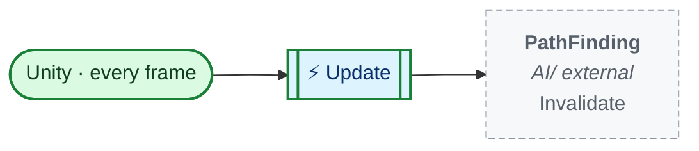
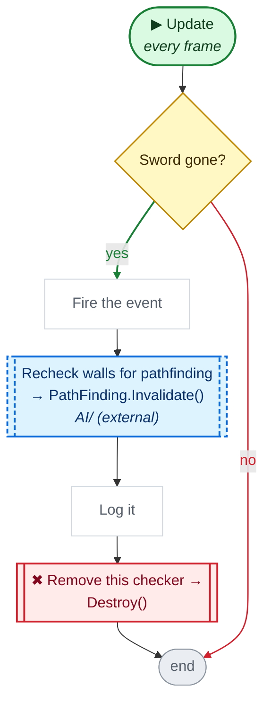
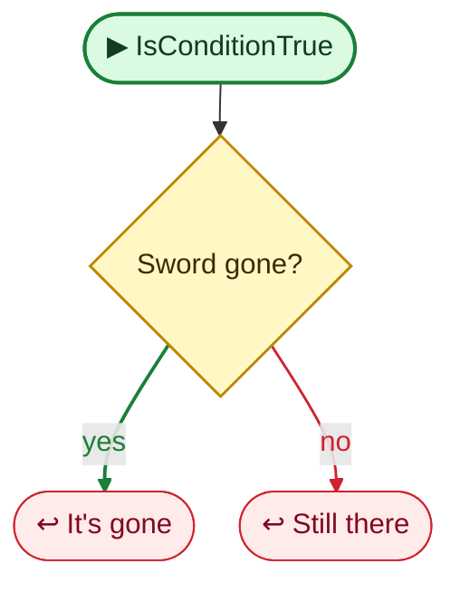

<!-- Generated by CodeGraph (CodeGraph~/tool). Don't edit: run the generator. Notes live in CodeGraph~/notes/. -->
# Map/EventCertainObjectDestroyed.cs

🤖 Fires an event once the sword pickup is gone (collected).

⚡ Unity calls it · 🔁 runs every frame · ⏳ can wait · blue box = calls another function · gray box = simple math · [code](../../../Map/EventCertainObjectDestroyed.cs) · [all files](../index.md)

## Map

## ⚡ Update · every frame

🤖 Each frame: once the sword is gone, fire once and remove itself.

Code (L11–20)

| Step | Code |
|---|---|
| Sword gone? | <code>IsConditionTrue()</code> L13 |
| Fire the event | <code>onCollectedSword?.Invoke()</code> L15 |
| Recheck walls for pathfinding → PathFinding.Invalidate() → `PathFinding.Invalidate` | <code>PathFinding.Invalidate()</code> L16 |
| Log it | <code>print("SWORD COLLECTED")</code> L17 |
| Remove this checker → Destroy() | <code>Destroy(gameObject)</code> L18 |

Source: [L11–20](../../../Map/EventCertainObjectDestroyed.cs#L11-L20)

## 🔁 IsConditionTrue

🤖 True when the sword object no longer exists.

Code (L22–26)

| Step | Code |
|---|---|
| Sword gone? | <code>sword == null</code> L24 |
| It's gone | <code>return true</code> L24 |
| Still there | <code>return false</code> L25 |

Source: [L22–26](../../../Map/EventCertainObjectDestroyed.cs#L22-L26)

Fields · EventCertainObjectDestroyed (2)

| Name | Type | Default | Note |
|---|---|---|---|
| `sword` *(Inspector)* | `Loot` |  |  |
| `onCollectedSword` *(Inspector)* | `UnityEvent` |  |  |

