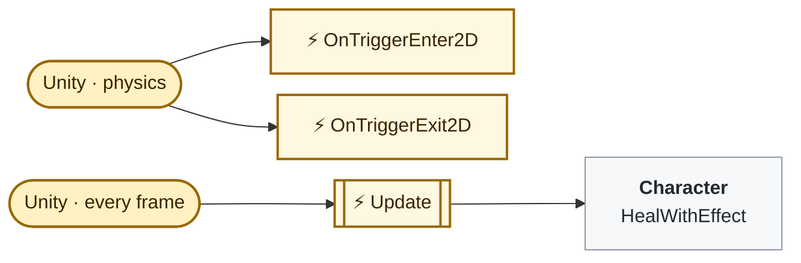
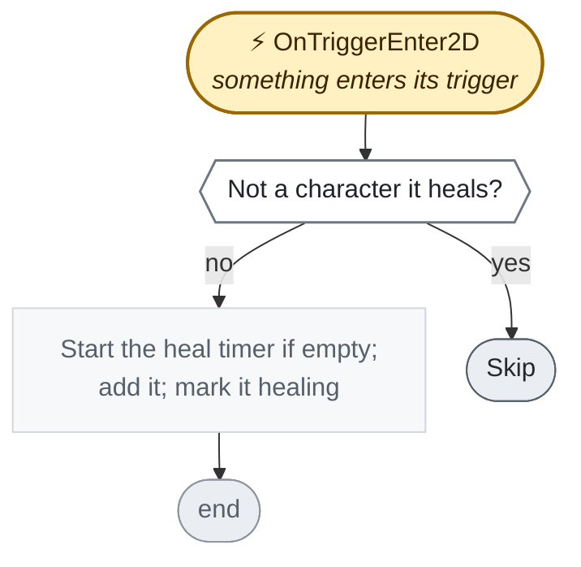
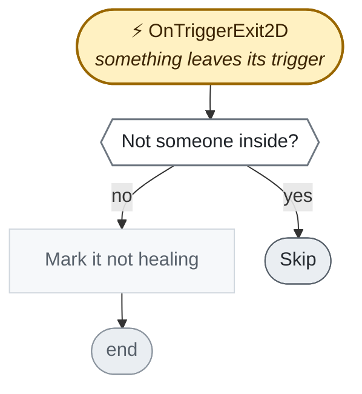
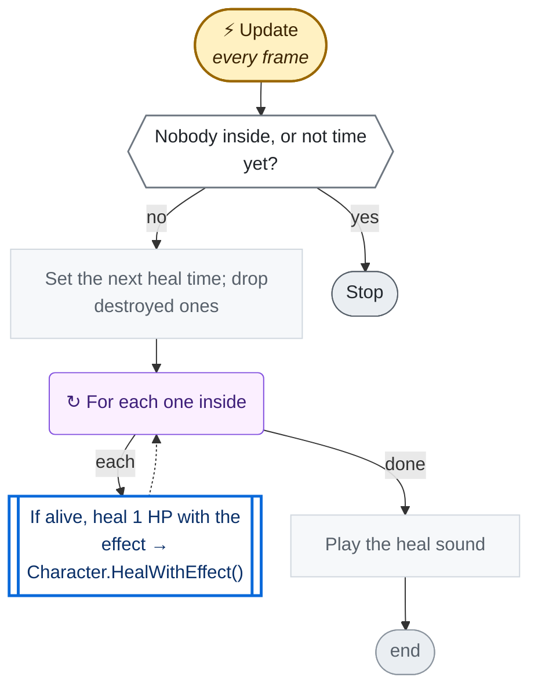

<!-- Generated by CodeGraph (CodeGraph~/tool). Don't edit: run the generator. Notes live in CodeGraph~/notes/. -->
# Map/HealingRoom.cs

🤖 A healing zone; characters of the chosen teams inside regain HP.

⚡ Unity calls it · 🔁 runs every frame · ⏳ can wait · blue box = calls another function · gray box = simple math · [code](../../../Map/HealingRoom.cs) · [all files](../index.md)

## Map

## ⚡ OnTriggerEnter2D · something enters its trigger

🤖 Starts healing a character of a healed team that walks in.

Code (L15–20)

| Step | Code |
|---|---|
| Not a character it heals? | <code>!other.TryGetComponent(out Character c) \|\| !Heals(c)</code> L16 |
| Skip | <code>return</code> L16 |
| Start the heal timer if empty; add it; mark it healing | <code>if(inside.Count == 0)nextHeal = Time.time + 1 / HPHealPerSecond</code> L17 <code>inside.Add(c)</code> L18 <code>c.isHealing = true</code> L19 |

Source: [L15–20](../../../Map/HealingRoom.cs#L15-L20)

## ⚡ OnTriggerExit2D · something leaves its trigger

🤖 Stops healing a character that walks out.

Code (L21–24)

| Step | Code |
|---|---|
| Not someone inside? | <code>!other.TryGetComponent(out Character c) \|\| !inside.Remove(c)</code> L22 |
| Skip | <code>return</code> L22 |
| Mark it not healing | <code>c.isHealing = false</code> L23 |

Source: [L21–24](../../../Map/HealingRoom.cs#L21-L24)

## ⚡ Update · every frame

🤖 Heals everyone inside 1 HP, HPHealPerSecond times a second.

Code (L25–31)

| Step | Code |
|---|---|
| Nobody inside, or not time yet? | <code>inside.Count == 0 \|\| Time.time &lt; nextHeal</code> L26 |
| Stop | <code>return</code> L26 |
| Set the next heal time; drop destroyed ones | <code>nextHeal = Time.time + 1 / HPHealPerSecond</code> L27 <code>inside.RemoveAll(c =&gt; c == null)</code> L28 |
| For each one inside | <code>for each c in inside</code> L29 |
| If alive, heal 1 HP with the effect → Character.HealWithEffect() → [`Character.HealWithEffect`](../Character.cs.md#m-character-healwitheffect) | <code>if !c.isDead</code> L29 <code>c.HealWithEffect(1)</code> L29 |
| Play the heal sound | <code>SoundPlayer.PlaySound(heal_sound)</code> L30 |

Source: [L25–31](../../../Map/HealingRoom.cs#L25-L31)

Small helpers (1)

| | Name | Does | Code |
|---|---|---|---|
|  | Heals | Whether this room heals that character's team. | <code>heals.HasFlag(c.team)</code> [L13](../../../Map/HealingRoom.cs#L13) |

Fields · HealingRoom (5)

| Name | Type | Default | Note |
|---|---|---|---|
| `heals` *(Inspector)* | `Team` | `Team.Player` |  |
| `HPHealPerSecond` *(Inspector)* | `float` | `3f` |  |
| `heal_sound` *(Inspector)* | `AudioClip` |  |  |
| `inside` | `List&lt;Character&gt;` | `new()` |  |
| `nextHeal` | `float` |  |  |

