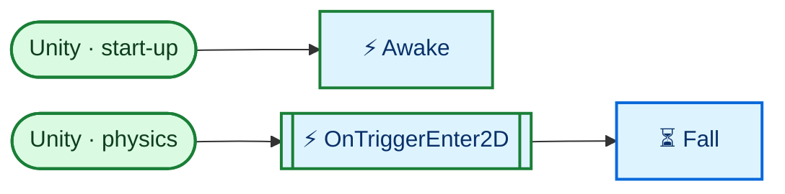
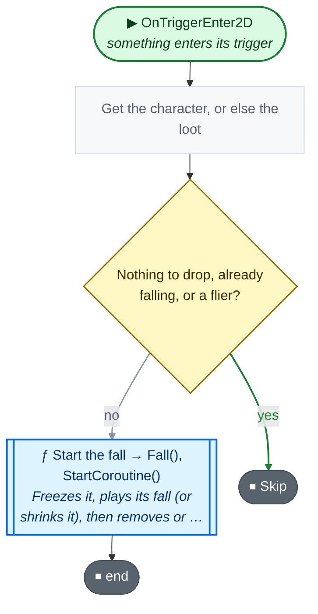
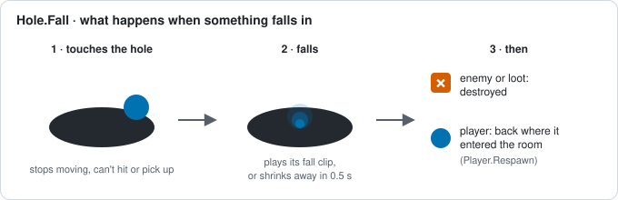
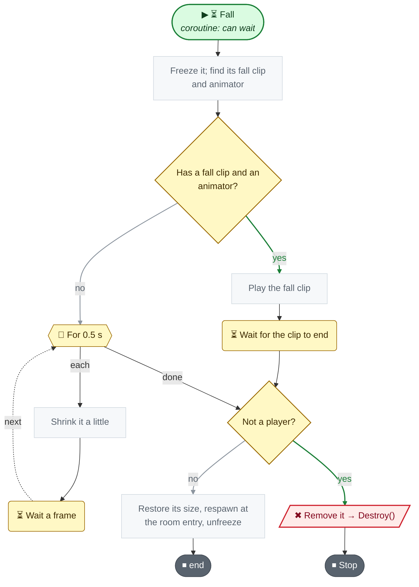

<!-- Generated by CodeGraph (CodeGraph~/tool). Don't edit: run the generator. Notes live in CodeGraph~/notes/. -->
# Map/Hole.cs

🤖 A pit; characters and loot that touch it fall in, except fliers.

[code](../../../Map/Hole.cs) · [all files](../index.md)

key
▶ green: start · gray: simple math · ƒ blue: another function (short ones drawn inside) · yellow ◇: question / 🔁 loop / ⏳ wait · ✚ ✖ engine action · 📦 outside library · ⏹ end · ⚡ Unity calls it · 🔁 in a title: runs every frame

## Map

## ⚡ OnTriggerEnter2D · something enters its trigger

🤖 Starts a fall for a character or loot that touches it.

Code (L15–19)

| Step | Code |
|---|---|
| Get the character, or else the loot | <code>Behaviour faller = other.TryGetComponent(out Character c) ? c : (Behaviour)other.GetComponent&lt;Loot&gt;()</code> L16 |
| Nothing to drop, already falling, or a flier? | <code>faller == null \|\| !faller.enabled \|\| c is Enemy e && e.enemyData.ignoreCollide</code> L17 |
| Skip | <code>return</code> L17 |
| Start the fall → Fall(), StartCoroutine() → [`Fall`](#m-hole-fall) | <code>StartCoroutine(Fall(faller, other))</code> L18 |

Source: [L15–19](../../../Map/Hole.cs#L15-L19)

## ⏳ Fall

🤖 Freezes it, plays its fall (or shrinks it), then removes or respawns it.

Code (L20–33)

| Step | Code |
|---|---|
| Freeze it; find its fall clip and animator | <code>faller.enabled = col.enabled = false</code> L21 <code>if(faller.TryGetComponent(out Rigidbody2D rb))rb.velocity = Vector2.zero</code> L22 <code>Transform t = faller.transform</code> L23 <code>Vector3 scale = t.localScale</code> L24 <code>var clip = faller switch{Player p =&gt; p.fallClip, Enemy e =&gt; e.enemyData.fallClip, Loot l =&gt; l.fallClip, _ =&gt; null}</code> L25 <code>var animator = faller.GetComponentInChildren&lt;Animator&gt;()</code> L26 |
| Has a fall clip and an animator? | <code>clip != null && animator != null</code> L27 |
| Play the fall clip | <code>animator.speed = 1</code> L27 <code>animator.Play(clip.name, 0, 0f)</code> L27 |
| Wait for the clip to end | <code>yield return new WaitForSeconds(clip.length)</code> L27 |
| For 0.5 s | <code>for (float time = 0; time &lt; fallShrinkTime; time += Time.deltaTime)</code> L28 |
| Shrink it a little | <code>t.localScale = scale * (1 - time / fallShrinkTime)</code> L28 |
| Wait a frame | <code>yield return null</code> L28 |
| Not a player? | <code>faller is not Player player</code> L29 |
| Remove it → Destroy() | <code>Destroy(t.gameObject)</code> L29 |
| Stop | <code>yield break</code> L29 |
| Restore its size, respawn at the room entry, unfreeze | <code>t.localScale = scale</code> L30 <code>player.Respawn()</code> L31 <code>faller.enabled = col.enabled = true</code> L32 |

Source: [L20–33](../../../Map/Hole.cs#L20-L33)

Small helpers (1)

| | Name | Does | Code |
|---|---|---|---|
| ⚡ | Awake | Gives the hole a kinematic body so loot can touch it too. | <code>if(!TryGetComponent(out Rigidbody2D rb))rb = gameObject.AddComponent&lt;Rigidbody2D&gt;()</code> <code>rb.bodyType = RigidbodyType2D.Kinematic</code> [L11–14](../../../Map/Hole.cs#L11-L14) |

Fields · Hole (1)

| Name | Type | Default | Note |
|---|---|---|---|
| `fallShrinkTime` | `float` | `.5f` | when it has no fall clip |

