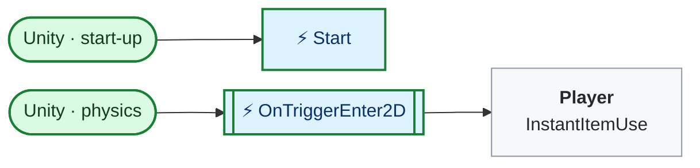
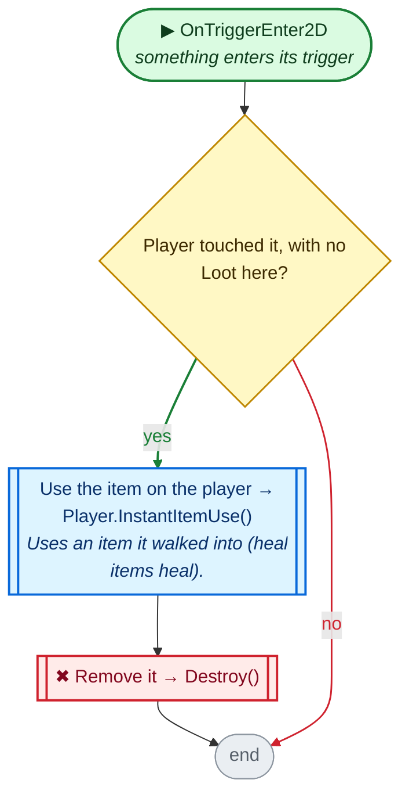

<!-- Generated by CodeGraph (CodeGraph~/tool). Don't edit: run the generator. Notes live in CodeGraph~/notes/. -->
# Map/InstantItemOnFloor.cs

🤖 An item on the floor that the player uses on touch.

⚡ Unity calls it · 🔁 runs every frame · ⏳ can wait · blue box = calls another function · gray box = simple math · [code](../../../Map/InstantItemOnFloor.cs) · [all files](../index.md)

## Map

## ⚡ OnTriggerEnter2D · something enters its trigger

🤖 When the player touches it, uses the item and removes it.

Code (L17–24)

| Step | Code |
|---|---|
| Player touched it, with no Loot here? | <code>other.TryGetComponent(out Player player) && !TryGetComponent(out Loot _)</code> L19 |
| Use the item on the player → Player.InstantItemUse() → [`Player.InstantItemUse`](../Player.cs.md#m-player-instantitemuse) | <code>player.InstantItemUse(itemSO)</code> L21 |
| Remove it → Destroy() | <code>Destroy(gameObject)</code> L22 |

Source: [L17–24](../../../Map/InstantItemOnFloor.cs#L17-L24)

Small helpers (1)

| | Name | Does | Code |
|---|---|---|---|
| ⚡ | Start | Plays the item's floor animation. | <code>anim_item = itemSO.anim_item</code> <code>anim.Play(anim_item.name)</code> [L12–16](../../../Map/InstantItemOnFloor.cs#L12-L16) |

Fields · InstantItemOnFloor (4)

| Name | Type | Default | Note |
|---|---|---|---|
| `itemSO` *(Inspector)* | `InstantItem` |  |  |
| `anim` *(Inspector)* | `Animator` |  |  |
| `col` *(Inspector)* | `BoxCollider2D` |  |  |
| `anim_item` | `AnimationClip` |  |  |

