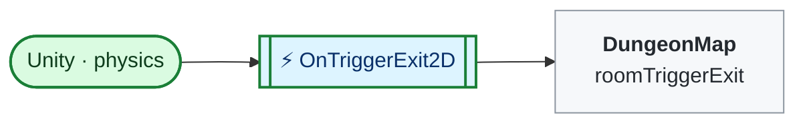

<!-- Generated by CodeGraph (CodeGraph~/tool). Don't edit: run the generator. Notes live in CodeGraph~/notes/. -->
# Map/RoomTrigger.cs

🤖 A door trigger; leaving it may move the player to the next room.

⚡ Unity calls it · 🔁 runs every frame · ⏳ can wait · blue box = calls another function · gray box = simple math · [code](../../../Map/RoomTrigger.cs) · [all files](../index.md)

## Map

Small helpers (1)

| | Name | Does | Code |
|---|---|---|---|
| ⚡ | OnTriggerExit2D | When the player leaves this door, the map decides whether to switch rooms. | <code>if other.TryGetComponent(out Player player)</code> <code>GameManager.Instance.map.roomTriggerExit(this)</code> [L8–12](../../../Map/RoomTrigger.cs#L8-L12) |

