<!-- Generated by CodeGraph (CodeGraph~/tool). Don't edit: run the generator. Notes live in CodeGraph~/notes/. -->
# Player.cs

🤖 The four facing directions, as names and as vectors. *(Direction)*

🤖 One hand - the weapon it holds and its cooldown. *(HoldingWeapons)*

🤖 The player - moves with input, attacks with two hands, has HP hearts. *(Player)*

[code](../../Player.cs) · [all files](index.md)

key
▶ green: start · gray: simple math · ƒ blue: another function (short ones drawn inside) · yellow ◇: question / 🔁 loop / ⏳ wait · ✚ ✖ engine action · 📦 outside library · ⏹ end · ⚡ Unity calls it · 🔁 in a title: runs every frame

## Map · HoldingWeapons

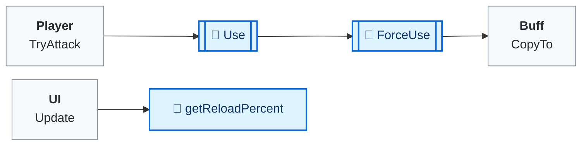

## Map · Player

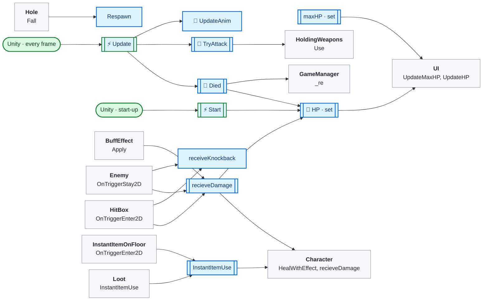

## 🔁 ForceUse

🤖 Attacks now - spawns the swing animation and the hitbox.

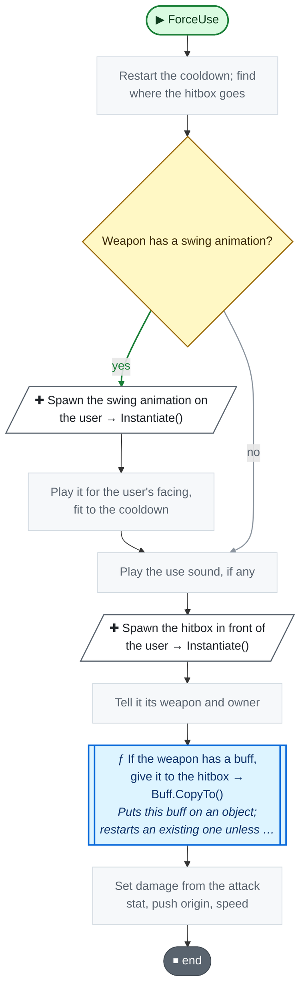

Code (L21–42)

| Step | Code |
|---|---|
| Restart the cooldown; find where the hitbox goes | <code>lastUse = Time.time</code> L22 <code>Vector2 playerPos = player.transform.position</code> L23 <code>Vector2 looking4dir = Direction.vec2MoveDict[player.animFacing]</code> L24 <code>Vector2 initPos = playerPos + new Vector2(0, 0.5f) + looking4dir * weapon.hitBoxDistance + weapon.GetOffset(player.animFacing)</code> L25 |
| Weapon has a swing animation? | <code>weapon.anim != null</code> L26 |
| Spawn the swing animation on the user → Instantiate() | <code>anim = Object.Instantiate(weapon.anim, playerPos, Quaternion.identity, player.transform)</code> L27 |
| Play it for the user's facing, fit to the cooldown | <code>if(player.animFacing &lt; anim.animations.Length){ var clip = anim.animations[player.animFacing]; anim.anim.Play(clip.name); anim.anim.speed = Mathf.Max(clip.length / cooldown, 1); }</code> L28 |
| Play the use sound, if any | <code>if(weapon.useSound != null)SoundPlayer.PlaySound(weapon.useSound)</code> L34 |
| Spawn the hitbox in front of the user → Instantiate() | <code>HitBox hitBox = Object.Instantiate(weapon.hitBox, initPos, weapon.velocity != 0 ? Quaternion.identity : Quaternion.FromToRotation(Vector2.right, looking4dir))</code> L35 |
| Tell it its weapon and owner | <code>hitBox.weapon = weapon</code> L36 <code>hitBox.owner = player</code> L37 |
| If the weapon has a buff, give it to the hitbox → Buff.CopyTo() → [`Buff.CopyTo`](BuffEffect.cs.md#m-buffeffect-buff-copyto) | <code>if weapon.buff != null</code> L38 <code>weapon.buff.CopyTo(hitBox.gameObject)</code> L38 |
| Set damage from the attack stat, push origin, speed | <code>hitBox.damage = weapon.damage * (weapon.isMagical ? player.combatStat.attackMagic : player.combatStat.attackPhysic)</code> L39 <code>hitBox.playerPos = playerPos</code> L40 <code>hitBox.setVelocity((Experimental.I.fourWayAttack ? looking4dir : player.looking) * weapon.velocity)</code> L41 |

Source: [L21–42](../../Player.cs#L21-L42)

## StopAnim

🤖 Removes the swing animation, if one is playing.

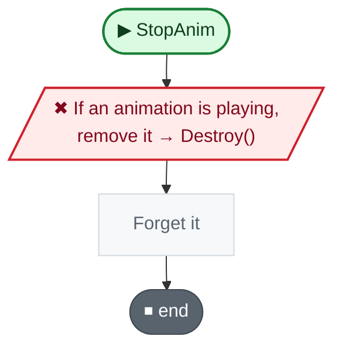

Code (L43–43)

| Step | Code |
|---|---|
| If an animation is playing, remove it → Destroy() | <code>if anim != null</code> L43 <code>GameObject.Destroy(anim.gameObject)</code> L43 |
| Forget it | <code>anim = null</code> L43 |

Source: [L43](../../Player.cs#L43)

## maxHP · set

🤖 Setting max HP also redraws the heart slots.

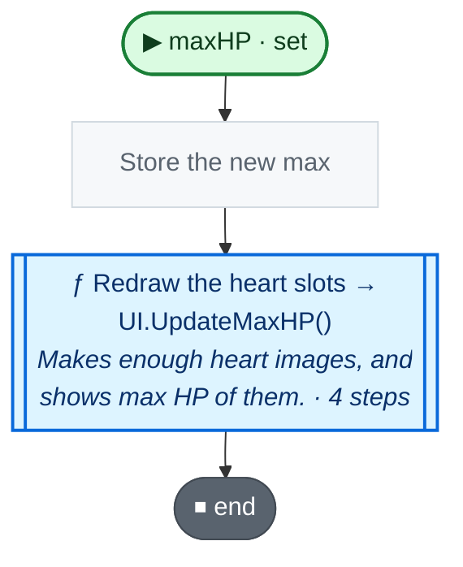

Code (L54–54)

| Step | Code |
|---|---|
| Store the new max | <code>_maxHP = value</code> L54 |
| Redraw the heart slots → UI.UpdateMaxHP() → [`UI.UpdateMaxHP`](UI.cs.md#m-ui-updatemaxhp) | <code>GameManager.Instance.ui.UpdateMaxHP(maxHP)</code> L54 |

Source: [L54](../../Player.cs#L54)

## 🔁 HP · set

🤖 Setting HP also refills the hearts on screen.

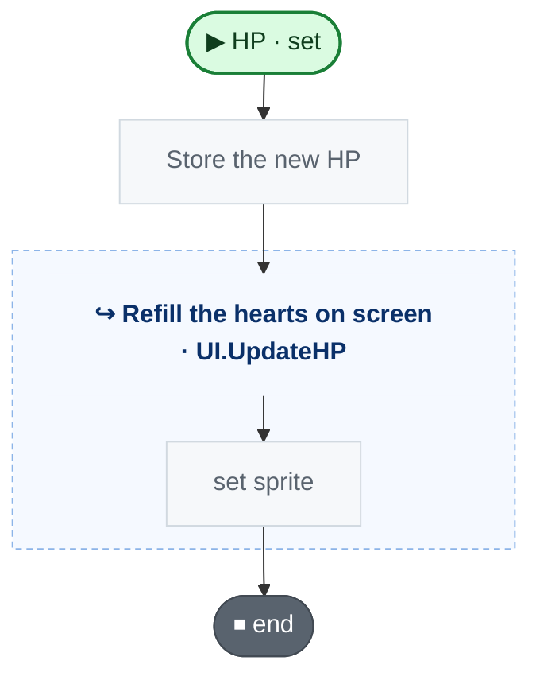

Code (L81–81)

| Step | Code |
|---|---|
| Store the new HP | <code>_HP = value</code> L81 |
| Refill the hearts on screen → UI.UpdateHP() → [`UI.UpdateHP`](UI.cs.md#m-ui-updatehp) | <code>GameManager.Instance.ui.UpdateHP(HP)</code> L81 |

Source: [L81](../../Player.cs#L81)

## ⚡ Start · before its first frame

🤖 Starts at full HP and remembers where it entered.

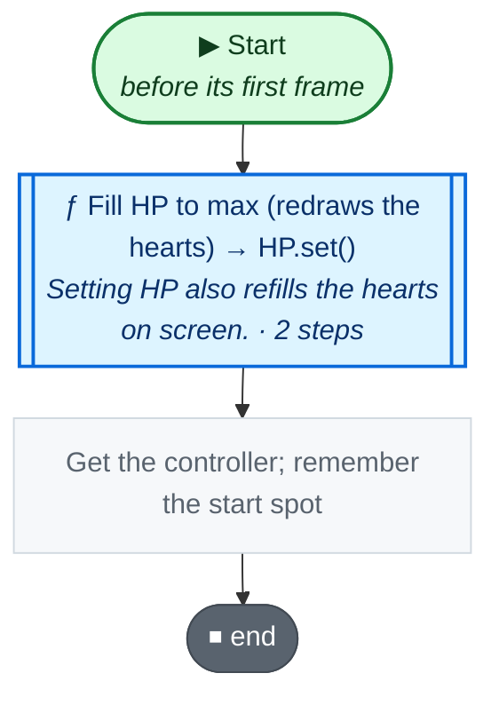

Code (L83–88)

| Step | Code |
|---|---|
| Fill HP to max (redraws the hearts) → HP.set() → [`HP.set`](#m-player-hp-set) | <code>HP = maxHP</code> L84 |
| Get the controller; remember the start spot | <code>controller = GameManager.Instance.controller</code> L85 <code>roomEntryPos = transform.position</code> L86 <code>invincibleTime = Time.time</code> L87 |

Source: [L83–88](../../Player.cs#L83-L88)

## ⚡ Update · every frame

🤖 Each frame - die at 0 HP, move, attack with each hand, animate.

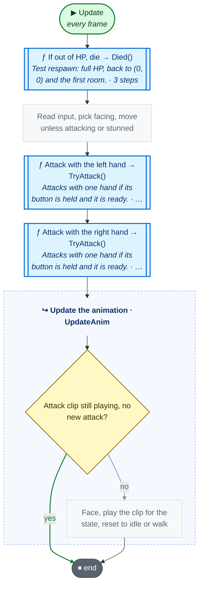

Code (L89–100)

| Step | Code |
|---|---|
| If out of HP, die → Died() → [`Died`](#m-player-died) | <code>if HP &lt;= 0</code> L90 <code>Died()</code> L90 |
| Read input, pick facing, move unless attacking or stunned | <code>movement = Vector2.ClampMagnitude(controller.movement, 1)</code> L91 <code>if(Experimental.I.stopMoveOnAttack && attackState)movement = Vector2.zero</code> L92 <code>if(Experimental.I.lookFollowMovement){if(isMoving)looking = movement;} else if(controller.looking.magnitude &gt; 0)looking = controller.looking; else if(!isLooking)looking = movement</code> L93 <code>if(!StuntMech(8))rb.velocity = movement * initSpeed</code> L96 |
| Attack with the left hand → TryAttack() → [`TryAttack`](#m-player-tryattack) | <code>TryAttack(lWeapon, controller.attackLeft)</code> L97 |
| Attack with the right hand → TryAttack() → [`TryAttack`](#m-player-tryattack) | <code>TryAttack(rWeapon, controller.attackRight)</code> L98 |
| Update the animation → UpdateAnim() → [`UpdateAnim`](#m-player-updateanim) | <code>UpdateAnim()</code> L99 |

Source: [L89–100](../../Player.cs#L89-L100)

## 🔁 TryAttack

🤖 Attacks with one hand if its button is held and it is ready.

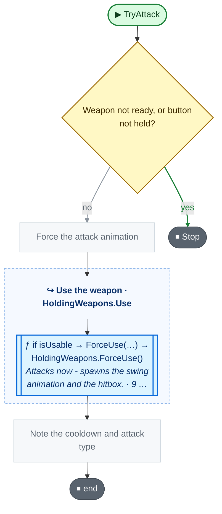

Code (L101–107)

| Step | Code |
|---|---|
| Weapon not ready, or button not held? | <code>!hand.isUsable \|\| !button.isPressed</code> L102 |
| Stop | <code>return</code> L102 |
| Force the attack animation | <code>forceAnim = true</code> L103 |
| Use the weapon → HoldingWeapons.Use() → [`HoldingWeapons.Use`](#m-holdingweapons-use) | <code>hand.Use(this)</code> L104 |
| Note the cooldown and attack type | <code>cooldown = hand.cooldown</code> L105 <code>state = (int)hand.weapon.type</code> L106 |

Source: [L101–107](../../Player.cs#L101-L107)

## InstantItemUse

🤖 Uses an item it walked into (heal items heal).

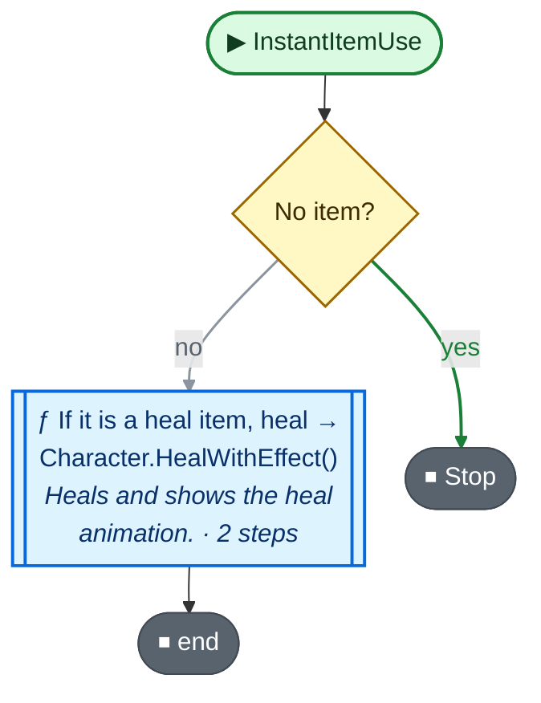

Code (L108–111)

| Step | Code |
|---|---|
| No item? | <code>item == null</code> L109 |
| Stop | <code>return</code> L109 |
| If it is a heal item, heal → Character.HealWithEffect() → [`Character.HealWithEffect`](Character.cs.md#m-character-healwitheffect) | <code>if item.usableItemType == ItemType.Heal</code> L110 <code>HealWithEffect(item.healAmount)</code> L110 |

Source: [L108–111](../../Player.cs#L108-L111)

## 🔁 Died

🤖 Test respawn: full HP, back to (0, 0) and the first room.

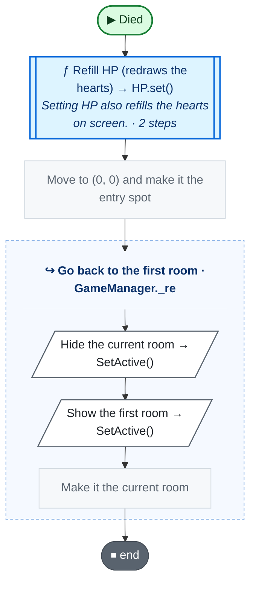

Code (L116–120)

| Step | Code |
|---|---|
| Refill HP (redraws the hearts) → HP.set() → [`HP.set`](#m-player-hp-set) | <code>HP = maxHP</code> L117 |
| Move to (0, 0) and make it the entry spot | <code>transform.position = roomEntryPos = new Vector2(0, 0)</code> L118 |
| Go back to the first room → GameManager._re() → [`GameManager._re`](GameManager.cs.md#m-gamemanager--re) | <code>GameManager.Instance._re()</code> L119 |

Source: [L116–120](../../Player.cs#L116-L120)

## 🔁 UpdateAnim

🤖 Each frame, plays the clip for idle, walking or the attack.

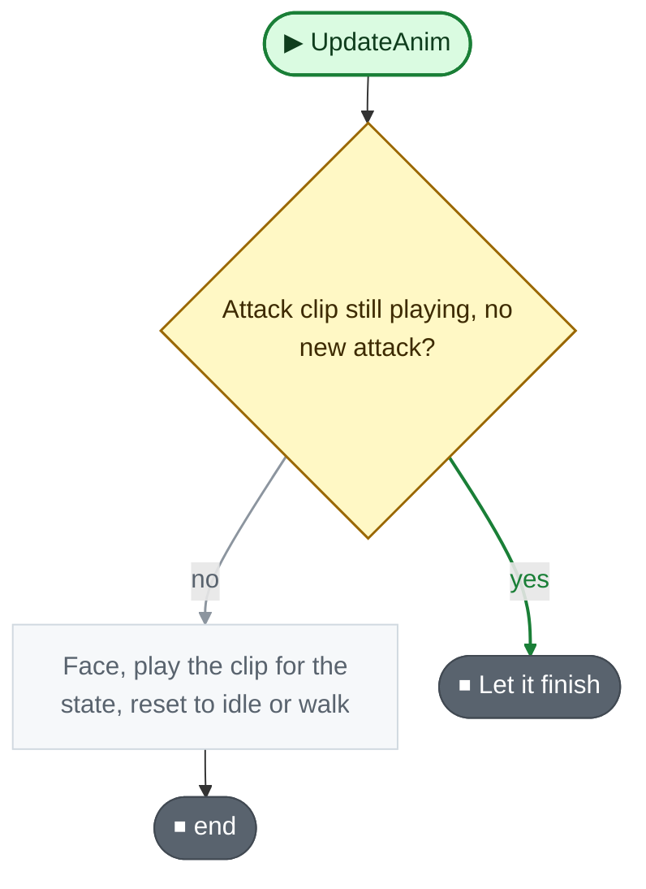

Code (L122–156)

| Step | Code |
|---|---|
| Attack clip still playing, no new attack? | <code>!forceAnim && attackState && anim.GetCurrentAnimatorStateInfo(0).normalizedTime &lt; .9f</code> L123 |
| Let it finish | <code>return</code> L123 |
| Face, play the clip for the state, reset to idle or walk | <code>attackState = false</code> L124 <code>setAnimFacing(looking)</code> L125 <code>switch(state){ case IDLE: cooldown = 0; if(isHealing)ChangeAnimation(playerIdleWater, animFacing); else ChangeAnimation(playerIdle, animFacing); break; case MOVING: cooldown = 0; if(isHealing)ChangeAnimation(playerWalkWater, animFacing); else ChangeAnimation(playerWalk, animFacing); break; case SWING: attackState = true; ChangeAnimation(playerSwinging, animFacing); forceAnim = false; break; case USEROD: attackState = true; ChangeAnimation(playerUseRod, animFacing); forceAnim = false; break; case CQC: case SPEAR: attackState = true; ChangeAnimation(playerSpear, animFacing); forceAnim = false; break; }</code> L126 <code>if (!isMoving)state = IDLE; else state = MOVING</code> L154 |

Source: [L122–156](../../Player.cs#L122-L156)

## 🔁 ChangeAnimation

🤖 Plays a clip, unless it is already playing.

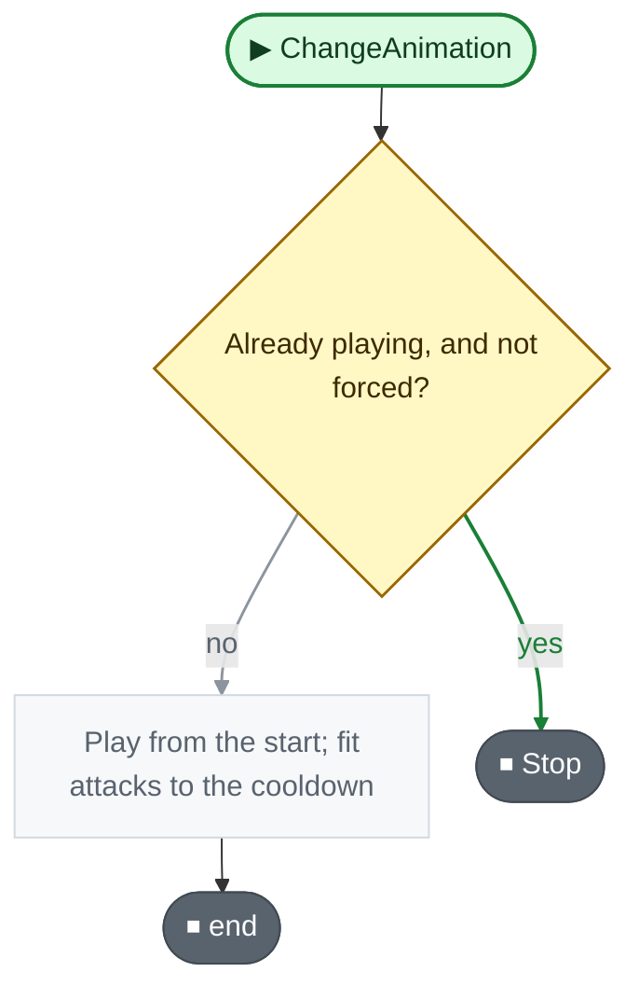

Code (L158–163)

| Step | Code |
|---|---|
| Already playing, and not forced? | <code>!forceAnim && currentAnim == toAnim.name</code> L159 |
| Stop | <code>return</code> L159 |
| Play from the start; fit attacks to the cooldown | <code>anim.Play(toAnim.name, 0, 0f)</code> L160 <code>currentAnim = toAnim.name</code> L161 <code>anim.speed = cooldown != 0 ? Mathf.Max(toAnim.length / cooldown, 1) : 1</code> L162 |

Source: [L158–163](../../Player.cs#L158-L163)

## recieveDamage

🤖 Plays the hit sound, then loses HP unless invincible.

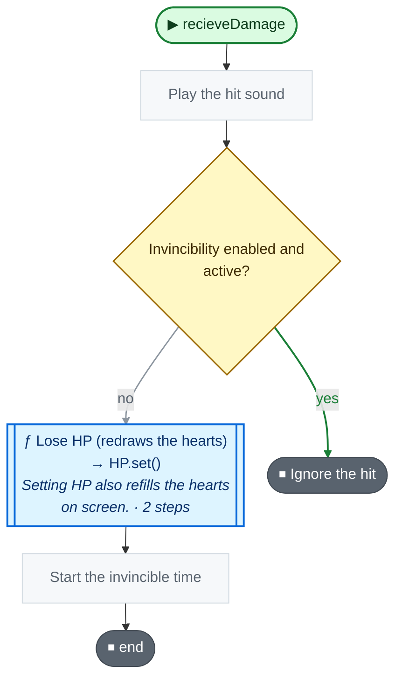

Code (L165–171)

| Step | Code |
|---|---|
| Play the hit sound | <code>base.recieveDamage(dmg, isMagical)</code> L166 <code>SoundPlayer.PlaySound(SoundPlayer.instance.sd_player_hit)</code> L167 |
| Invincibility enabled and active? | <code>enableInvincible && isInvincible</code> L168 |
| Ignore the hit | <code>return</code> L168 |
| Lose HP (redraws the hearts) → HP.set() → [`HP.set`](#m-player-hp-set) | <code>HP -= dmg</code> L169 |
| Start the invincible time | <code>invincibleTime = invincibleCooldownTime + Time.time</code> L170 |

Source: [L165–171](../../Player.cs#L165-L171)

## receiveKnockback

🤖 Gets pushed back unless invincible, less with resistance.

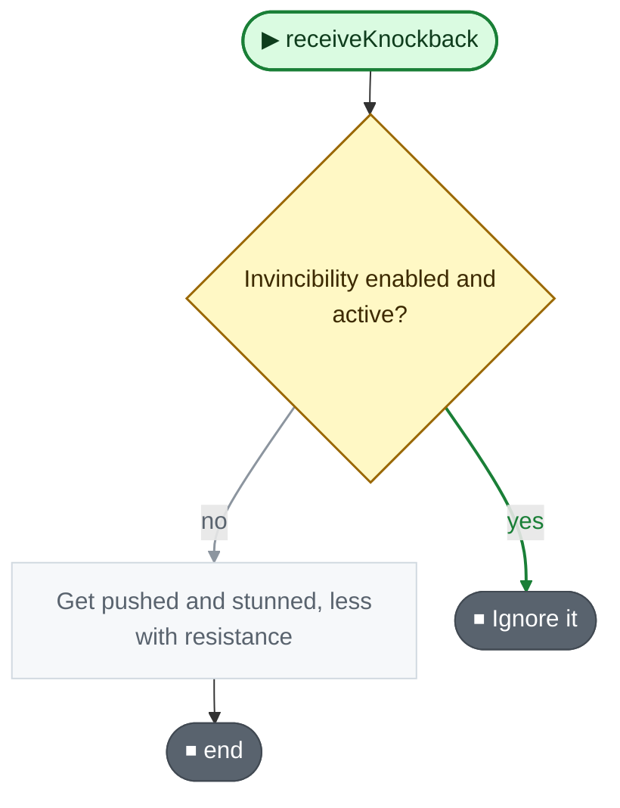

Code (L172–175)

| Step | Code |
|---|---|
| Invincibility enabled and active? | <code>enableInvincible && isInvincible</code> L173 |
| Ignore it | <code>return</code> L173 |
| Get pushed and stunned, less with resistance | <code>receiveKnockback(pos, force, knockbackResistance)</code> L174 |

Source: [L172–175](../../Player.cs#L172-L175)

Small helpers (15)

| | Name | Does | Code |
|---|---|---|---|
|  | isOnCooldown · get |  | <code>lastUse + cooldown &gt; Time.time</code> [L15](../../Player.cs#L15) |
|  | isUsable · get |  | <code>weapon != null && !isOnCooldown</code> [L16](../../Player.cs#L16) |
|  | cooldown · get |  | <code>weapon.cooldown</code> [L17](../../Player.cs#L17) |
| 🔁 | Use | Uses the weapon if it is ready. | <code>if isUsable</code> <code>ForceUse(user)</code> [L19](../../Player.cs#L19) |
| 🔁 | getReloadPercent | How reloaded the weapon is, from 0 to 1 (for the UI). | <code>weapon == null ? 1 : Mathf.Min((Time.time - lastUse) / weapon.cooldown, 1)</code> [L20](../../Player.cs#L20) |
|  | combatStat · get |  | <code>_combatStat</code> [L49](../../Player.cs#L49) |
|  | combatStat · set |  | <code>_combatStat = value</code> [L49](../../Player.cs#L49) |
|  | initSpeed · get |  | <code>_initSpeed</code> [L51](../../Player.cs#L51) |
|  | team · get |  | <code>Team.Player</code> [L52](../../Player.cs#L52) |
|  | maxHP · get |  | <code>_maxHP</code> [L54](../../Player.cs#L54) |
|  | enableInvincible · get |  | <code>Experimental.I.enableInvincible</code> [L55](../../Player.cs#L55) |
|  | isInvincible · get |  | <code>invincibleTime &gt; Time.time</code> [L75](../../Player.cs#L75) |
|  | HP · get |  | <code>_HP</code> [L81](../../Player.cs#L81) |
|  | Respawn | Goes back to where it entered the room (after a fall). | <code>transform.position = roomEntryPos</code> <code>currentAnim = null</code> [L112–115](../../Player.cs#L112-L115) |
| 🔁 | ChangeAnimation | Plays the clip for a facing, if the list has one. | <code>if(index &lt; toAnim.Length)ChangeAnimation(toAnim[index])</code> [L157](../../Player.cs#L157) |

Fields · Direction (2)

| Name | Type | Default | Note |
|---|---|---|---|
| `strMoveDict` | `string[]` | `{"up", "right", "down", "left", }` |  |
| `vec2MoveDict` | `Vector2[]` | `{Vector2.up, Vector2.right, Vector2.down, Vector2.left, }` |  |

Fields · HoldingWeapons (6)

| Name | Type | Default | Note |
|---|---|---|---|
| `weapon` *(Inspector)* | `Weapon` |  |  |
| `lastUse` | `float` |  |  |
| `isOnCooldown` | `bool` | `=&gt; lastUse + cooldown &gt; Time.time` |  |
| `isUsable` | `bool` | `=&gt; weapon != null && !isOnCooldown` |  |
| `cooldown` | `float` | `=&gt; weapon.cooldown` |  |
| `anim` | `BaseWeapon` |  |  |

Fields · Player (40)

| Name | Type | Default | Note |
|---|---|---|---|
| `_combatStat` *(Inspector)* | `CombatStat` |  |  |
| `combatStat` | `CombatStat` |  |  |
| `_initSpeed` *(Inspector)* | `float` | `1` |  |
| `initSpeed` | `float` | `=&gt; _initSpeed` |  |
| `team` | `Team` | `=&gt; Team.Player` |  |
| `_maxHP` *(Inspector)* | `int` | `4` |  |
| `maxHP` | `int` |  |  |
| `enableInvincible` | `bool` | `=&gt; Experimental.I.enableInvincible` |  |
| `speedBoost` *(Inspector)* | `float` |  |  |
| `state` | `int` |  | IDLE, MOVING, or the WeaponType number while attacking |
| `attackState` | `bool` |  |  |
| `IDLE` | `int` | `0` |  |
| `MOVING` | `int` | `1` |  |
| `SWING` | `int` | `(int)WeaponType.Swinging` |  |
| `USEROD` | `int` | `(int)WeaponType.Rod` |  |
| `SPEAR` | `int` | `(int)WeaponType.Spear` |  |
| `CQC` | `int` | `(int)WeaponType.CQC` |  |
| `cooldown` | `float` |  |  |
| `currentAnim` | `string` |  |  |
| `anim` *(Inspector)* | `Animator` |  |  |
| `playerIdle` *(Inspector)* | `AnimationClip[]` |  |  |
| `playerWalk` *(Inspector)* | `AnimationClip[]` |  |  |
| `playerIdleWater` *(Inspector)* | `AnimationClip[]` |  |  |
| `playerWalkWater` *(Inspector)* | `AnimationClip[]` |  |  |
| `playerSwinging` *(Inspector)* | `AnimationClip[]` |  |  |
| `playerShooting` *(Inspector)* | `AnimationClip[]` |  |  |
| `playerUseRod` *(Inspector)* | `AnimationClip[]` |  |  |
| `playerSpear` *(Inspector)* | `AnimationClip[]` |  |  |
| `lWeapon` *(Inspector)* | `HoldingWeapons` |  |  |
| `rWeapon` *(Inspector)* | `HoldingWeapons` |  |  |
| `activeArmor` *(Inspector)* | `Armor` |  |  |
| `knockbackResistance` *(Inspector)* | `float` |  |  |
| `controller` | `Controller` |  |  |
| `invincibleCooldownTime` *(Inspector)* | `float` |  |  |
| `invincibleTime` | `float` |  |  |
| `isInvincible` | `bool` | `=&gt; invincibleTime &gt; Time.time` |  |
| `forceAnim` | `bool` |  |  |
| `fallClip` *(Inspector)* | `AnimationClip` |  | Fall down animation when it falls in a hole (a state with this clip's name in its Animator). Empty: it shrinks away |
| `roomEntryPos` | `Vector2` |  | where this player entered the current room: falling in a hole brings it back here |
| `HP` | `int` |  |  |

