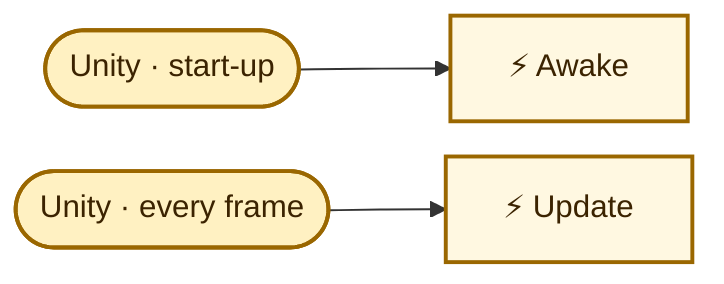

<!-- Generated by CodeGraph (CodeGraph~/tool). Don't edit: run the generator. Notes live in CodeGraph~/notes/. -->
# Player/Weapons/BaseWeapon.cs

🤖 A weapon's animation effect; it removes itself when the animation ends.

⚡ Unity calls it · 🔁 runs every frame · ⏳ can wait · blue box = calls another function · gray box = simple math · [code](../../../../Player/Weapons/BaseWeapon.cs) · [all files](../../index.md)

## Map

Small helpers (2)

| | Name | Does | Code |
|---|---|---|---|
| ⚡ | Awake | Finds its Animator if none is set. | <code>if(anim == null)anim = GetComponent&lt;Animator&gt;()</code> [L9](../../../../Player/Weapons/BaseWeapon.cs#L9) |
| ⚡ | Update | Removes itself once the animation is 90% done. | <code>if anim.GetCurrentAnimatorStateInfo(0).normalizedTime &gt;= .9f</code> <code>Destroy(gameObject)</code> [L10](../../../../Player/Weapons/BaseWeapon.cs#L10) |

Fields · BaseWeapon (2)

| Name | Type | Default | Note |
|---|---|---|---|
| `animations` *(Inspector)* | `AnimationClip[]` |  | up, right, down, left |
| `anim` *(Inspector)* | `Animator` |  |  |

