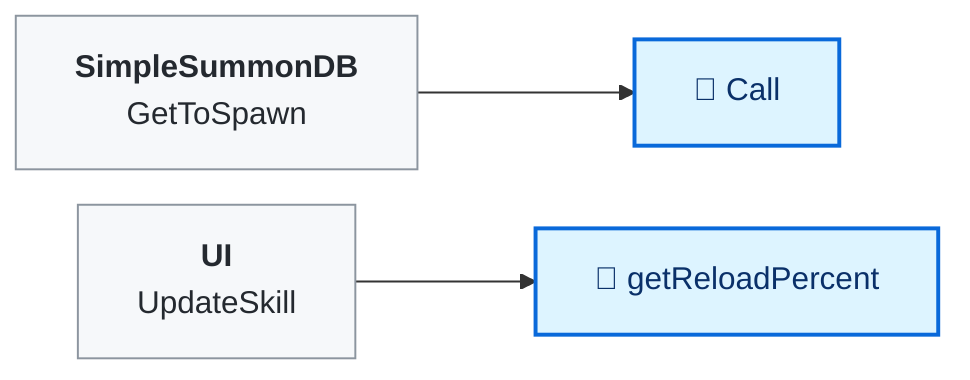
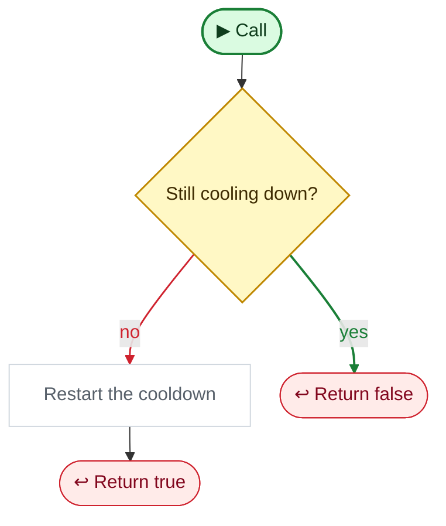

<!-- Generated by CodeGraph (CodeGraph~/tool). Don't edit: run the generator. Notes live in CodeGraph~/notes/. -->
# Skill.cs

🤖 A chat skill's cooldown timer.

⚡ Unity calls it · 🔁 runs every frame · ⏳ can wait · blue box = calls another function · gray box = simple math · [code](../../Skill.cs) · [all files](index.md)

## Map

## 🔁 Call

🤖 Uses the skill if it's ready, and restarts its cooldown.

Code (L15–19)

| Step | Code |
|---|---|
| Still cooling down? | <code>!isReady</code> L16 |
| Return false | <code>return false</code> L16 |
| Restart the cooldown | <code>lastUse = Time.time</code> L17 |
| Return true | <code>return true</code> L18 |

Source: [L15–19](../../Skill.cs#L15-L19)

Small helpers (4)

| | Name | Does | Code |
|---|---|---|---|
|  | isReady · get |  | <code>lastUse + cooldown &lt; Time.time</code> [L11](../../Skill.cs#L11) |
|  | precReady · get |  | <code>Mathf.Min((Time.time - lastUse) / cooldown, 1)</code> [L12](../../Skill.cs#L12) |
| 🔁 | getReloadPercent | How recharged it is, from 0 to 1 (for the UI). | <code>precReady</code> [L13](../../Skill.cs#L13) |
|  | Start | Never runs - Skill isn't a MonoBehaviour, so Unity doesn't call it. | <code>lastUse = Time.time</code> [L14](../../Skill.cs#L14) |

Fields · Skill (5)

| Name | Type | Default | Note |
|---|---|---|---|
| `chatType` *(Inspector)* | `ChatType` |  |  |
| `cooldown` *(Inspector)* | `float` |  |  |
| `lastUse` | `float` |  |  |
| `isReady` | `bool` | `=&gt; lastUse + cooldown &lt; Time.time` |  |
| `precReady` | `float` | `=&gt; Mathf.Min((Time.time - lastUse) / cooldown, 1)` |  |

