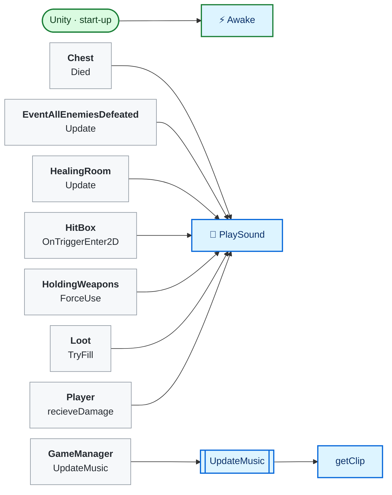
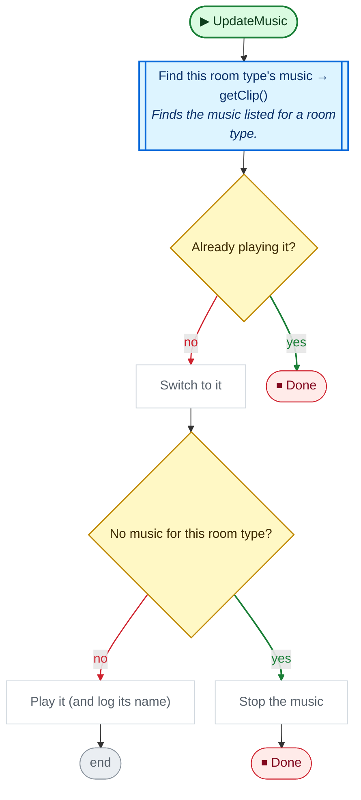
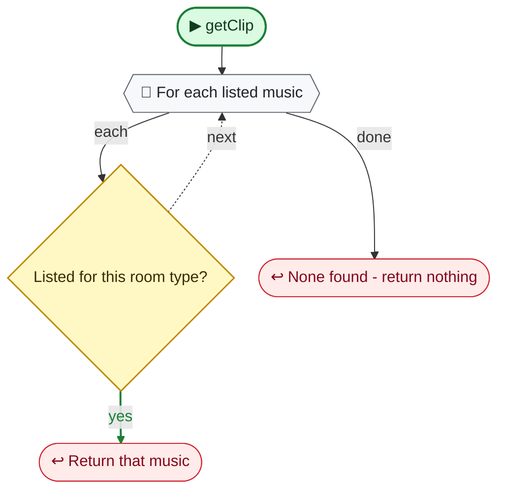

<!-- Generated by CodeGraph (CodeGraph~/tool). Don't edit: run the generator. Notes live in CodeGraph~/notes/. -->
# SoundPlayer.cs

🤖 Plays sound effects, and each room type's music.

⚡ Unity calls it · 🔁 runs every frame · ⏳ can wait · blue box = calls another function · gray box = simple math · [code](../../SoundPlayer.cs) · [all files](index.md)

## Map

## UpdateMusic

🤖 Switches to the current room type's music, or stops it.

Code (L15–22)

| Step | Code |
|---|---|
| Find this room type's music → getClip() → [`getClip`](#m-soundplayer-getclip) | <code>var clip = getClip(GameManager.Instance.currentRoom.roomType)</code> L16 |
| Already playing it? | <code>musicSource.clip == clip</code> L17 |
| Done | <code>return</code> L17 |
| Switch to it | <code>musicSource.clip = clip</code> L18 |
| No music for this room type? | <code>clip == null</code> L19 |
| Stop the music | <code>musicSource.Stop()</code> L19 |
| Done | <code>return</code> L19 |
| Play it (and log its name) | <code>musicSource.Play()</code> L20 <code>print("Play:" + clip.name)</code> L21 |

Source: [L15–22](../../SoundPlayer.cs#L15-L22)

## getClip

🤖 Finds the music listed for a room type.

Code (L23–27)

| Step | Code |
|---|---|
| For each listed music | <code>for (int i = 0; i &lt; roomMusicList.Length; i++)</code> L24 |
| Listed for this room type? | <code>roomType == roomTypeList[i]</code> L25 |
| Return that music | <code>return roomMusicList[i]</code> L25 |
| None found - return nothing | <code>return null</code> L26 |

Source: [L23–27](../../SoundPlayer.cs#L23-L27)

Small helpers (2)

| | Name | Does | Code |
|---|---|---|---|
| ⚡ | Awake | Becomes the one sound player everyone uses (ready before any Start). | <code>instance = this</code> [L13](../../SoundPlayer.cs#L13) |
| 🔁 | PlaySound | Plays a sound effect once. | <code>instance.soundSource.PlayOneShot(sound)</code> [L14](../../SoundPlayer.cs#L14) |

Fields · SoundPlayer (9)

| Name | Type | Default | Note |
|---|---|---|---|
| `musicSource` *(Inspector)* | `AudioSource` |  |  |
| `soundSource` *(Inspector)* | `AudioSource` |  |  |
| `instance` | `SoundPlayer` |  |  |
| `sd_enemy_hit` *(Inspector)* | `AudioClip` |  |  |
| `sd_pickup_wep` *(Inspector)* | `AudioClip` |  |  |
| `sd_door_open` *(Inspector)* | `AudioClip` |  |  |
| `sd_player_hit` *(Inspector)* | `AudioClip` |  |  |
| `roomTypeList` *(Inspector)* | `RoomType[]` |  | roomMusicList[i] plays in rooms of type roomTypeList[i] |
| `roomMusicList` *(Inspector)* | `AudioClip[]` |  |  |

