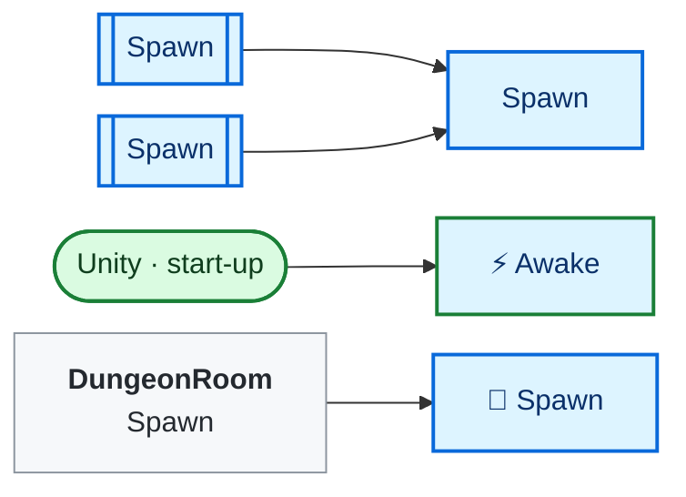
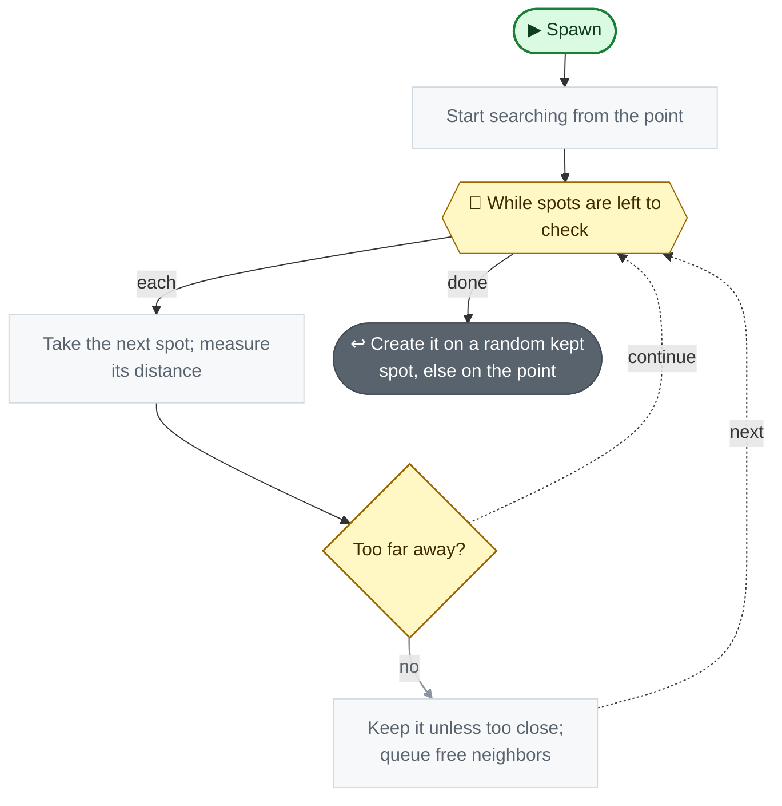

<!-- Generated by CodeGraph (CodeGraph~/tool). Don't edit: run the generator. Notes live in CodeGraph~/notes/. -->
# Spawner.cs

🤖 Spawns enemies on a room's floor, in free spots.

[code](../../Spawner.cs) · [all files](index.md)

key
▶ green: start · gray: simple math · ƒ blue: another function (short ones drawn inside) · yellow ◇: question / 🔁 loop / ⏳ wait · ✚ ✖ engine action · 📦 outside library · ⏹ end · ⚡ Unity calls it · 🔁 in a title: runs every frame

## Map

## 🔁 Spawn

🤖 Creates the enemy on a random free spot near a point.

Code (L20–35)

| Step | Code |
|---|---|
| Start searching from the point | <code>Queue&lt;Vector2&gt; q = new()</code> L21 <code>q.Enqueue(oriPos)</code> L21 <code>HashSet&lt;Vector2&gt; seen = new()</code> L22 <code>List&lt;Vector2&gt; result = new()</code> L23 |
| While spots are left to check | <code>while q.Count &gt; 0</code> L24 |
| Take the next spot; measure its distance | <code>var f = q.Dequeue()</code> L25 <code>float dist = (f - oriPos).magnitude</code> L26 |
| Too far away? | <code>dist &gt; range</code> L27 |
| Keep it unless too close; queue free neighbors | <code>if(dist &gt; .5)result.Add(f)</code> L28 <code>foreach(var d in Direction.vec2MoveDict){ var n = f + d * 0.5f; if(seen.Add(n) && Physics2D.OverlapPoint(n) == null && bounds.Contains(n))q.Enqueue(n); }</code> L29 |
| Create it on a random kept spot, else on the point | <code>return Instantiate(enemy, result.Count &gt; 0 ? result[Random.Range(0, result.Count)] : oriPos, Quaternion.identity)</code> L34 |

Source: [L20–35](../../Spawner.cs#L20-L35)

Small helpers (5)

| | Name | Does | Code |
|---|---|---|---|
| ⚡ | Awake | Measures the floor's area from its tilemap. | <code>GetComponent&lt;Tilemap&gt;().CompressBounds()</code> <code>if(tilemapRenderer == null)tilemapRenderer = GetComponent&lt;TilemapRenderer&gt;()</code> <code>bounds = tilemapRenderer.bounds</code> [L10–14](../../Spawner.cs#L10-L14) |
|  | Rand | Picks a random point inside an area. | <code>new Vector3(Random.Range(b.min.x, b.max.x), Random.Range(b.min.y, b.max.y), Random.Range(b.min.z, b.max.z))</code> [L15](../../Spawner.cs#L15) |
|  | Spawn | Creates the enemy at a position. | <code>Instantiate(enemy, pos, Quaternion.identity)</code> [L16](../../Spawner.cs#L16) |
|  | Spawn | Creates the enemy at a random point in an area. | <code>Spawn(enemy, Rand(b))</code> [L17](../../Spawner.cs#L17) |
|  | Spawn | Creates the enemy at a random point on the floor. | <code>Spawn(enemy, bounds)</code> [L18](../../Spawner.cs#L18) |

Fields · Spawner (2)

| Name | Type | Default | Note |
|---|---|---|---|
| `tilemapRenderer` *(Inspector)* | `TilemapRenderer` |  |  |
| `bounds` | `Bounds` |  |  |

