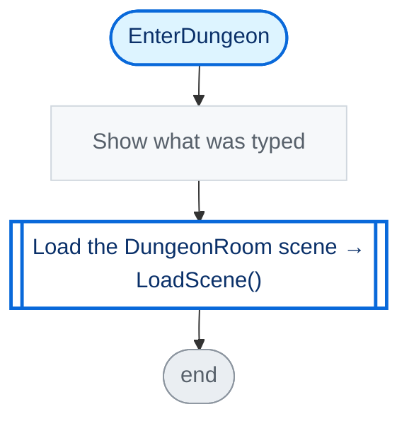

<!-- Generated by CodeGraph (CodeGraph~/tool). Don't edit: run the generator. Notes live in CodeGraph~/notes/. -->
# Title.cs

🤖 The title screen - shows what you typed and enters the dungeon.

<sub>⚡ Unity calls it · 🔁 runs every frame · ⏳ can wait · blue box = calls another function · gray box = simple math · [code](../../Title.cs) · [all files](index.md)</sub>

## Map

```mermaid
---
config:
  flowchart:
    wrappingWidth: 320
    nodeSpacing: 18
    rankSpacing: 60
---
flowchart LR
  classDef engine fill:#fff1c2,stroke:#9a6700,stroke-width:2px,color:#3b2300
  classDef own fill:#ffffff,stroke:#0969da,stroke-width:2px,color:#0a3069
  classDef ownev fill:#fff8e1,stroke:#9a6700,stroke-width:2px,color:#3b2300
  classDef other fill:#f6f8fa,stroke:#8c959f,color:#24292f
  classDef ext fill:#f6f8fa,stroke:#8c959f,stroke-dasharray:4 3,color:#57606a
  classDef more fill:#ffffff,stroke:#d0d7de,stroke-dasharray:2 2,color:#57606a
```

<a id="m-title-enterdungeon"></a>

## EnterDungeon

🤖 Shows the input, then loads the dungeon scene.



<details><summary>Code (L15–15)</summary>

| Step | Code |
|---|---|
| Show what was typed | <code>SubmitInput()</code> <sub>L15</sub> |
| Load the DungeonRoom scene → LoadScene() | <code>SceneManager.LoadScene("DungeonRoom")</code> <sub>L15</sub> |

Source: [L15](../../Title.cs#L15)

</details>

<details><summary>Small helpers (1)</summary>

| | Name | Does | Code |
|---|---|---|---|
|  | <a id="m-title-submitinput"></a>SubmitInput | Shows what was typed in the input box. | <code>resultDisplay.text = "You entered: " + userInput.text</code> [L14](../../Title.cs#L14) |

</details>

<details><summary>Fields · Title (4)</summary>

| Name | Type | Default | Note |
|---|---|---|---|
| `myAudio` *(Inspector)* | `AudioSource` |  |  |
| `titleMusic` *(Inspector)* | `AudioClip` |  |  |
| `userInput` *(Inspector)* | `InputField` |  |  |
| `resultDisplay` *(Inspector)* | `Text` |  |  |

</details>

