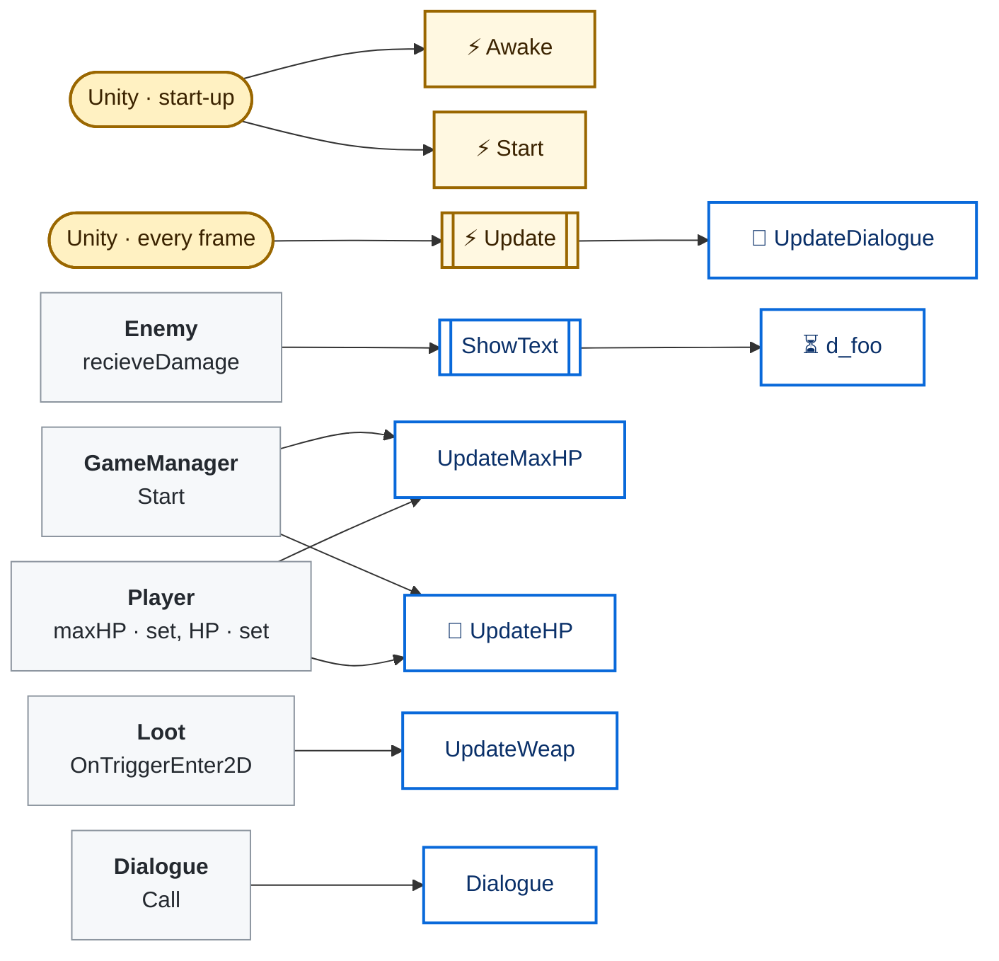
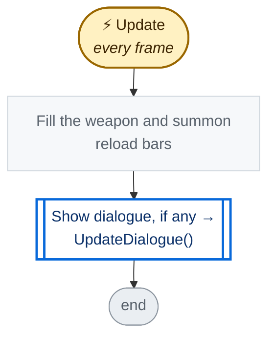
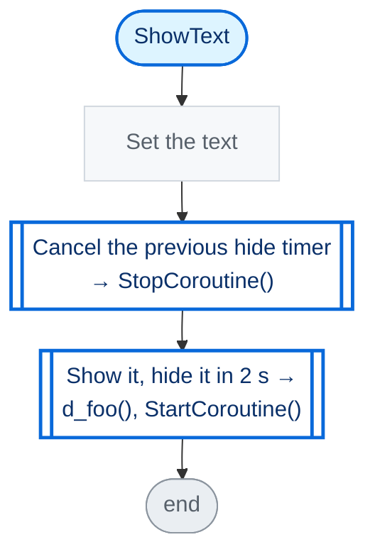
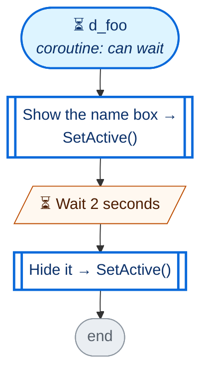
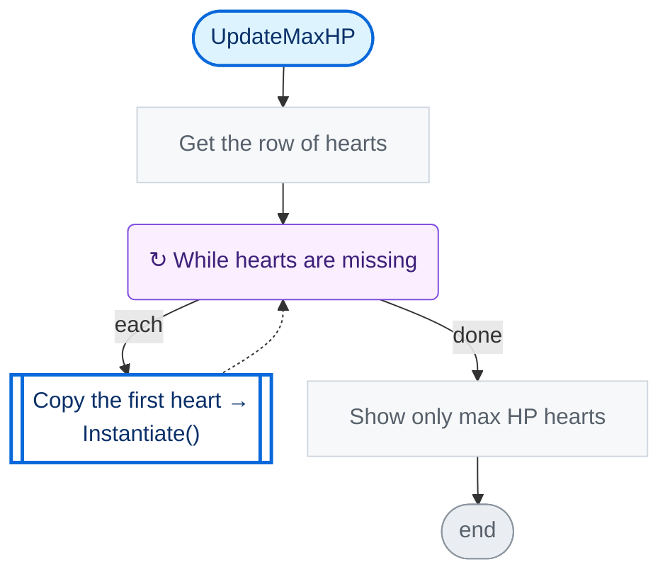
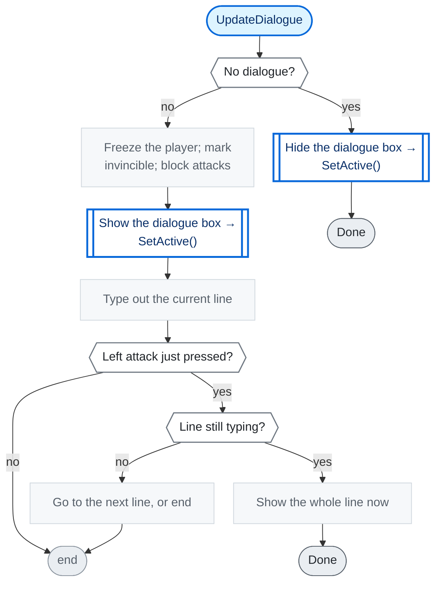

<!-- Generated by CodeGraph (CodeGraph~/tool). Don't edit: run the generator. Notes live in CodeGraph~/notes/. -->
# UI.cs

🤖 The on-screen HUD - hearts, weapon reloads, enemy names and dialogue.

⚡ Unity calls it · 🔁 runs every frame · ⏳ can wait · blue box = calls another function · gray box = simple math · [code](../../UI.cs) · [all files](index.md)

## Map

## ⚡ Update · every frame

🤖 Each frame - reload bars, then dialogue.

Code (L44–49)

| Step | Code |
|---|---|
| Fill the weapon and summon reload bars | <code>leftFill.fillAmount = player.lWeapon.getReloadPercent()</code> L45 <code>rightFill.fillAmount = player.rWeapon.getReloadPercent()</code> L46 <code>UpdateSkill()</code> L47 |
| Show dialogue, if any → UpdateDialogue() → [`UpdateDialogue`](#m-ui-updatedialogue) | <code>UpdateDialogue()</code> L48 |

Source: [L44–49](../../UI.cs#L44-L49)

## ShowText

🤖 Shows a text (an enemy's name) for 2 seconds.

Code (L51–55)

| Step | Code |
|---|---|
| Set the text | <code>enemyNameTextLabel.SetText(txt)</code> L52 |
| Cancel the previous hide timer → StopCoroutine() | <code>if d_hide != null</code> L53 <code>StopCoroutine(d_hide)</code> L53 |
| Show it, hide it in 2 s → d_foo(), StartCoroutine() → [`d_foo`](#m-ui-d-foo) | <code>d_hide = StartCoroutine(d_foo())</code> L54 |

Source: [L51–55](../../UI.cs#L51-L55)

## ⏳ d_foo

🤖 Shows the name box for 2 seconds, then hides it.

Code (L56–60)

| Step | Code |
|---|---|
| Show the name box → SetActive() | <code>enemyNameTextbox.SetActive(true)</code> L57 |
| Wait 2 seconds | <code>yield return new WaitForSeconds(2)</code> L58 |
| Hide it → SetActive() | <code>enemyNameTextbox.SetActive(false)</code> L59 |

Source: [L56–60](../../UI.cs#L56-L60)

## UpdateMaxHP

🤖 Makes enough heart images, and shows max HP of them.

Code (L61–65)

| Step | Code |
|---|---|
| Get the row of hearts | <code>Transform t = healthUI.transform</code> L62 |
| While hearts are missing | <code>while heart.Count &lt;= maxHP</code> L63 |
| Copy the first heart → Instantiate() | <code>heart.Add(Instantiate(heart[0], t.position, Quaternion.identity, t))</code> L63 |
| Show only max HP hearts | <code>for(int i = 1; i &lt; heart.Count; i++)heart[i].enabled = i &lt; maxHP</code> L64 |

Source: [L61–65](../../UI.cs#L61-L65)

## 🔁 UpdateDialogue

🤖 While dialogue shows - freeze the player, type it out, click to go on.

Code (L77–95)

| Step | Code |
|---|---|
| No dialogue? | <code>dialogueTextToShow == null \|\| dialogueTextToShow.Length == 0</code> L78 |
| Hide the dialogue box → SetActive() | <code>dialogueTextbox.SetActive(false)</code> L79 |
| Done | <code>return</code> L80 |
| Freeze the player; mark invincible; block attacks | <code>player.froze()</code> L82 <code>player.invincibleTime = Time.time + 1</code> L83 <code>player.lWeapon.lastUse = player.rWeapon.lastUse = Time.time</code> L84 |
| Show the dialogue box → SetActive() | <code>dialogueTextbox.SetActive(true)</code> L85 |
| Type out the current line | <code>dialogueTextLabel.SetText(dialogueTextToShow[0])</code> L86 <code>int shown = (int)((Time.time - dialogueStart) * dialogueSpeed)</code> L87 <code>dialogueTextLabel.maxVisibleCharacters = shown</code> L88 |
| Left attack just pressed? | <code>GameManager.Instance.controller.attackLeft.isPressedOnce("dialogue")</code> L89 |
| Line still typing? | <code>shown &lt; dialogueTextToShow[0].Length</code> L90 |
| Show the whole line now | <code>dialogueStart -= 9999</code> L90 |
| Done | <code>return</code> L90 |
| Go to the next line, or end | <code>dialogueStart = Time.time</code> L91 <code>if(dialogueTextToShow.Length == 1)dialogueTextToShow = null; else dialogueTextToShow = dialogueTextToShow[1..]</code> L92 |

Source: [L77–95](../../UI.cs#L77-L95)

Small helpers (7)

| | Name | Does | Code |
|---|---|---|---|
|  | player · get |  | <code>GameManager.Instance.player</code> [L27](../../UI.cs#L27) |
| ⚡ | Awake | Collects the heart, skill and weapon images it updates later. | <code>heart.Clear()</code> <code>skills.Clear()</code> <code>skillsReload.Clear()</code> <code>foreach(Transform o in healthUI.transform)heart.Add(o.GetComponent&lt;Image&gt;())</code> <code>foreach(Transform o in skillSlot.transform){var img = o.GetComponent&lt;Image&gt;(); skills.Add(img); skillsReload.Add(img.transform.GetChild(0).GetComponent&lt;Image&gt;());}</code> <code>enemyNameTextLabel = enemyNameTextbox.GetComponentInChildren&lt;TMP_Text&gt;()</code> <code>dialogueTextLabel = dialogueTextbox.GetComponentInChildren&lt;TMP_Text&gt;()</code> <code>leftFill = leftWeapon.transform.Find("Fill").GetComponent&lt;Image&gt;()</code> <code>rightFill = rightWeapon.transform.Find("Fill").GetComponent&lt;Image&gt;()</code> [L29–37](../../UI.cs#L29-L37) |
| ⚡ | Start | Draws on the UI camera and shows the held weapons. | <code>Canvas canvas = GetComponent&lt;Canvas&gt;()</code> <code>canvas.renderMode = RenderMode.ScreenSpaceCamera</code> <code>canvas.worldCamera = GameManager.Instance.uiCam</code> <code>UpdateWeap()</code> [L38–43](../../UI.cs#L38-L43) |
| 🔁 | UpdateHP | Full hearts for current HP, empty ones for the rest. | <code>for(int i = 0; i &lt; heart.Count; i++)heart[i].sprite = healthSprite[i &lt; HP ? 0 : 1]</code> [L66](../../UI.cs#L66) |
| 🔁 | UpdateSkill | Fills the summon reload bar. | <code>if(skillsReload.Count &gt; 0)skillsReload[0].fillAmount = GameManager.Instance.summondb.spawnSkill.getReloadPercent()</code> [L67](../../UI.cs#L67) |
|  | UpdateWeap | Shows the icon of the weapon in each hand. | <code>if(player.lWeapon.weapon != null)wepImages[0].sprite = player.lWeapon.weapon.uiWep</code> <code>if(player.rWeapon.weapon != null)wepImages[1].sprite = player.rWeapon.weapon.uiWep</code> [L68–71](../../UI.cs#L68-L71) |
|  | Dialogue | Starts a dialogue; a held attack button won't skip its first line. | <code>dialogueTextToShow = text</code> <code>dialogueStart = Time.time</code> <code>GameManager.Instance.controller.attackLeft.isPressedOnce("dialogue")</code> [L72–76](../../UI.cs#L72-L76) |

Fields · UI (20)

| Name | Type | Default | Note |
|---|---|---|---|
| `healthUI` *(Inspector)* | `LayoutGroup` |  |  |
| `heart` | `List&lt;Image&gt;` | `new()` |  |
| `healthSprite` *(Inspector)* | `Sprite[]` | `new Sprite[2]` | full, empty |
| `leftWeapon` *(Inspector)* | `Image` |  |  |
| `rightWeapon` *(Inspector)* | `Image` |  |  |
| `skillSlot` *(Inspector)* | `LayoutGroup` |  |  |
| `skills` *(Inspector)* | `List&lt;Image&gt;` | `new()` |  |
| `skillsReload` *(Inspector)* | `List&lt;Image&gt;` | `new()` |  |
| `wepImages` *(Inspector)* | `Image[]` |  | get by correct index |
| `enemyNameTextbox` *(Inspector)* | `GameObject` |  |  |
| `dialogueTextbox` *(Inspector)* | `GameObject` |  |  |
| `dialogueTextLabel` | `TMP_Text` |  |  |
| `dialogueTextToShow` | `string[]` |  |  |
| `dialogueSpeed` *(Inspector)* | `float` | `30` | typewriter: letters per second |
| `dialogueStart` | `float` |  |  |
| `enemyNameTextLabel` | `TMP_Text` |  |  |
| `d_hide` | `Coroutine` |  |  |
| `leftFill` | `Image` |  |  |
| `rightFill` | `Image` |  |  |
| `player` | `Player` | `=&gt; GameManager.Instance.player` |  |

