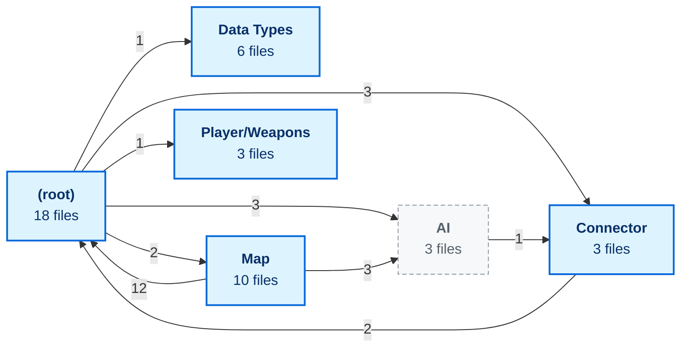

<!-- Generated by CodeGraph (CodeGraph~/tool). Don't edit: run the generator. Notes live in CodeGraph~/notes/. -->
# Lord of the Dungeon · code as pictures

43 files. Each page shows one file: who calls it, and one small chart per function. `AI/` is treated as an outside library.

## Folders

Arrow number: how many classes in one folder use the other.

## Files

| File | What it is | Functions |
|---|---|---|
| [BuffEffect.cs](BuffEffect.cs.md) | The kinds of buff - burn, heal, slow, stun, or none. | 5 |
| [ChannelBtn.cs](ChannelBtn.cs.md) | A button that saves the chat channel typed in its box. | 1 |
| [Character.cs](Character.cs.md) | Attack and defense numbers, physical and magic. | 10 |
| [Connector/Chat.cs](Connector/Chat.cs.md) | Kinds of chat command - summon, teleport, vote, work, or not a command. | 2 |
| [Connector/SummonDB.cs](Connector/SummonDB.cs.md) | One chat summon request - who asked, which enemy, and where. | 7 |
| [Connector/TwitchChat.cs](Connector/TwitchChat.cs.md) | Reads Twitch chat through the Lexone package (the backup reader). | 5 |
| [Controller.cs](Controller.cs.md) | One button's state, with a "seen once per press" check. | 5 |
| [Data Types/Armor.cs](Data%20Types/Armor.cs.md) | Armor data asset with defense values (no code reads it yet). | 0 |
| [Data Types/Enemy.cs](Data%20Types/Enemy.cs.md) | Enemy data asset - chat name, speed, HP, combat stats, knockback. | 0 |
| [Data Types/InstantItem.cs](Data%20Types/InstantItem.cs.md) | What an instant item does - heal, buff or cleanse. | 0 |
| [Data Types/UsableItem.cs](Data%20Types/UsableItem.cs.md) | Kinds of usable item - heal, mute, enhance, explode. | 0 |
| [Data Types/Weapon.cs](Data%20Types/Weapon.cs.md) | Weapon data asset - damage, cooldown, hitbox, sounds, icon, buff. | 1 |
| [Data Types/WeaponType.cs](Data%20Types/WeaponType.cs.md) | Weapon kinds; the number is also the player's attack animation state. | 0 |
| [DestructableObj.cs](DestructableObj.cs.md) | A breakable object (like a crate) - breaks after some hits, drops loot. | 3 |
| [Dialogue.cs](Dialogue.cs.md) | Names of the story dialogues. | 3 |
| [Enemy.cs](Enemy.cs.md) | A monster that chases the player and hurts it on touch. | 9 |
| [Experimental.cs](Experimental.cs.md) | On/off switches for test and experimental features, in one place. | 0 |
| [FollowPlayer.cs](FollowPlayer.cs.md) | Makes the Cinemachine camera follow the player. | 1 |
| [GameManager.cs](GameManager.cs.md) | The game's hub - holds player, UI, map and chat, and spawns summons. | 8 |
| [HitBox.cs](HitBox.cs.md) | An attack's damage area - hurts what it touches, then disappears. | 5 |
| [Loot.cs](Loot.cs.md) | Kind of pickup - weapon, chat skill, instant item, or none. | 10 |
| [Map/Chest.cs](Map/Chest.cs.md) | An enemy that is a chest; any hit opens it and drops its loot. | 4 |
| [Map/Door.cs](Map/Door.cs.md) | Empty placeholder (no code yet). | 0 |
| [Map/DungeonMap.cs](Map/DungeonMap.cs.md) | All rooms and doors of the dungeon; only the current room is active. | 6 |
| [Map/DungeonRoom.cs](Map/DungeonRoom.cs.md) | Kinds of room; each kind picks its music. | 1 |
| [Map/EventAllEnemiesDefeated.cs](Map/EventAllEnemiesDefeated.cs.md) | Fires an event once no enemy is left (e.g. to open doors). | 2 |
| [Map/EventCertainObjectDestroyed.cs](Map/EventCertainObjectDestroyed.cs.md) | Fires an event once the sword pickup is gone (collected). | 2 |
| [Map/HealingRoom.cs](Map/HealingRoom.cs.md) | A healing zone; characters of the chosen teams inside regain HP. | 4 |
| [Map/Hole.cs](Map/Hole.cs.md) | A pit; characters and loot that touch it fall in, except fliers. | 3 |
| [Map/InstantItemOnFloor.cs](Map/InstantItemOnFloor.cs.md) | An item on the floor that the player uses on touch. | 2 |
| [Map/RoomTrigger.cs](Map/RoomTrigger.cs.md) | A door trigger; leaving it may move the player to the next room. | 1 |
| [Player.cs](Player.cs.md) | The four facing directions, as names and as vectors. | 15 |
| [Player/Weapons/BaseWeapon.cs](Player/Weapons/BaseWeapon.cs.md) | A weapon's animation effect; it removes itself when the animation ends. | 2 |
| [Player/Weapons/SwingWeapon.cs](Player/Weapons/SwingWeapon.cs.md) | A swing effect; same as BaseWeapon. | 0 |
| [Player/Weapons/UseRod.cs](Player/Weapons/UseRod.cs.md) | A rod effect; same as BaseWeapon. | 0 |
| [Skill.cs](Skill.cs.md) | A chat skill's cooldown timer. | 3 |
| [SoundPlayer.cs](SoundPlayer.cs.md) | Plays sound effects, and each room type's music. | 4 |
| [Spawner.cs](Spawner.cs.md) | Spawns enemies on a room's floor, in free spots. | 6 |
| [Title.cs](Title.cs.md) | The title screen - shows what you typed and enters the dungeon. | 2 |
| [UI.cs](UI.cs.md) | The on-screen HUD - hearts, weapon reloads, enemy names and dialogue. | 11 |
| [AI/PathFinding.cs](AI/PathFinding.cs.md) *(external)* |  | 16 |
| [AI/PlayModeOnly.cs](AI/PlayModeOnly.cs.md) *(external)* |  | 2 |
| [AI/UnifiedChat.cs](AI/UnifiedChat.cs.md) *(external)* |  | 10 |

What Unity runs, and when

| Class | start-up | every frame | physics | editor |
|---|---|---|---|---|
| `BaseWeapon` | [Awake](Player/Weapons/BaseWeapon.cs.md#m-baseweapon-awake) | [Update](Player/Weapons/BaseWeapon.cs.md#m-baseweapon-update) |  |  |
| `BuffEffect` | [Start](BuffEffect.cs.md#m-buffeffect-start) | [LateUpdate](BuffEffect.cs.md#m-buffeffect-lateupdate) | [OnTriggerEnter2D](BuffEffect.cs.md#m-buffeffect-ontriggerenter2d) |  |
| `Chest` |  |  | [OnTriggerStay2D](Map/Chest.cs.md#m-chest-ontriggerstay2d) |  |
| `Controller` |  | [Update](Controller.cs.md#m-controller-update) |  |  |
| `Destructable` | [Start](DestructableObj.cs.md#m-destructable-start) |  |  |  |
| `Dialogue` | [Start](Dialogue.cs.md#m-dialogue-start) | [Update](Dialogue.cs.md#m-dialogue-update) |  |  |
| `DungeonMap` | [Start](Map/DungeonMap.cs.md#m-dungeonmap-start) |  |  | [OnValidate](Map/DungeonMap.cs.md#m-dungeonmap-onvalidate) |
| `Enemy` | [Start](Enemy.cs.md#m-enemy-start) | [Update](Enemy.cs.md#m-enemy-update) | [OnTriggerStay2D](Enemy.cs.md#m-enemy-ontriggerstay2d) | [OnDrawGizmosSelected](Enemy.cs.md#m-enemy-ondrawgizmosselected) |
| `EventAllEnemiesDefeated` |  | [Update](Map/EventAllEnemiesDefeated.cs.md#m-eventallenemiesdefeated-update) |  |  |
| `EventCertainObjectDestroyed` |  | [Update](Map/EventCertainObjectDestroyed.cs.md#m-eventcertainobjectdestroyed-update) |  |  |
| `FollowPlayer` | [Start](FollowPlayer.cs.md#m-followplayer-start) |  |  |  |
| `GameManager` | [Awake](GameManager.cs.md#m-gamemanager-awake), [Start](GameManager.cs.md#m-gamemanager-start) | [Update](GameManager.cs.md#m-gamemanager-update) |  |  |
| `HealingRoom` |  | [Update](Map/HealingRoom.cs.md#m-healingroom-update) | [OnTriggerEnter2D](Map/HealingRoom.cs.md#m-healingroom-ontriggerenter2d), [OnTriggerExit2D](Map/HealingRoom.cs.md#m-healingroom-ontriggerexit2d) |  |
| `HitBox` | [Start](HitBox.cs.md#m-hitbox-start) | [Update](HitBox.cs.md#m-hitbox-update) | [OnTriggerEnter2D](HitBox.cs.md#m-hitbox-ontriggerenter2d) |  |
| `Hole` | [Awake](Map/Hole.cs.md#m-hole-awake) |  | [OnTriggerEnter2D](Map/Hole.cs.md#m-hole-ontriggerenter2d) |  |
| `InstantItemOnFloor` | [Start](Map/InstantItemOnFloor.cs.md#m-instantitemonfloor-start) |  | [OnTriggerEnter2D](Map/InstantItemOnFloor.cs.md#m-instantitemonfloor-ontriggerenter2d) |  |
| `Loot` | [Start](Loot.cs.md#m-loot-start) |  | [OnTriggerEnter2D](Loot.cs.md#m-loot-ontriggerenter2d) |  |
| `Player` | [Start](Player.cs.md#m-player-start) | [Update](Player.cs.md#m-player-update) |  |  |
| `RoomTrigger` |  |  | [OnTriggerExit2D](Map/RoomTrigger.cs.md#m-roomtrigger-ontriggerexit2d) |  |
| `SoundPlayer` | [Awake](SoundPlayer.cs.md#m-soundplayer-awake) |  |  |  |
| `Spawner` | [Awake](Spawner.cs.md#m-spawner-awake) |  |  |  |
| `TwitchChat` | [Start](Connector/TwitchChat.cs.md#m-twitchchat-start) |  |  |  |
| `UI` | [Awake](UI.cs.md#m-ui-awake), [Start](UI.cs.md#m-ui-start) | [Update](UI.cs.md#m-ui-update) |  |  |

