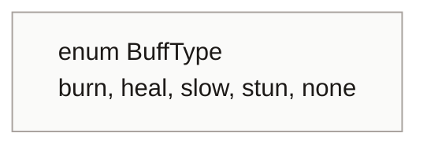
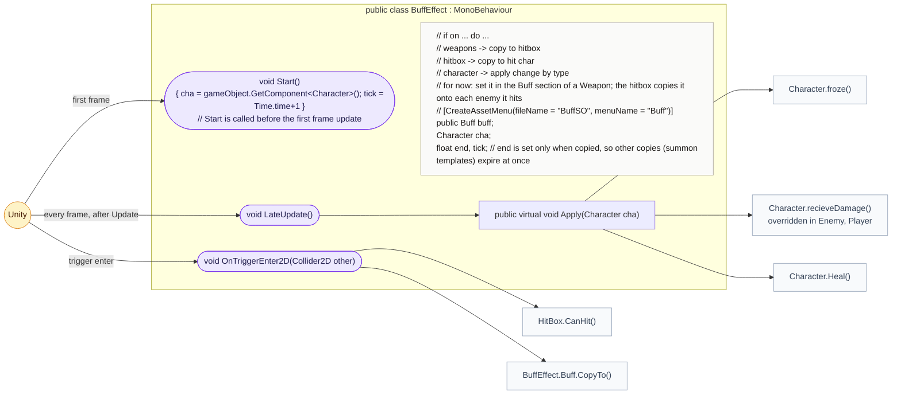
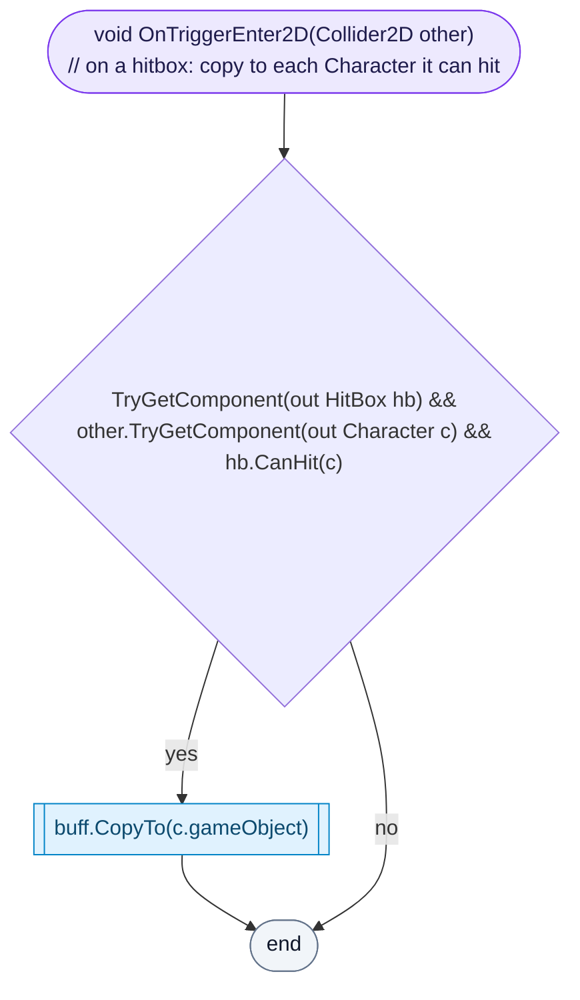
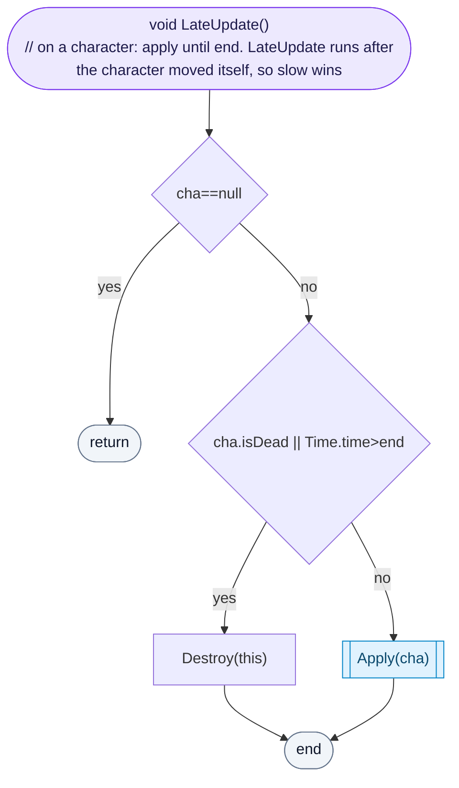
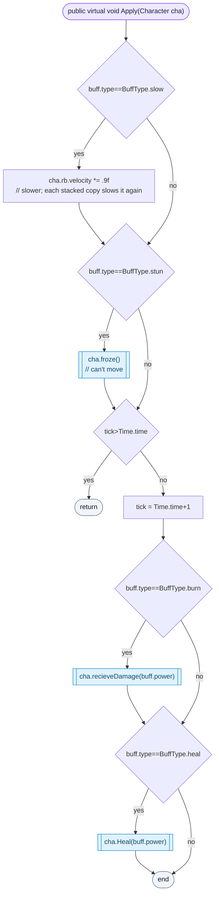
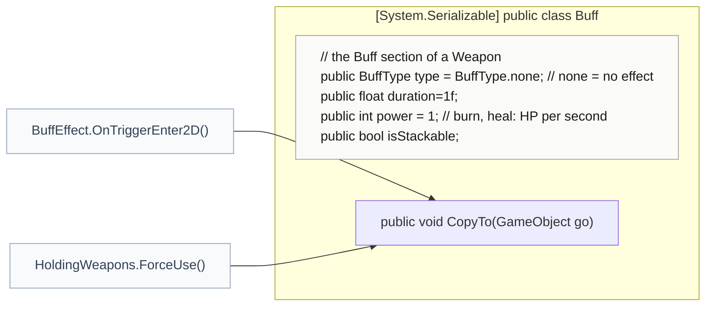
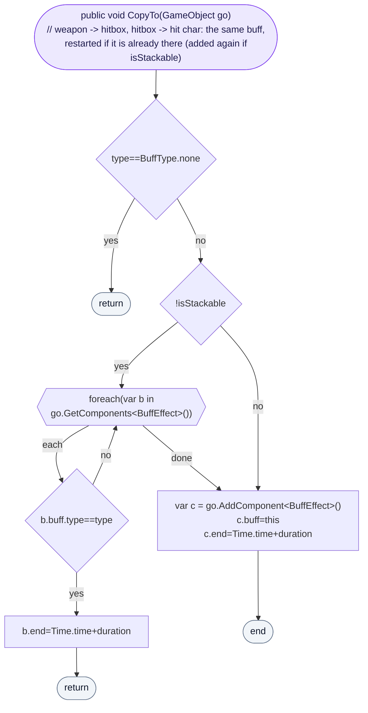

<!-- generated by CodeGraph~/codegraph.py from BuffEffect.cs. Do not edit: run python "CodeGraph~/codegraph.py". Notes go in CodeGraph~/ai/BuffEffect.cs.md -->
# BuffEffect.cs

[overview](README.md) · [source](../../BuffEffect.cs) · 60 lines · using `System.Collections`, `System.Collections.Generic`, `UnityEngine`

Buffs and debuffs (burn, heal, slow, stun) that a weapon passes to whoever its hitbox touches.

The buff travels: **Weapon** (its Buff section) → **HitBox** (copied in `HoldingWeapons.ForceUse`) → each **Character** the hitbox can hit (copied in `OnTriggerEnter2D`) → applied every frame until it runs out.

## enum BuffType

## class BuffEffect

Carries a buff: spreads it from a hitbox, applies it on a character.
The same component does both jobs, depending on where it sits. `end` is set only when a buff is copied, so copies that were never handed on (summon templates) expire at once.

### BuffEffect.OnTriggerEnter2D

Only does something on a hitbox: each character the hitbox is allowed to hit (another team) gets a copy of the buff.

[lines 39–42](../../BuffEffect.cs#L39-L42) · called by Unity: trigger enter · calls [HitBox.CanHit](HitBox.cs.md#class-hitbox), [BuffEffect.Buff.CopyTo](BuffEffect.cs.md#buffeffectbuffcopyto)

### BuffEffect.LateUpdate

Only does something on a character: removes the buff when the character is dead or the time is up, otherwise applies it. It runs in LateUpdate, after the character set its own velocity, so the slow wins.

[lines 45–50](../../BuffEffect.cs#L45-L50) · called by Unity: every frame, after Update · calls [BuffEffect.Apply](BuffEffect.cs.md#buffeffectapply)

### BuffEffect.Apply

Slow multiplies velocity by 0.9 every frame (each stacked copy slows again); stun keeps the character frozen. Burn and heal tick once a second, by `power` HP.

[lines 52–59](../../BuffEffect.cs#L52-L59) · called by [BuffEffect.LateUpdate](BuffEffect.cs.md#buffeffectlateupdate) · calls [Character.froze](Character.cs.md#class-character), [Character.recieveDamage](Character.cs.md#class-character), [Character.Heal](Character.cs.md#characterheal)

## class BuffEffect.Buff

The Buff section of a weapon: type, duration, power, stackable.
Serialized inside `Weapon`, so it is edited on the weapon asset. Type `none` means no buff.

### BuffEffect.Buff.CopyTo

Puts this buff on a GameObject. If it is not stackable and the target already has the same buff, that one's timer restarts instead; otherwise a new BuffEffect is added that ends after `duration`.

[lines 21–26](../../BuffEffect.cs#L21-L26) · called by [BuffEffect.OnTriggerEnter2D](BuffEffect.cs.md#buffeffectontriggerenter2d), [HoldingWeapons.ForceUse](Player.cs.md#holdingweaponsforceuse)
