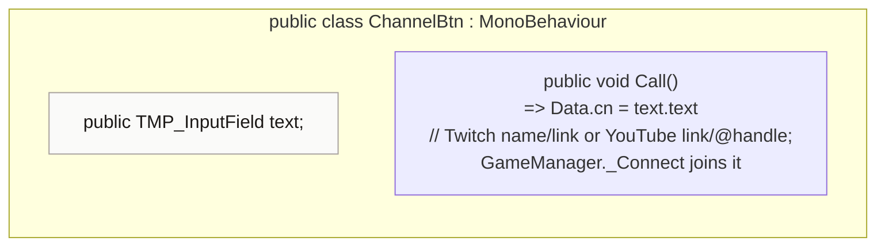

<!-- generated by CodeGraph~/codegraph.py from ChannelBtn.cs. Do not edit: run python "CodeGraph~/codegraph.py". Notes go in CodeGraph~/ai/ChannelBtn.cs.md -->
# ChannelBtn.cs

[overview](README.md) · [source](../../ChannelBtn.cs) · 10 lines · using `System.Collections`, `System.Collections.Generic`, `UnityEngine`, `TMPro`

The channel box: remembers which chat to read.

## class ChannelBtn

Button that saves the typed channel into Data.cn.
Accepts a Twitch name or link, or a YouTube link or @handle. `Data` is defined outside this folder. `GameManager._Connect` joins that channel later (on the first kill or weapon pickup).

