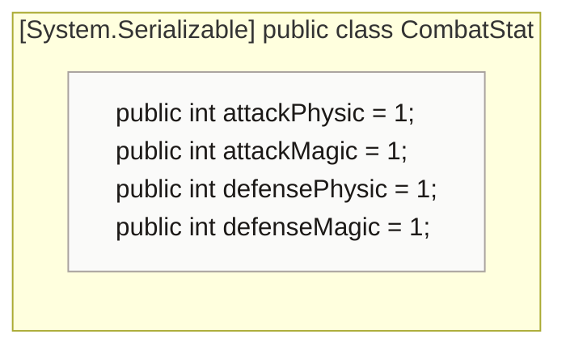
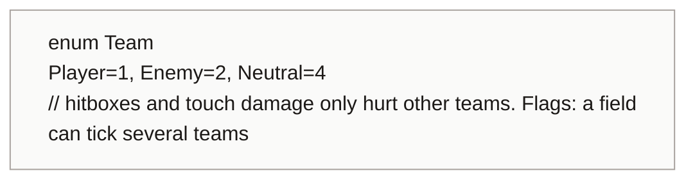
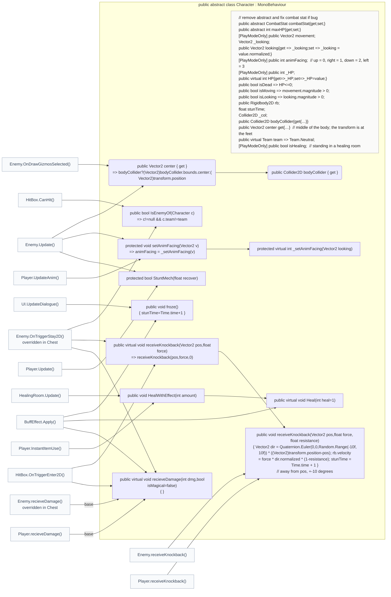
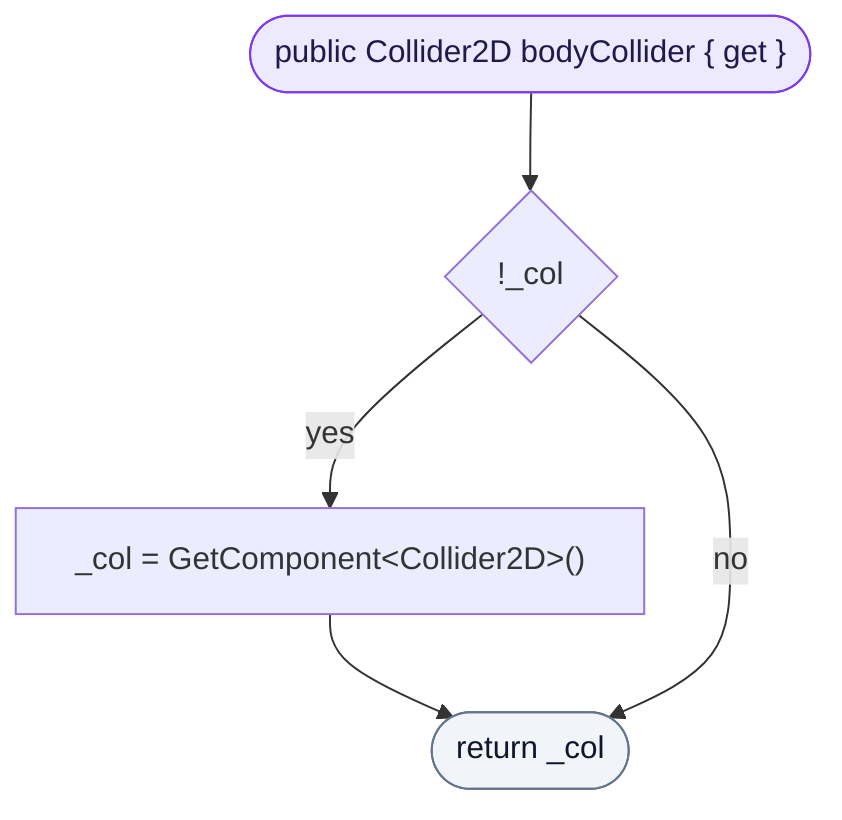
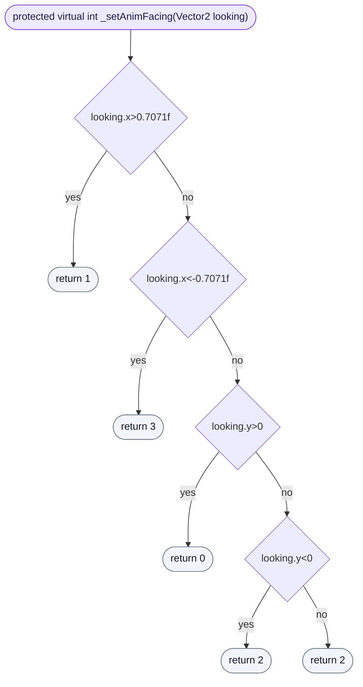
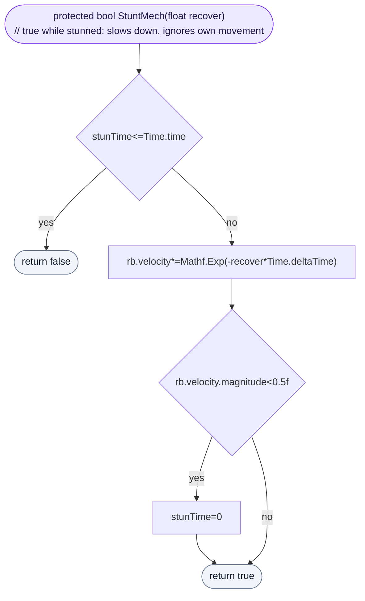
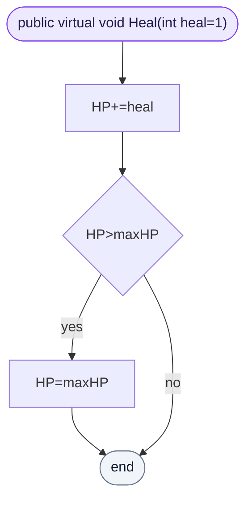
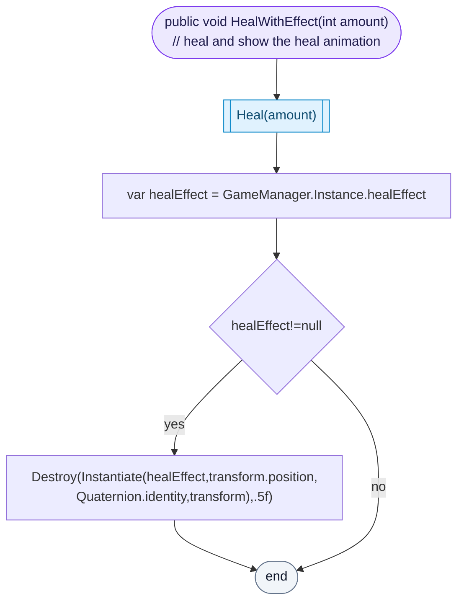

<!-- generated by CodeGraph~/codegraph.py from Character.cs. Do not edit: run python "CodeGraph~/codegraph.py". Notes go in CodeGraph~/ai/Character.cs.md -->
# Character.cs

[overview](README.md) · [source](../../Character.cs) · 69 lines · using `System.Collections`, `System.Collections.Generic`, `UnityEngine`

What the player and every enemy have in common: health, movement, facing, teams, knockback, stun and healing.

## class CombatStat

Attack and defense numbers, physical and magic.
Weapons multiply their damage by the attack stat; enemies subtract their defense stat from damage taken.

## enum Team

## class Character

Base of Player and Enemy: HP, movement, team, hits.
Abstract: each subclass says how much HP it has (`maxHP`) and its combat stats. `team` decides who can hurt whom: hitboxes and touch damage only hurt other teams. `recieveDamage` does nothing here; Player, Enemy and Chest override it.

### Character.bodyCollider.get

Finds the character's collider the first time it is asked for, then keeps it.

[lines 31–31](../../Character.cs#L31-L31) · called by [Character.center.get](Character.cs.md#class-character)

### Character._setAnimFacing

Turns a direction into the facing number used by the animations: right or left when it points more sideways than 45°, otherwise up or down, and down when there is no direction.

[lines 37–43](../../Character.cs#L37-L43) · called by [Character.setAnimFacing](Character.cs.md#class-character)

### Character.StuntMech

While stunned (after a knockback or a freeze) the character slides to a stop and ignores its own movement: callers skip moving when it returns true. The stun ends early once it is nearly still.

[lines 45–50](../../Character.cs#L45-L50) · called by [Enemy.Update](Enemy.cs.md#enemyupdate), [Player.Update](Player.cs.md#playerupdate)

### Character.Heal

Adds HP, never above `maxHP`.

[lines 58–58](../../Character.cs#L58-L58) · called by [BuffEffect.Apply](BuffEffect.cs.md#buffeffectapply), [Character.HealWithEffect](Character.cs.md#characterhealwitheffect)

### Character.HealWithEffect

Heals and plays GameManager's heal animation on the character for half a second. Used by the healing room and the Health Bone.

[lines 60–64](../../Character.cs#L60-L64) · called by [HealingRoom.Update](Map/HealingRoom.cs.md#healingroomupdate), [Player.InstantItemUse](Player.cs.md#playerinstantitemuse) · calls [Character.Heal](Character.cs.md#characterheal)
