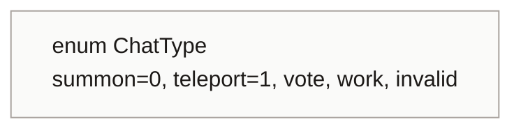
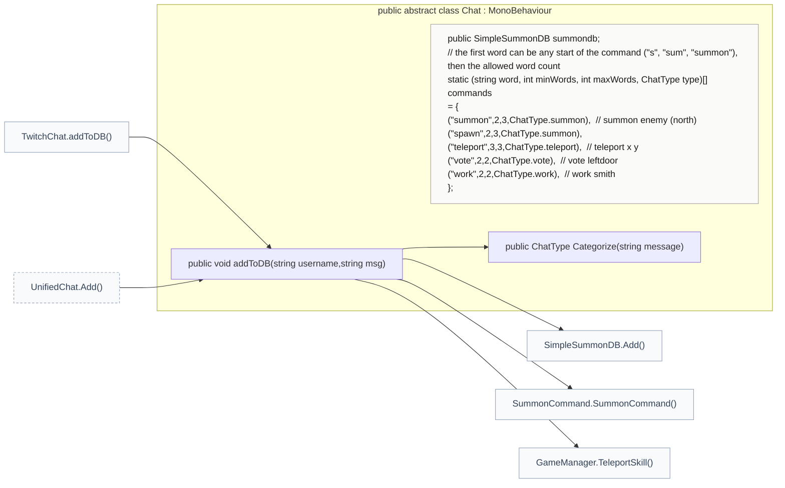
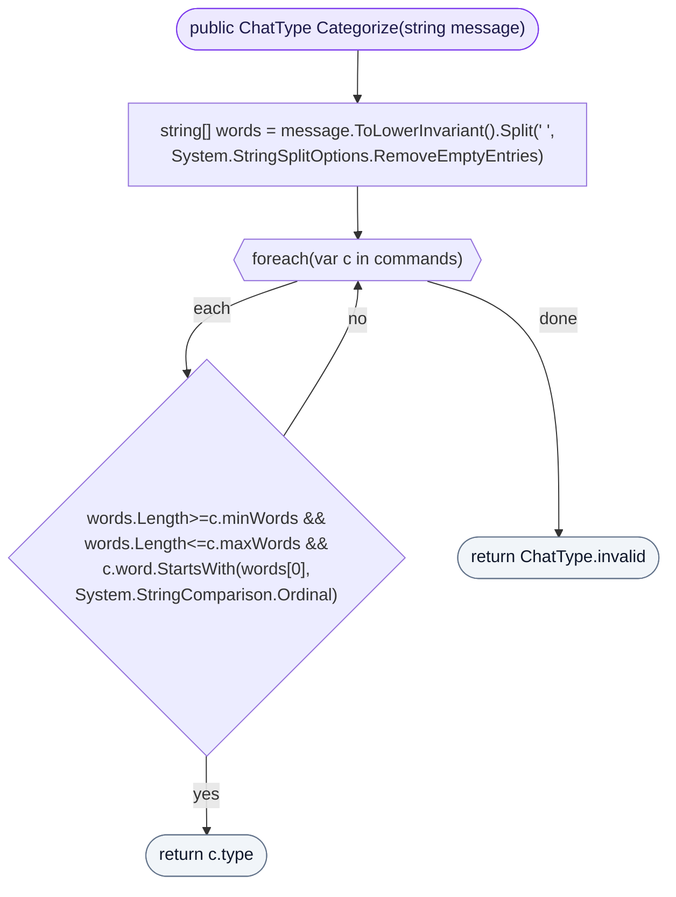
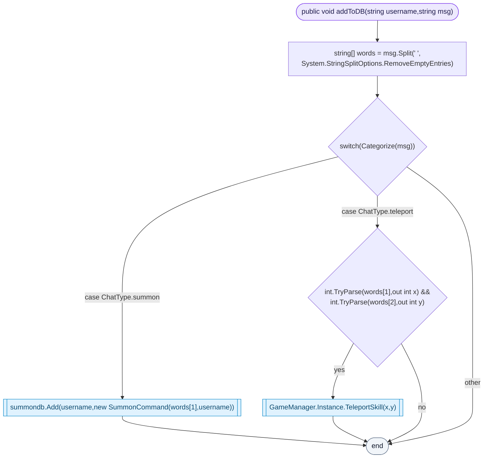

<!-- generated by CodeGraph~/codegraph.py from Connector/Chat.cs. Do not edit: run python "CodeGraph~/codegraph.py". Notes go in CodeGraph~/ai/Connector/Chat.cs.md -->
# Connector/Chat.cs

[overview](../README.md) · [source](../../../Connector/Chat.cs) · 32 lines · using `System.Collections`, `System.Collections.Generic`, `UnityEngine`

Turns chat messages into game commands (summon, teleport, vote, work).

## enum ChatType

## class Chat

Base of the chat readers: message → command.
A message's first word can be any start of a command word ("s", "sum", "summon"), followed by the allowed number of words. TwitchChat (Lexone) and AI/UnifiedChat both send their messages to `addToDB`.

### Chat.Categorize

Finds the first command whose word count fits and whose word starts with the first word typed. Because summon comes first in the table, "s" means summon. Anything else is `invalid`.

[lines 19–24](../../../Connector/Chat.cs#L19-L24) · called by [Chat.addToDB](Chat.cs.md#chataddtodb)

### Chat.addToDB

Summon queues the named enemy for its sender; teleport moves the player when both numbers parse. Vote and work are recognized but nothing handles them yet.

[lines 25–31](../../../Connector/Chat.cs#L25-L31) · called by [TwitchChat.addToDB](TwitchChat.cs.md#class-twitchchat), [UnifiedChat.Add](../../../AI/UnifiedChat.cs#L31) · calls [Chat.Categorize](Chat.cs.md#chatcategorize), [SimpleSummonDB.Add](SummonDB.cs.md#simplesummondbadd), [SummonCommand.SummonCommand](SummonDB.cs.md#class-summoncommand), [GameManager.TeleportSkill](../GameManager.cs.md#gamemanagerteleportskill)
