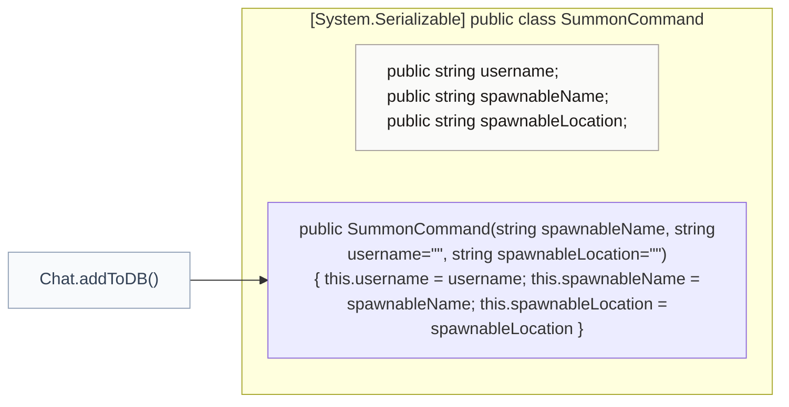
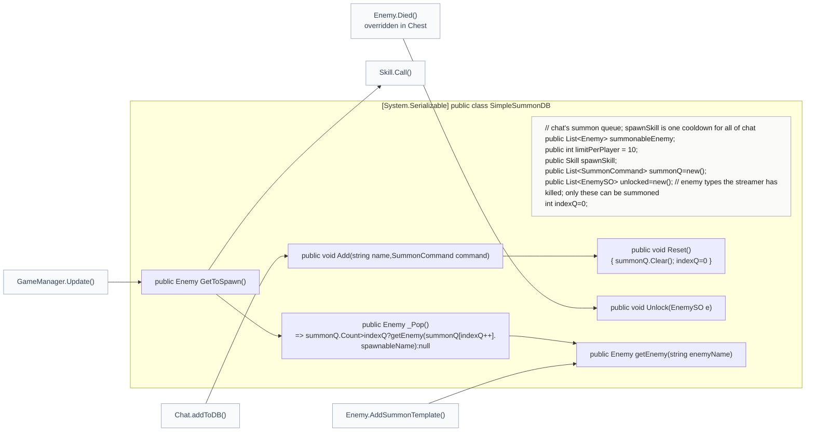
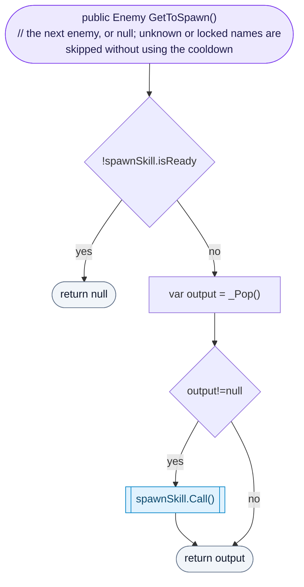
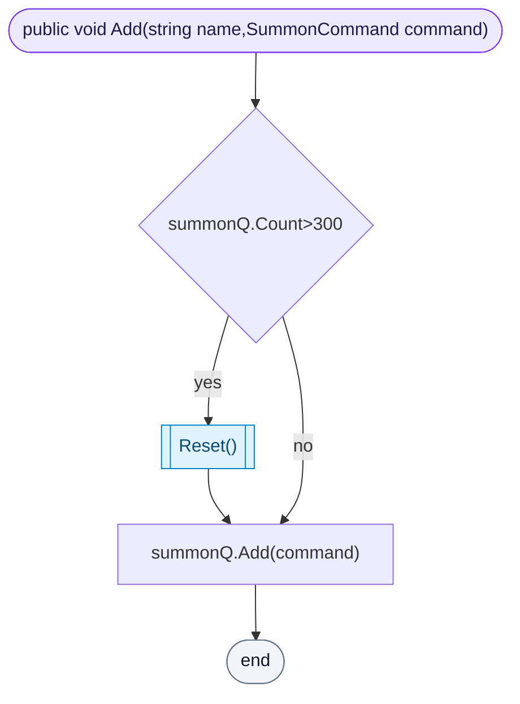
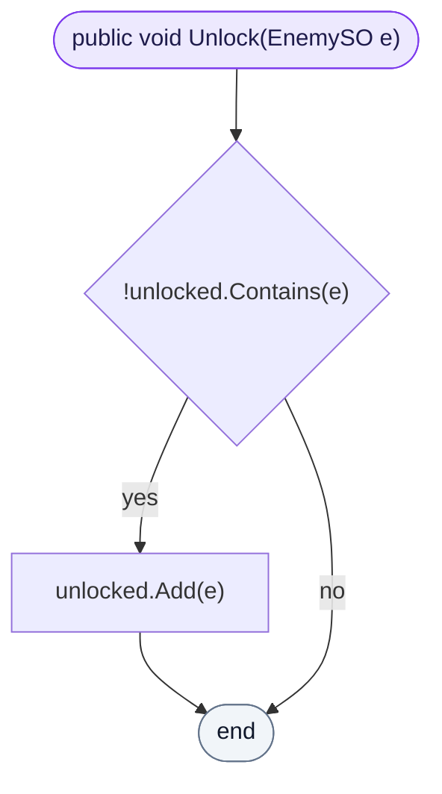
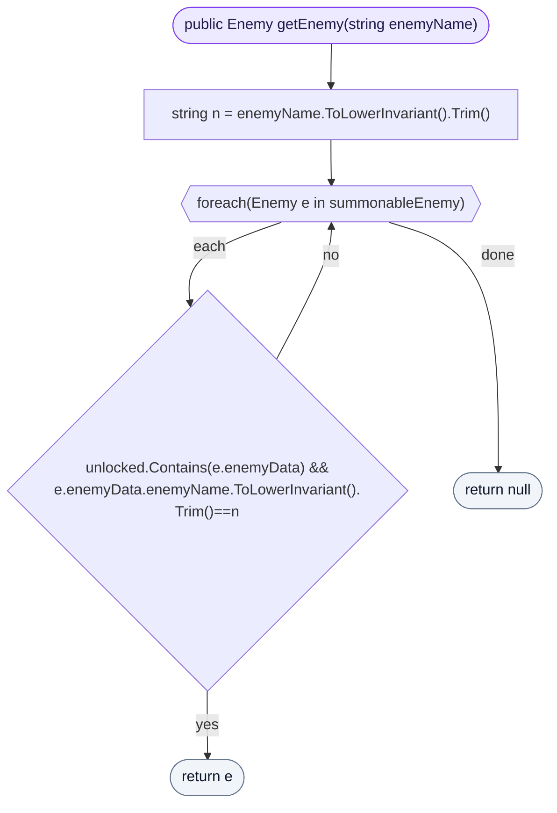

<!-- generated by CodeGraph~/codegraph.py from Connector/SummonDB.cs. Do not edit: run python "CodeGraph~/codegraph.py". Notes go in CodeGraph~/ai/Connector/SummonDB.cs.md -->
# Connector/SummonDB.cs

[overview](../README.md) · [source](../../../Connector/SummonDB.cs) · 40 lines · using `System.Collections.Generic`

The queue of enemies chat asked for, and which enemy types chat may summon.

## class SummonCommand

One chat request: who asked, and which enemy.

## class SimpleSummonDB

Chat's summon queue, unlocked types and shared cooldown.
Chat can only summon a type after the streamer has killed one (`unlocked`); `summonableEnemy` holds a hidden copy of that first kill to clone. One cooldown (`spawnSkill`) is shared by all of chat. `limitPerPlayer` is not used yet.

### SimpleSummonDB.GetToSpawn

Called every frame by GameManager. When the cooldown is ready, takes the next request; unknown or locked names give nothing and do not start the cooldown.

[lines 22–27](../../../Connector/SummonDB.cs#L22-L27) · called by [GameManager.Update](../GameManager.cs.md#gamemanagerupdate) · calls [SimpleSummonDB._Pop](SummonDB.cs.md#class-simplesummondb), [Skill.Call](../Skill.cs.md#skillcall)

### SimpleSummonDB.Add

Queues a request; the queue is cleared when it grows past 300.

[lines 29–32](../../../Connector/SummonDB.cs#L29-L32) · called by [Chat.addToDB](Chat.cs.md#chataddtodb) · calls [SimpleSummonDB.Reset](SummonDB.cs.md#class-simplesummondb)

### SimpleSummonDB.Unlock

Lets chat summon this enemy type from now on.

[lines 34–34](../../../Connector/SummonDB.cs#L34-L34) · called by [Enemy.Died](../Enemy.cs.md#enemydied)

### SimpleSummonDB.getEnemy

The summon template for a typed name (case and spaces ignored), only if that type is unlocked.

[lines 35–39](../../../Connector/SummonDB.cs#L35-L39) · called by [Enemy.AddSummonTemplate](../Enemy.cs.md#enemyaddsummontemplate), [SimpleSummonDB._Pop](SummonDB.cs.md#class-simplesummondb)
