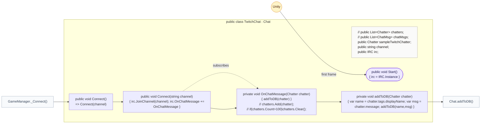

<!-- generated by CodeGraph~/codegraph.py from Connector/TwitchChat.cs. Do not edit: run python "CodeGraph~/codegraph.py". Notes go in CodeGraph~/ai/Connector/TwitchChat.cs.md -->
# Connector/TwitchChat.cs

[overview](../README.md) · [source](../../../Connector/TwitchChat.cs) · 208 lines · using `System.Collections`, `System.Collections.Generic`, `UnityEngine`, `Lexone.UnityTwitchChat`

Reads Twitch chat through the Lexone Unity-Twitch-Chat package. The commented-out code at the end is an older IRC client, kept for reference (not drawn).

## class TwitchChat

Chat reader using Lexone's IRC: joins, forwards messages.
`Connect` joins `channel` and subscribes to the package's chat event; each message goes to `Chat.addToDB` as (display name, message). This is the backup when Experimental.unifiedChat is off.

