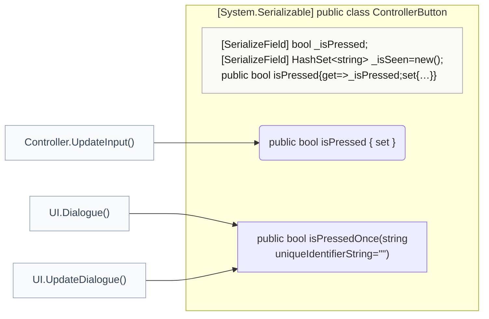
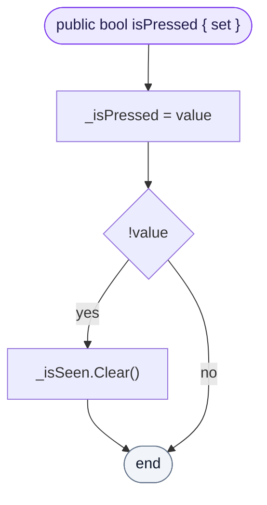
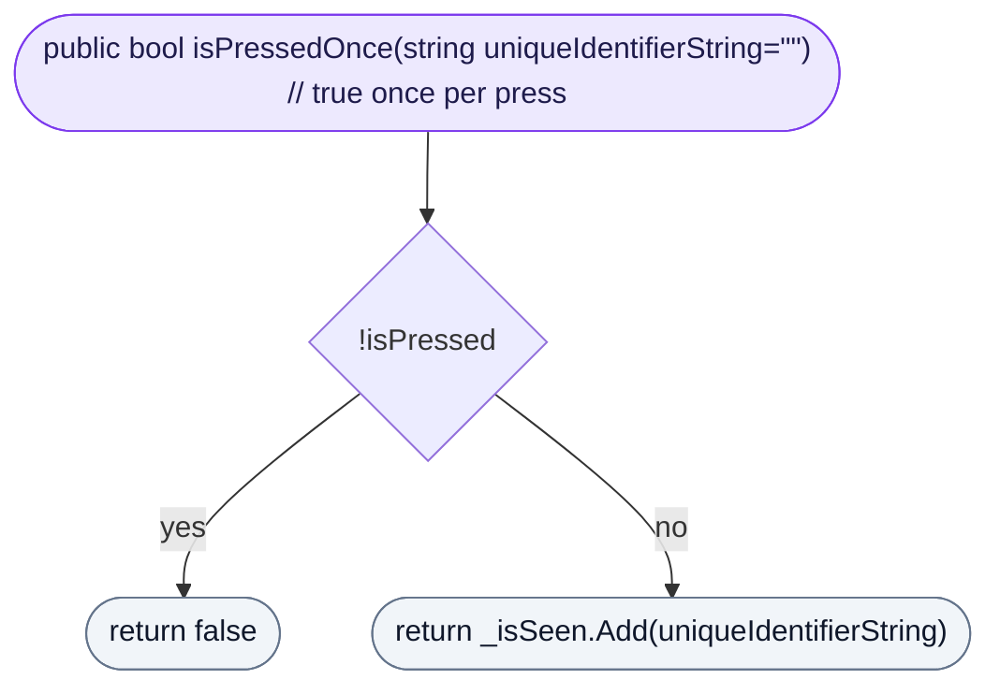
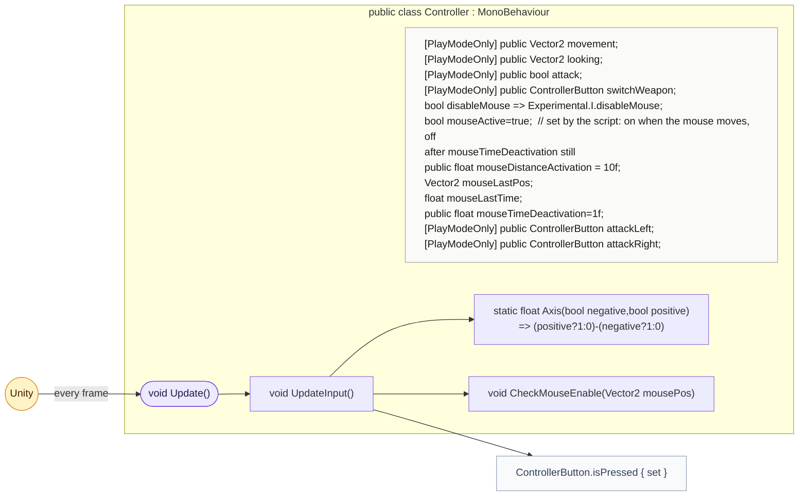
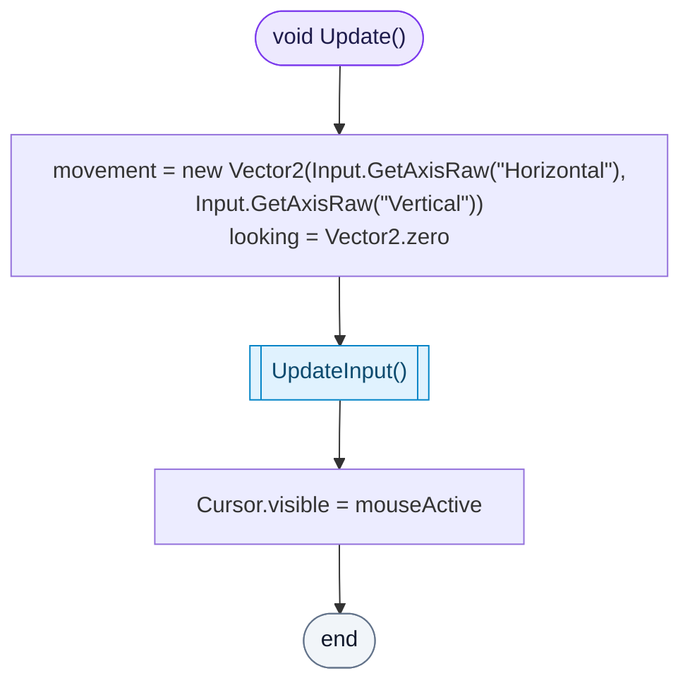
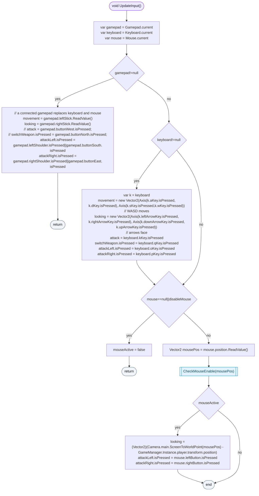
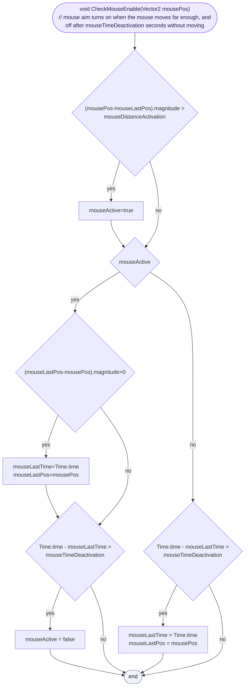

<!-- generated by CodeGraph~/codegraph.py from Controller.cs. Do not edit: run python "CodeGraph~/codegraph.py". Notes go in CodeGraph~/ai/Controller.cs.md -->
# Controller.cs

[overview](README.md) · [source](../../Controller.cs) · 78 lines · using `System.Collections`, `System.Collections.Generic`, `UnityEngine`, `UnityEngine.InputSystem`

Player input: gamepad, keyboard and mouse, read once per frame into fields that Player and UI use.

## class ControllerButton

A button that can be asked "pressed just now?" once per caller.

### ControllerButton.isPressed.set

Stores the button state; letting go clears the memory of who already saw this press.

[lines 10–10](../../Controller.cs#L10-L10) · called by [Controller.UpdateInput](Controller.cs.md#controllerupdateinput)

### ControllerButton.isPressedOnce

True only the first time each caller (by id string) asks during one press. The dialogue uses this so one click advances one line.

[lines 11–14](../../Controller.cs#L11-L14) · called by [UI.Dialogue](UI.cs.md#class-ui), [UI.UpdateDialogue](UI.cs.md#uiupdatedialogue)

## class Controller

Reads gamepad, keyboard and mouse into movement, look and attack.

### Controller.Update

Starts from the old Input axes, then lets `UpdateInput` overwrite with the Input System, and shows the cursor only while the mouse is in use.

[lines 32–37](../../Controller.cs#L32-L37) · called by Unity: every frame · calls [Controller.UpdateInput](Controller.cs.md#controllerupdateinput)

### Controller.UpdateInput

A connected gamepad replaces keyboard and mouse: left stick moves, right stick looks, shoulders or south/east buttons attack. Otherwise WASD moves, arrows look, O and P attack (K and Q are read but not used for attacks). Then the mouse, unless Experimental.disableMouse: once it wakes up it aims at the cursor and its buttons attack.

[lines 38–68](../../Controller.cs#L38-L68) · called by [Controller.Update](Controller.cs.md#controllerupdate) · calls [ControllerButton.isPressed.set](Controller.cs.md#controllerbuttonispressedset), [Controller.Axis](Controller.cs.md#class-controller), [Controller.CheckMouseEnable](Controller.cs.md#controllercheckmouseenable)

### Controller.CheckMouseEnable

The mouse wakes up when it moves farther than `mouseDistanceActivation` and goes back to sleep after `mouseTimeDeactivation` seconds without moving.

[lines 71–77](../../Controller.cs#L71-L77) · called by [Controller.UpdateInput](Controller.cs.md#controllerupdateinput)
