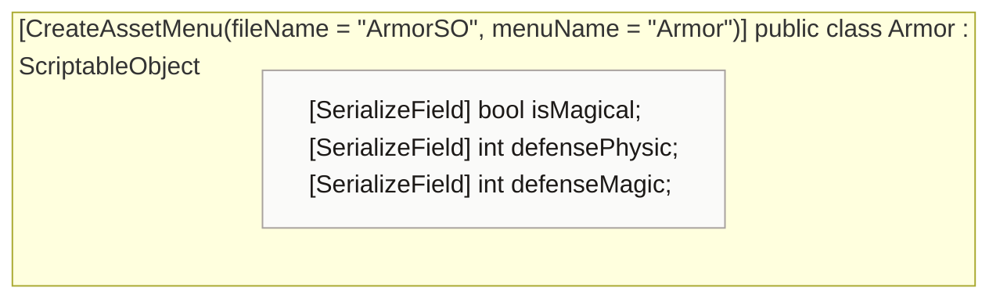

<!-- generated by CodeGraph~/codegraph.py from Data Types/Armor.cs. Do not edit: run python "CodeGraph~/codegraph.py". Notes go in CodeGraph~/ai/Data Types/Armor.cs.md -->
# Data Types/Armor.cs

[overview](../README.md) · [source](../../../Data%20Types/Armor.cs) · 11 lines · using `System.Collections`, `System.Collections.Generic`, `UnityEngine`

Armor data asset (Create → Armor).

## class Armor

Armor asset: defense values. Not used by code yet.
Player has an `activeArmor` field, but nothing reads it.

