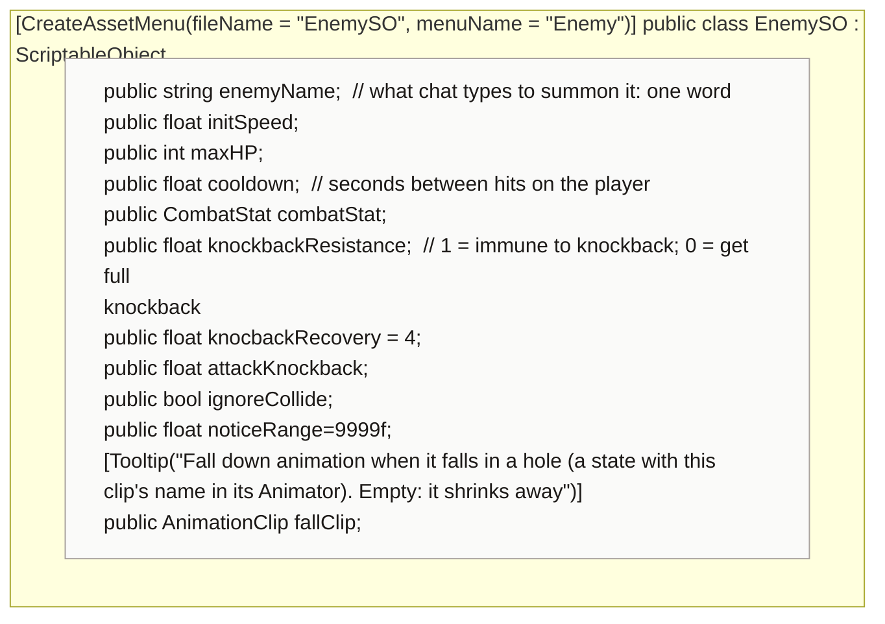

<!-- generated by CodeGraph~/codegraph.py from Data Types/Enemy.cs. Do not edit: run python "CodeGraph~/codegraph.py". Notes go in CodeGraph~/ai/Data Types/Enemy.cs.md -->
# Data Types/Enemy.cs

[overview](../README.md) · [source](../../../Data%20Types/Enemy.cs) · 20 lines · using `System.Collections`, `System.Collections.Generic`, `UnityEngine`

The enemy type asset (Create → Enemy): one per kind of enemy, in Database/Enemies.

## class EnemySO

One enemy type: name chat types, speed, HP, attack, defense.
`enemyName` is the word chat types to summon it. `ignoreCollide` makes it fly: it goes straight through walls and over holes (ghosts). `knockbackResistance` 1 means no knockback; `knocbackRecovery` is how fast it stops sliding after one.

