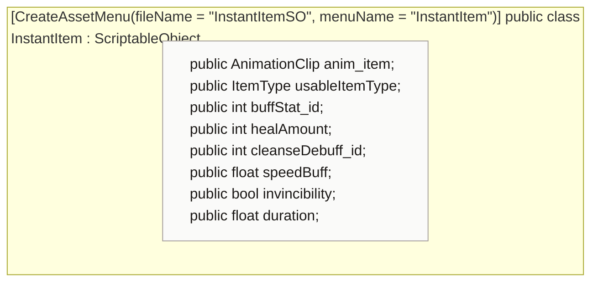

<!-- generated by CodeGraph~/codegraph.py from Data Types/InstantItem.cs. Do not edit: run python "CodeGraph~/codegraph.py". Notes go in CodeGraph~/ai/Data Types/InstantItem.cs.md -->
# Data Types/InstantItem.cs

[overview](../README.md) · [source](../../../Data%20Types/InstantItem.cs) · 18 lines · using `System.Collections`, `System.Collections.Generic`, `UnityEngine`

Items used the moment the player walks over them (Create → InstantItem), like the Health Bone.

## enum ItemType

## class InstantItem

An item used on touch: heal now; buff and cleanse planned.
Only `Heal` does something so far (`Player.InstantItemUse`). `anim_item` is the animation it plays while lying on the floor.

