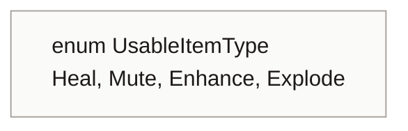
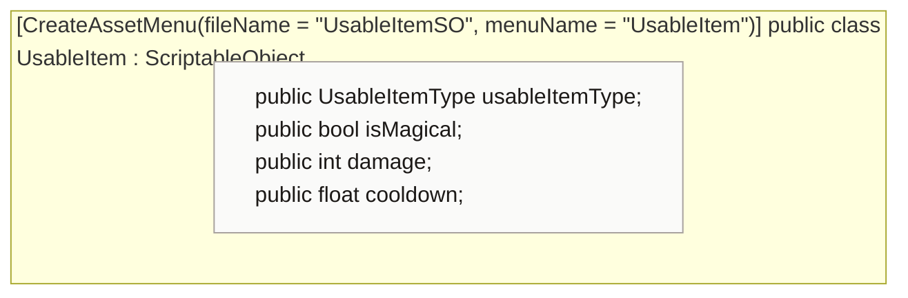

<!-- generated by CodeGraph~/codegraph.py from Data Types/UsableItem.cs. Do not edit: run python "CodeGraph~/codegraph.py". Notes go in CodeGraph~/ai/Data Types/UsableItem.cs.md -->
# Data Types/UsableItem.cs

[overview](../README.md) · [source](../../../Data%20Types/UsableItem.cs) · 14 lines · using `System.Collections`, `System.Collections.Generic`, `UnityEngine`

Items to carry and use later (Create → UsableItem). Not used by code yet.

## enum UsableItemType

## class UsableItem

Planned usable item: heal, mute, enhance or explode.

