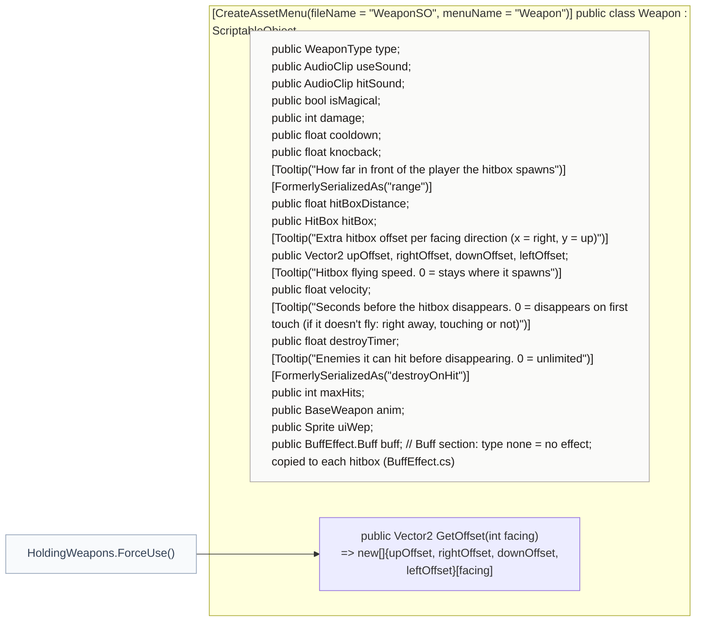

<!-- generated by CodeGraph~/codegraph.py from Data Types/Weapon.cs. Do not edit: run python "CodeGraph~/codegraph.py". Notes go in CodeGraph~/ai/Data Types/Weapon.cs.md -->
# Data Types/Weapon.cs

[overview](../README.md) · [source](../../../Data%20Types/Weapon.cs) · 34 lines · using `System.Collections`, `System.Collections.Generic`, `UnityEngine`, `UnityEngine.Serialization`

The weapon asset (Create → Weapon): everything an attack needs, in Database/Weapons.

## class Weapon

One weapon: damage, cooldown, hitbox, effect, sounds, buff.
`hitBox` is the prefab spawned in front of the user, `hitBoxDistance` away plus a per-direction offset. `velocity` 0 keeps it where it spawned (sword); more makes it fly (arrow, rod shot). `destroyTimer` and `maxHits` decide when it disappears. `anim` is the effect animation played on the user.

