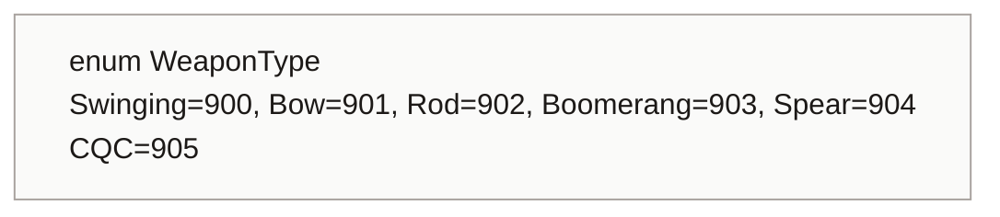

<!-- generated by CodeGraph~/codegraph.py from Data Types/WeaponType.cs. Do not edit: run python "CodeGraph~/codegraph.py". Notes go in CodeGraph~/ai/Data Types/WeaponType.cs.md -->
# Data Types/WeaponType.cs

[overview](../README.md) · [source](../../../Data%20Types/WeaponType.cs) · 9 lines

Kinds of weapon. The numbers (900 and up) double as `Player.state` while attacking, which picks the attack animation; CQC means bare hands.

## enum WeaponType

