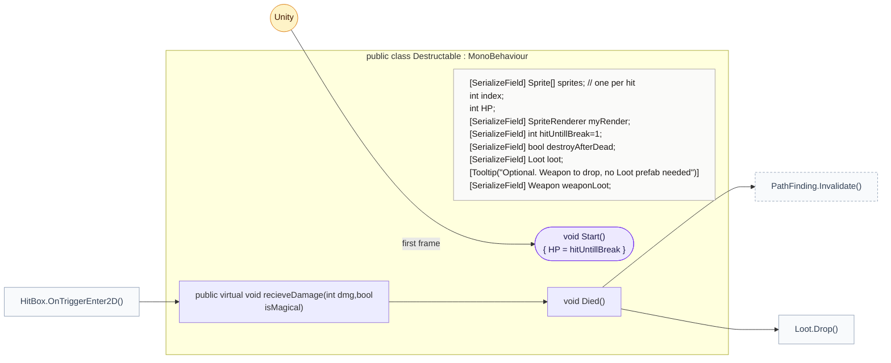
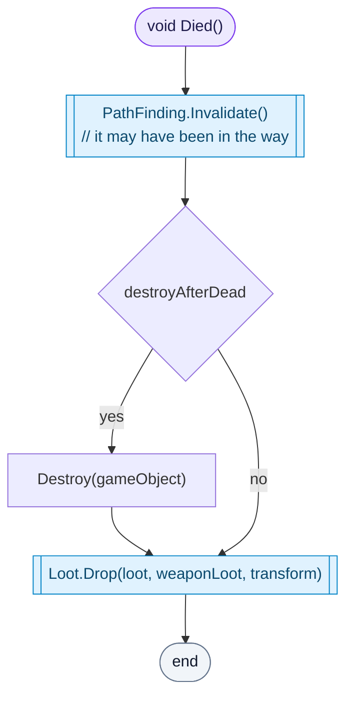
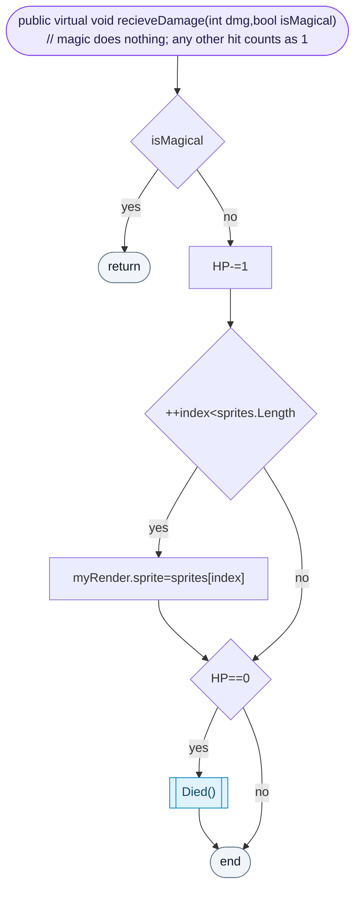

<!-- generated by CodeGraph~/codegraph.py from DestructableObj.cs. Do not edit: run python "CodeGraph~/codegraph.py". Notes go in CodeGraph~/ai/DestructableObj.cs.md -->
# DestructableObj.cs

[overview](README.md) · [source](../../DestructableObj.cs) · 29 lines · using `System.Collections`, `System.Collections.Generic`, `UnityEngine`

Breakable objects such as crates and pots. The file is DestructableObj.cs but the class is `Destructable`; Unity normally wants a MonoBehaviour's file and class names to match.

## class Destructable

Breakable object: changes sprite per hit, can drop loot.

### Destructable.Died

Tells pathfinding the way may be open now, removes the object if `destroyAfterDead`, and drops its loot.

[lines 18–22](../../DestructableObj.cs#L18-L22) · called by [Destructable.recieveDamage](DestructableObj.cs.md#destructablerecievedamage) · calls [PathFinding.Invalidate](../../AI/PathFinding.cs#L35), [Loot.Drop](Loot.cs.md#lootdrop)

### Destructable.recieveDamage

Magic does nothing; any other hit counts as one, whatever its damage. Each hit shows the next sprite, and it breaks after `hitUntillBreak` hits.

[lines 23–28](../../DestructableObj.cs#L23-L28) · called by [HitBox.OnTriggerEnter2D](HitBox.cs.md#hitboxontriggerenter2d) · calls [Destructable.Died](DestructableObj.cs.md#destructabledied)
